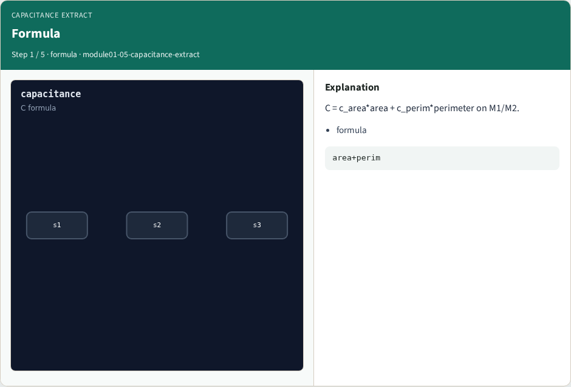
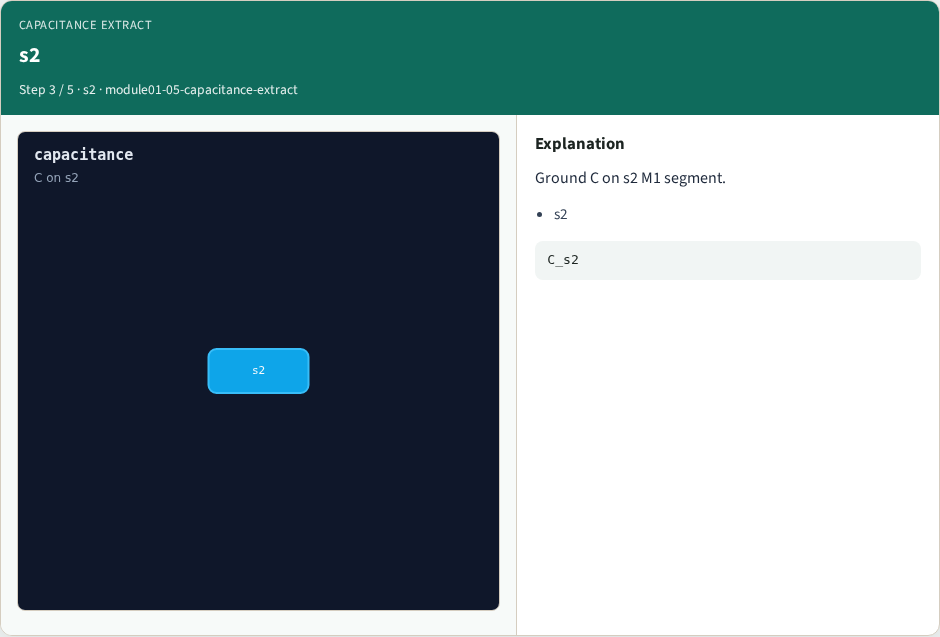
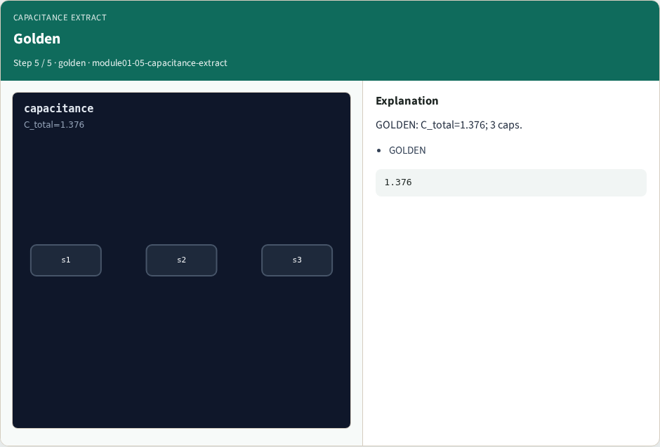
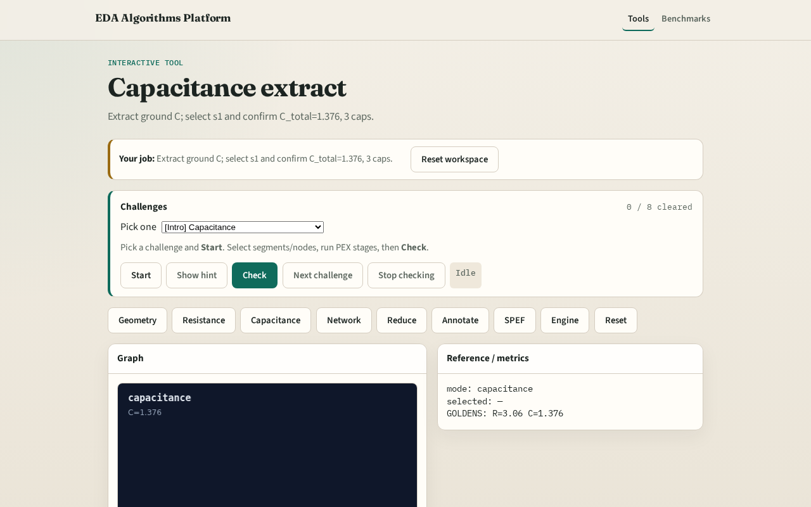

# Capacitance extract

**Module id:** module01-05-capacitance-extract
**Lab:** capacitance-extract
**Tracks:** A (implement) · B (browser lab)

## Slide 1 — Capacitance

Capacitance extract uses c_area*area + c_perim*perimeter on metals; skip VIA.

## Slide 2 — The idea

GOLDEN: C_total=1.376; 3 caps.

<!-- algorithm-walkthrough -->

## Slide 3 — Formula

C = c_area*area + c_perim*perimeter on M1/M2.

## Slide 4 — s1

Ground C on s1 M1 segment.

## Slide 5 — s2

Ground C on s2 M1 segment.

## Slide 6 — s3

Ground C on s3 M2 segment.

## Slide 7 — Golden

GOLDEN: C_total=1.376; 3 caps.

<!-- /algorithm-walkthrough -->

## Slide 8 — Browser lab track

Open **capacitance-extract**. Select s1; confirm C_total=1.376 and 3 caps.

## Slide 9 — Implement track

Call extract_capacitance(); assert c_total==1.376 and count==3.

## Slide 10 — Pitfalls

Adding VIA capacitance. Using length instead of area for C.

## Slide 11 — Your turn

Next: RC network build.
