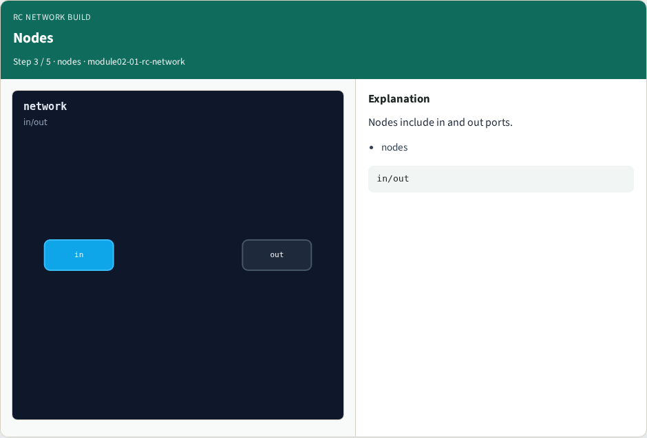
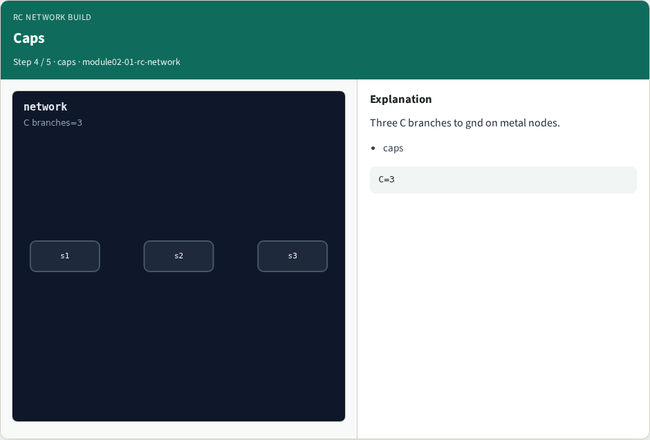

# RC network build — step-by-step (for slides / transcript)

**Module:** `module02-01-rc-network`  
**Lab / algo:** `rc-network`  
**Viewer:** `/tools/algorithm-walkthrough/?algo=rc-network&step=1`

Use each **Caption** as spoken prose (or a shortened slide note).
Use **Bullets** on the PPT; pair with the PNG in `assets/steps/`.

## Step 1 — Order


**Caption (transcript):** Series path: s1 → s2 → v1 → s3.

**Slide bullets:**

- order

**On-screen metrics:**

```
s1→s3
```

## Step 2 — Resistors


**Caption (transcript):** Four R edges in series from in to out.

**Slide bullets:**

- resistors

**On-screen metrics:**

```
R=4
```

## Step 3 — Nodes



**Caption (transcript):** Nodes include in and out ports.

**Slide bullets:**

- nodes

**On-screen metrics:**

```
in/out
```

## Step 4 — Caps



**Caption (transcript):** Three C branches to gnd on metal nodes.

**Slide bullets:**

- caps

**On-screen metrics:**

```
C=3
```

## Step 5 — Golden


**Caption (transcript):** GOLDEN: series chain; nodes include in/out.

**Slide bullets:**

- GOLDEN

**On-screen metrics:**

```
in/out
```

