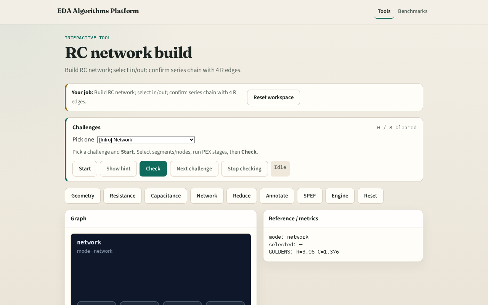

# RC network

RC network chains segment resistors in series; attach ground C at metal nodes

---

## The idea
- GOLDEN: series chain; nodes include in/out

---

## Order

---

## Resistors

---

## Nodes

---

## Caps

---

## Golden

---

## Browser lab track

---

## Implement track
- Call build_rc_network(); assert nodes include 'in' and 'out' and r_count==4

---

## Pitfalls
- Parallel instead of series R
- Attaching C on VIA node

---

## Your turn
- Next: network reduction

