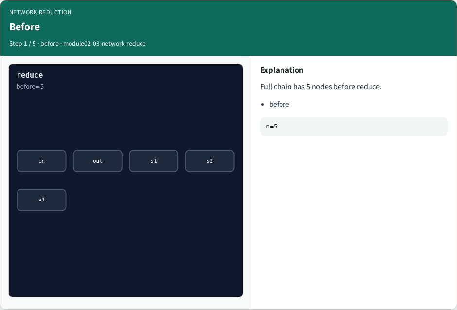
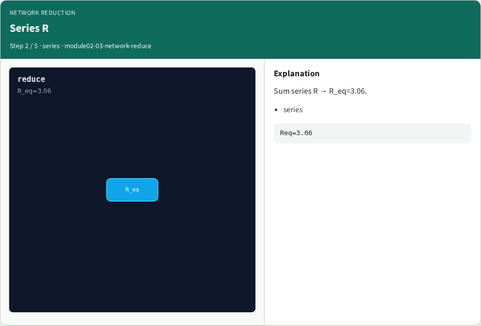
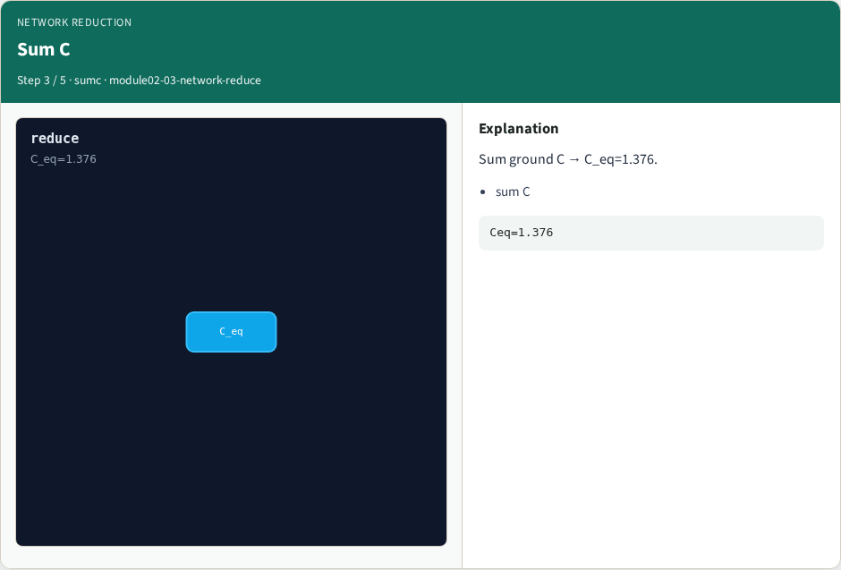
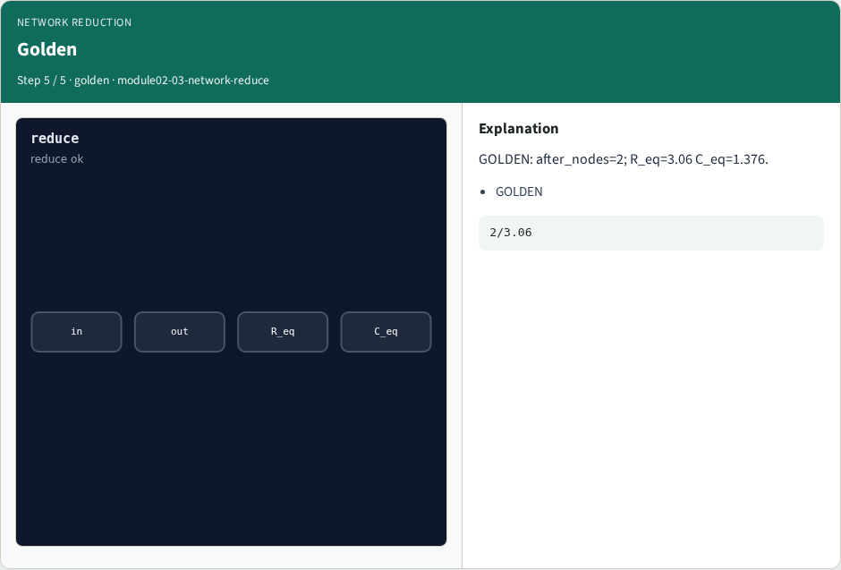
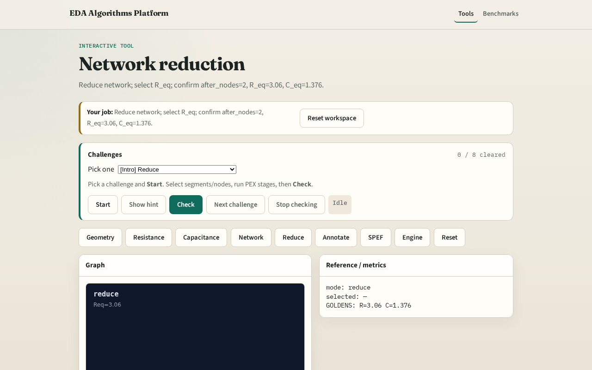

# Network reduction

**Module id:** module02-03-network-reduce
**Lab:** network-reduce
**Tracks:** A (implement) · B (browser lab)

## Slide 1 — Reduce

Network reduction collapses the chain to in–out R_eq and lumped C_eq.

## Slide 2 — The idea

GOLDEN: after_nodes=2; R_eq=3.06 C_eq=1.376.

<!-- algorithm-walkthrough -->

## Slide 3 — Before

Full chain has 5 nodes before reduce.

## Slide 4 — Series R

Sum series R → R_eq=3.06.

## Slide 5 — Sum C

Sum ground C → C_eq=1.376.

## Slide 6 — After

Reduced to 2 signal ports (in/out).

## Slide 7 — Golden

GOLDEN: after_nodes=2; R_eq=3.06 C_eq=1.376.

<!-- /algorithm-walkthrough -->

## Slide 8 — Browser lab track

Open **network-reduce**. Select R_eq; confirm after_nodes=2.

## Slide 9 — Implement track

Call reduce_network(); assert after_nodes==2 and r_eq==3.06 and c_eq==1.376.

## Slide 10 — Pitfalls

Reducing C before R. Keeping internal nodes after reduce.

## Slide 11 — Your turn

Next: back-annotate nets.
