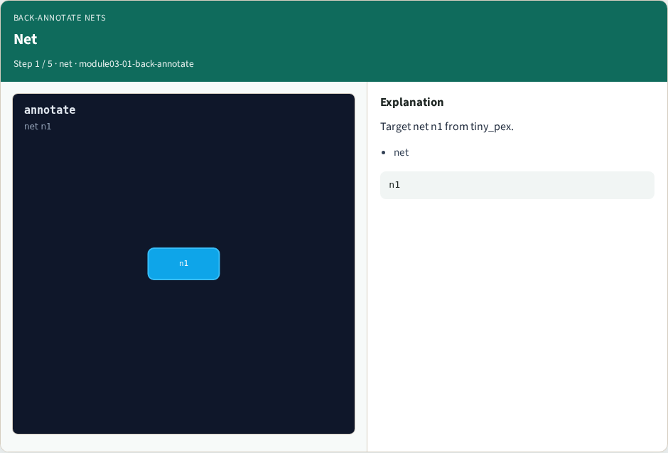
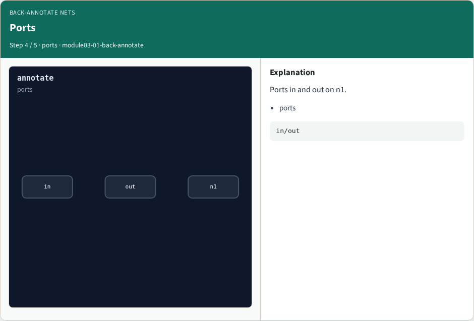
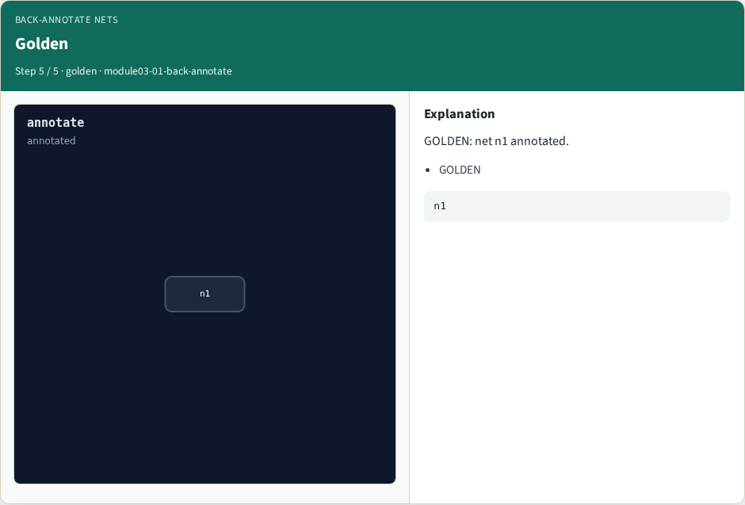

# Back-annotate nets — step-by-step (for slides / transcript)

**Module:** `module03-01-back-annotate`  
**Lab / algo:** `back-annotate`  
**Viewer:** `/tools/algorithm-walkthrough/?algo=back-annotate&step=1`

Use each **Caption** as spoken prose (or a shortened slide note).
Use **Bullets** on the PPT; pair with the PNG in `assets/steps/`.

## Step 1 — Net



**Caption (transcript):** Target net n1 from tiny_pex.

**Slide bullets:**

- net

**On-screen metrics:**

```
n1
```

## Step 2 — R total


**Caption (transcript):** r_total=3.06 from reduced network.

**Slide bullets:**

- R

**On-screen metrics:**

```
R=3.06
```

## Step 3 — C total


**Caption (transcript):** c_total=1.376 from reduced network.

**Slide bullets:**

- C

**On-screen metrics:**

```
C=1.376
```

## Step 4 — Ports



**Caption (transcript):** Ports in and out on n1.

**Slide bullets:**

- ports

**On-screen metrics:**

```
in/out
```

## Step 5 — Golden



**Caption (transcript):** GOLDEN: net n1 annotated.

**Slide bullets:**

- GOLDEN

**On-screen metrics:**

```
n1
```

