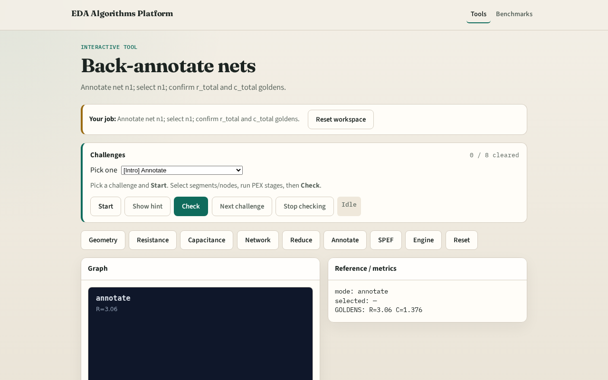

# Back-annotate nets

**Module id:** module03-01-back-annotate
**Lab:** back-annotate
**Tracks:** A (implement) · B (browser lab)

## Slide 1 — Annotate

Back-annotate writes r_total and c_total onto net n1 with port list.

## Slide 2 — The idea

GOLDEN: net n1 annotated.

<!-- algorithm-walkthrough -->

## Slide 3 — Net

Target net n1 from tiny_pex.

## Slide 4 — R total

r_total=3.06 from reduced network.

## Slide 5 — C total

c_total=1.376 from reduced network.

## Slide 6 — Ports

Ports in and out on n1.

## Slide 7 — Golden

GOLDEN: net n1 annotated.

<!-- /algorithm-walkthrough -->

## Slide 8 — Browser lab track

Open **back-annotate**. Select n1; confirm annotation count=1.

## Slide 9 — Implement track

Call back_annotate(); assert net=='n1' and count==1.

## Slide 10 — Pitfalls

Annotating wrong net. Missing port list on annotation.

## Slide 11 — Your turn

Next: SPEF-lite emit.
