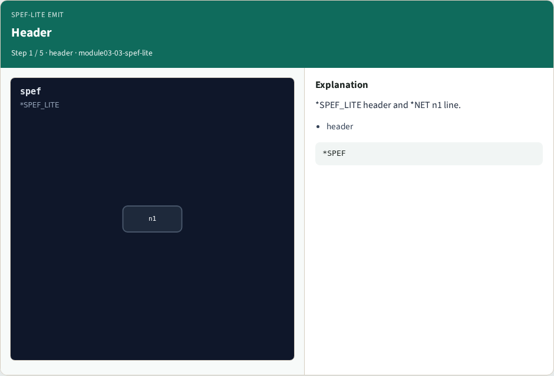
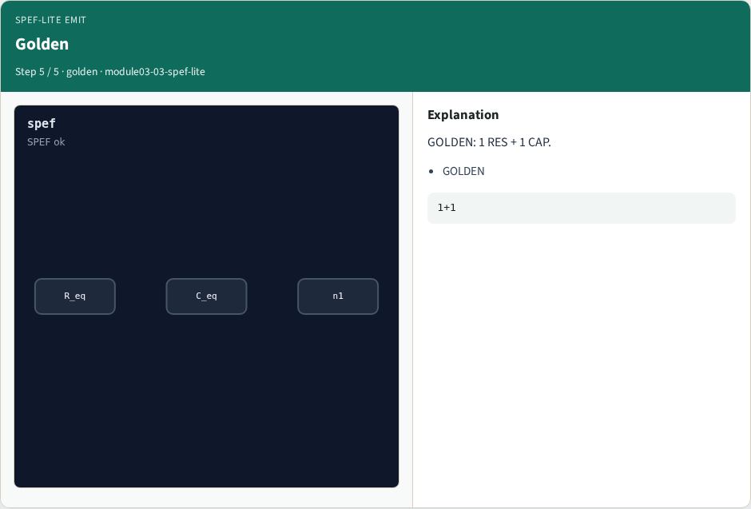

# SPEF-lite emit — step-by-step (for slides / transcript)

**Module:** `module03-03-spef-lite`  
**Lab / algo:** `spef-lite`  
**Viewer:** `/tools/algorithm-walkthrough/?algo=spef-lite&step=1`

Use each **Caption** as spoken prose (or a shortened slide note).
Use **Bullets** on the PPT; pair with the PNG in `assets/steps/`.

## Step 1 — Header



**Caption (transcript):** *SPEF_LITE header and *NET n1 line.

**Slide bullets:**

- header

**On-screen metrics:**

```
*SPEF
```

## Step 2 — RES


**Caption (transcript):** One *RES in out 3.06 line.

**Slide bullets:**

- RES

**On-screen metrics:**

```
1
```

## Step 3 — CAP


**Caption (transcript):** One *CAP out 1.376 line.

**Slide bullets:**

- CAP

**On-screen metrics:**

```
1
```

## Step 4 — Counts


**Caption (transcript):** res_count=1, cap_count=1.

**Slide bullets:**

- counts

**On-screen metrics:**

```
1/1
```

## Step 5 — Golden



**Caption (transcript):** GOLDEN: 1 RES + 1 CAP.

**Slide bullets:**

- GOLDEN

**On-screen metrics:**

```
1+1
```

