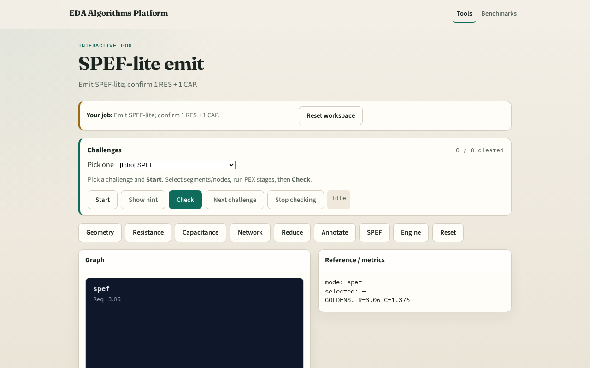

# SPEF-lite emit

**Module id:** module03-03-spef-lite
**Lab:** spef-lite
**Tracks:** A (implement) · B (browser lab)

## Slide 1 — SPEF-lite

SPEF-lite records one *RES and one *CAP from the reduced network.

## Slide 2 — The idea

GOLDEN: 1 RES + 1 CAP.

<!-- algorithm-walkthrough -->

## Slide 3 — Header

*SPEF_LITE header and *NET n1 line.

## Slide 4 — RES

One *RES in out 3.06 line.

## Slide 5 — CAP

One *CAP out 1.376 line.

## Slide 6 — Counts

res_count=1, cap_count=1.

## Slide 7 — Golden

GOLDEN: 1 RES + 1 CAP.

<!-- /algorithm-walkthrough -->

## Slide 8 — Browser lab track

Open **spef-lite**. Run SPEF; confirm 1 RES + 1 CAP.

## Slide 9 — Implement track

Call emit_spef_lite(); assert res_count==1 and cap_count==1.

## Slide 10 — Pitfalls

Emitting per-segment instead of reduced. Missing *NET line.

## Slide 11 — Your turn

Next: PEX engine integration.
