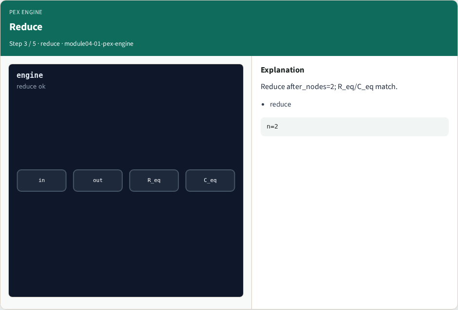
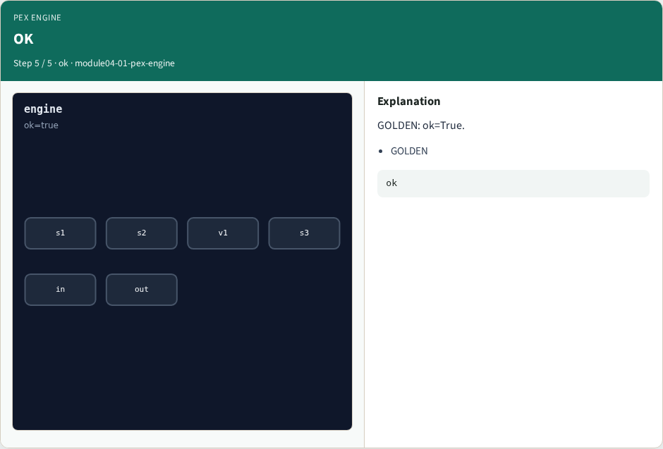

# PEX engine pass — step-by-step (for slides / transcript)

**Module:** `module04-01-pex-engine`  
**Lab / algo:** `pex-engine`  
**Viewer:** `/tools/algorithm-walkthrough/?algo=pex-engine&step=1`

Use each **Caption** as spoken prose (or a shortened slide note).
Use **Bullets** on the PPT; pair with the PNG in `assets/steps/`.

## Step 1 — Geo


**Caption (transcript):** Geometry segment_count=4, layer_count=3.

**Slide bullets:**

- geo

**On-screen metrics:**

```
s=4
```

## Step 2 — R/C


**Caption (transcript):** Resistance r_total=3.06; capacitance c_total=1.376.

**Slide bullets:**

- R/C

**On-screen metrics:**

```
3.06/1.376
```

## Step 3 — Reduce



**Caption (transcript):** Reduce after_nodes=2; R_eq/C_eq match.

**Slide bullets:**

- reduce

**On-screen metrics:**

```
n=2
```

## Step 4 — SPEF


**Caption (transcript):** SPEF res_count=1, cap_count=1.

**Slide bullets:**

- spef

**On-screen metrics:**

```
1/1
```

## Step 5 — OK



**Caption (transcript):** GOLDEN: ok=True.

**Slide bullets:**

- GOLDEN

**On-screen metrics:**

```
ok
```

