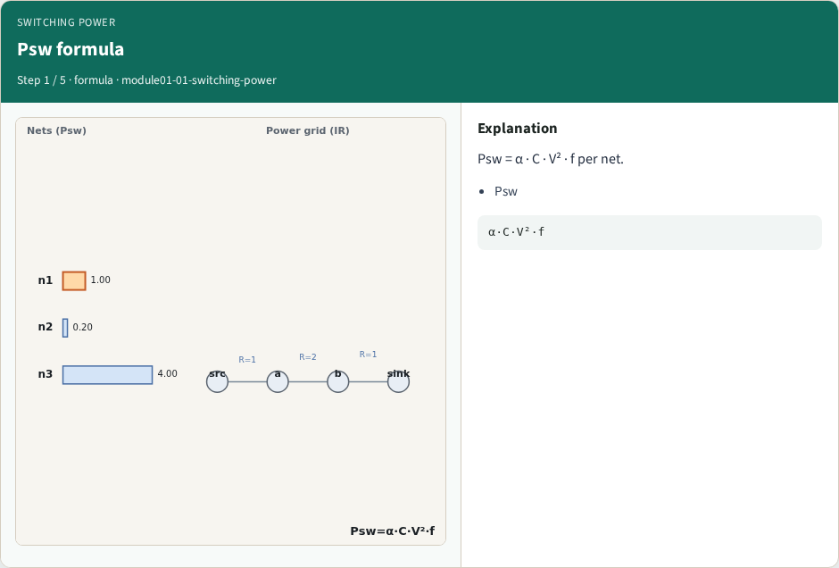
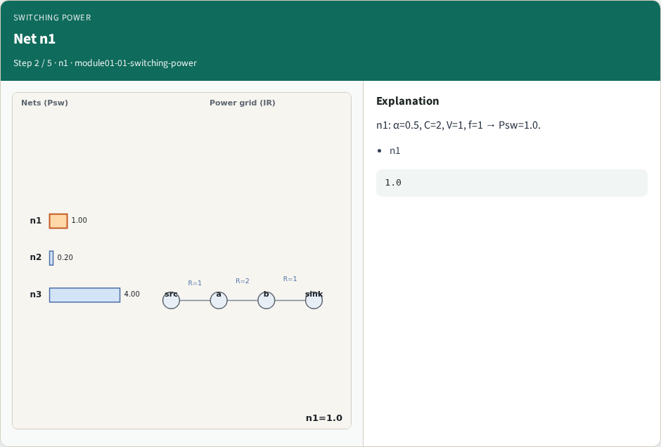
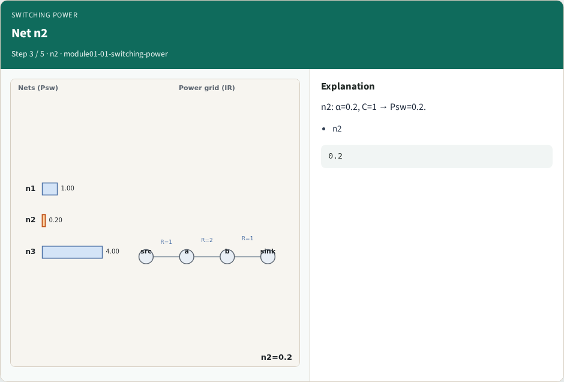
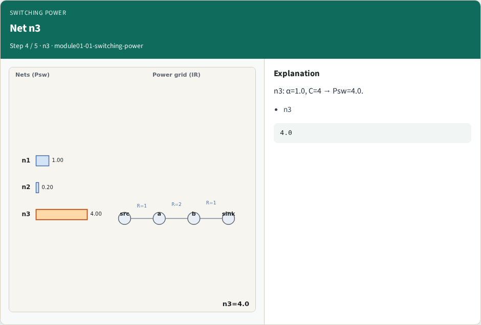
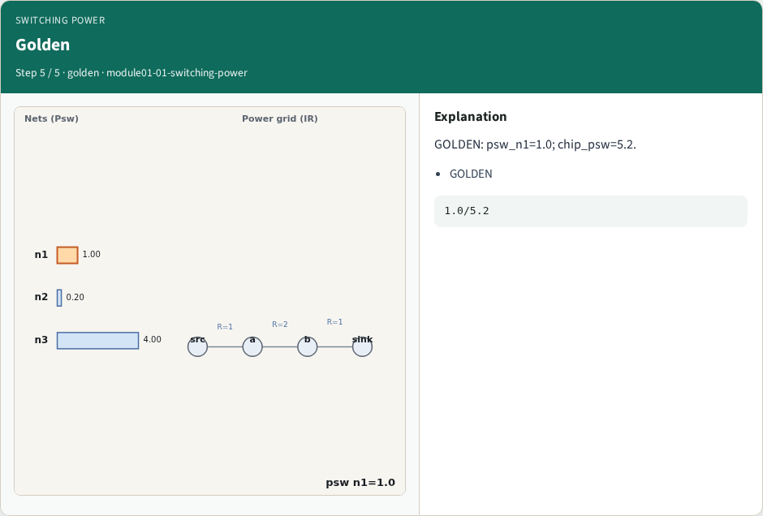

# Switching power — step-by-step (for slides / transcript)

**Module:** `module01-01-switching-power`  
**Lab / algo:** `switching-power`  
**Viewer:** `/tools/algorithm-walkthrough/?algo=switching-power&step=1`

Use each **Caption** as spoken prose (or a shortened slide note).
Use **Bullets** on the PPT; pair with the PNG in `assets/steps/`.

## Step 1 — Psw formula



**Caption (transcript):** Psw = α · C · V² · f per net.

**Slide bullets:**

- Psw

**On-screen metrics:**

```
α·C·V²·f
```

## Step 2 — Net n1



**Caption (transcript):** n1: α=0.5, C=2, V=1, f=1 → Psw=1.0.

**Slide bullets:**

- n1

**On-screen metrics:**

```
1.0
```

## Step 3 — Net n2



**Caption (transcript):** n2: α=0.2, C=1 → Psw=0.2.

**Slide bullets:**

- n2

**On-screen metrics:**

```
0.2
```

## Step 4 — Net n3



**Caption (transcript):** n3: α=1.0, C=4 → Psw=4.0.

**Slide bullets:**

- n3

**On-screen metrics:**

```
4.0
```

## Step 5 — Golden



**Caption (transcript):** GOLDEN: psw_n1=1.0; chip_psw=5.2.

**Slide bullets:**

- GOLDEN

**On-screen metrics:**

```
1.0/5.2
```

