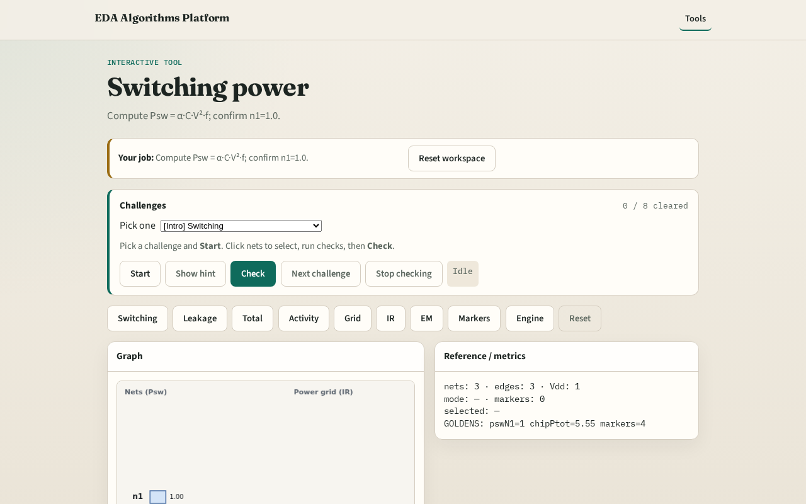

# Why switching

Dynamic power scales with activity, cap, voltage squared, and frequency

---

## The idea
- GOLDEN: psw_n1=1.0

---

## Psw formula

---

## Net n1

---

## Net n2

---

## Net n3

---

## Golden

---

## Browser lab track

---

## Implement track
- Call switching_power(); assert by_net['n1']==1.0

---

## Pitfalls
- Forgetting V²
- Using leakage instead of switching

---

## Your turn
- Next: leakage power

