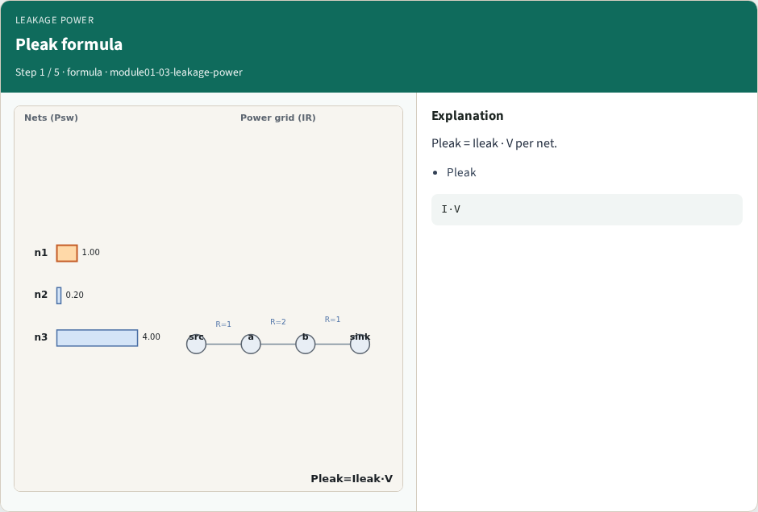
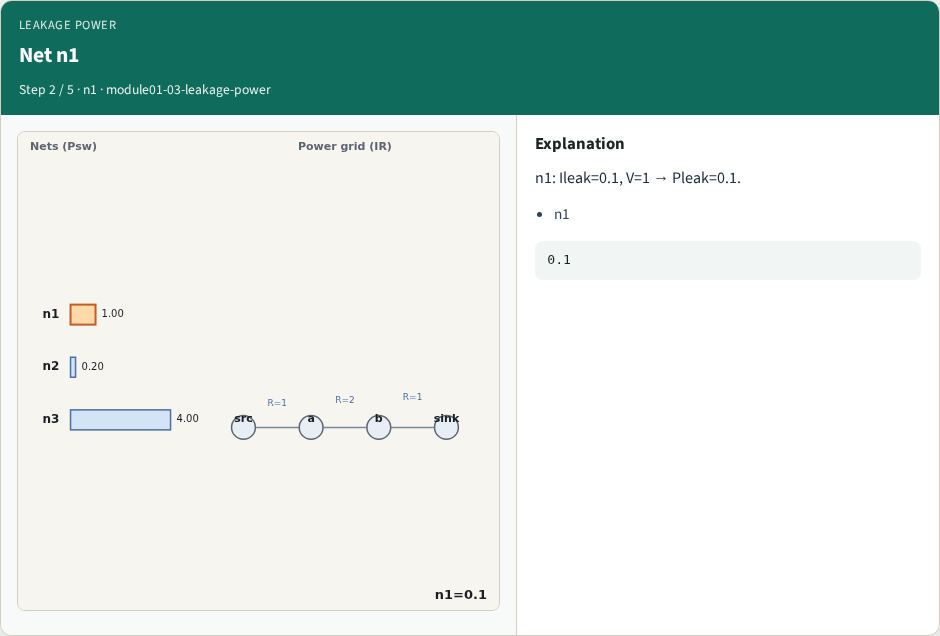
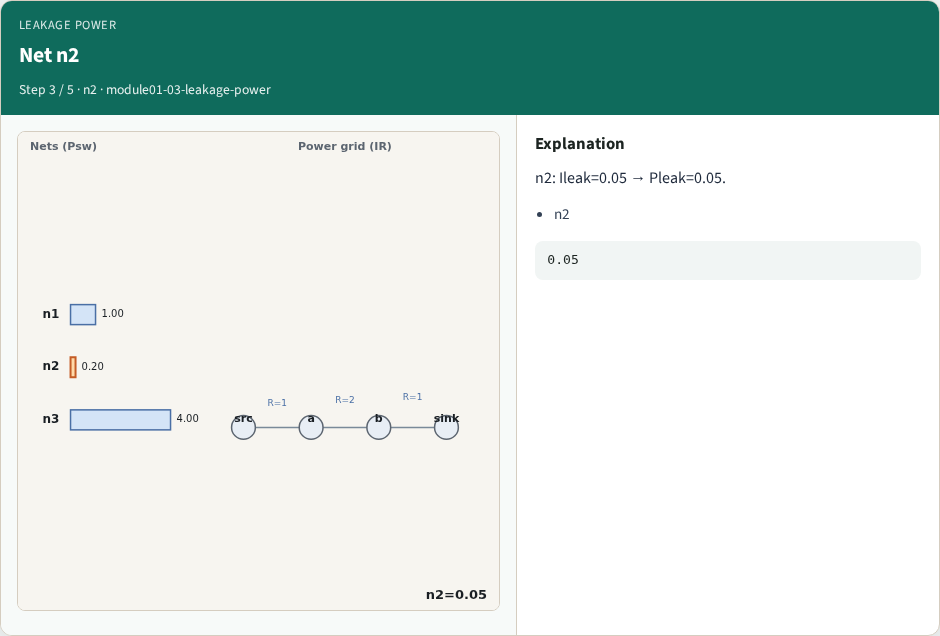
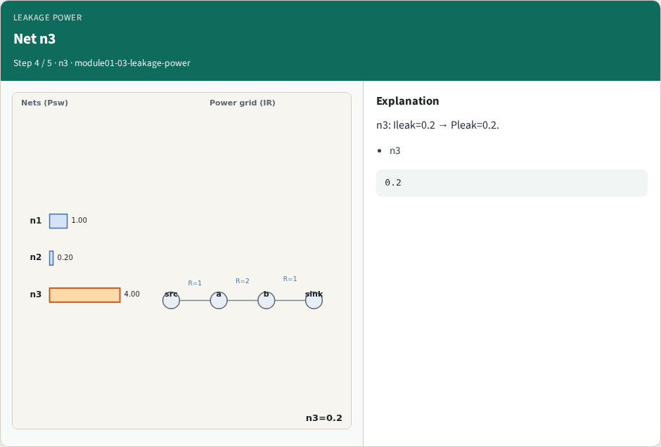
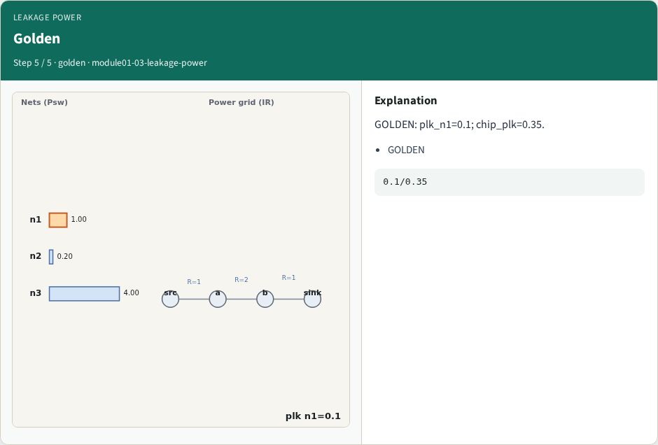

# Leakage power — step-by-step (for slides / transcript)

**Module:** `module01-03-leakage-power`  
**Lab / algo:** `leakage-power`  
**Viewer:** `/tools/algorithm-walkthrough/?algo=leakage-power&step=1`

Use each **Caption** as spoken prose (or a shortened slide note).
Use **Bullets** on the PPT; pair with the PNG in `assets/steps/`.

## Step 1 — Pleak formula



**Caption (transcript):** Pleak = Ileak · V per net.

**Slide bullets:**

- Pleak

**On-screen metrics:**

```
I·V
```

## Step 2 — Net n1



**Caption (transcript):** n1: Ileak=0.1, V=1 → Pleak=0.1.

**Slide bullets:**

- n1

**On-screen metrics:**

```
0.1
```

## Step 3 — Net n2



**Caption (transcript):** n2: Ileak=0.05 → Pleak=0.05.

**Slide bullets:**

- n2

**On-screen metrics:**

```
0.05
```

## Step 4 — Net n3



**Caption (transcript):** n3: Ileak=0.2 → Pleak=0.2.

**Slide bullets:**

- n3

**On-screen metrics:**

```
0.2
```

## Step 5 — Golden



**Caption (transcript):** GOLDEN: plk_n1=0.1; chip_plk=0.35.

**Slide bullets:**

- GOLDEN

**On-screen metrics:**

```
0.1/0.35
```

