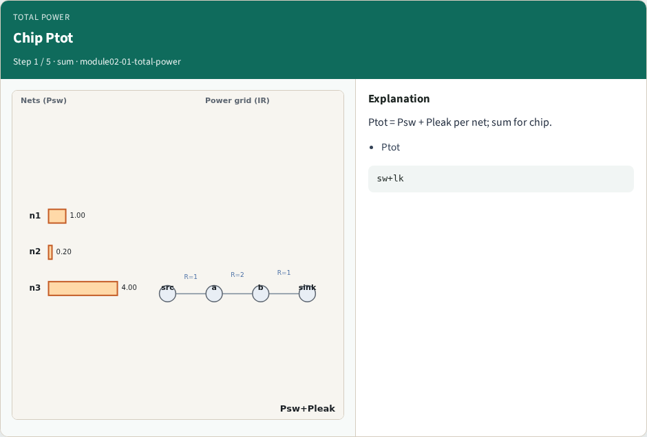
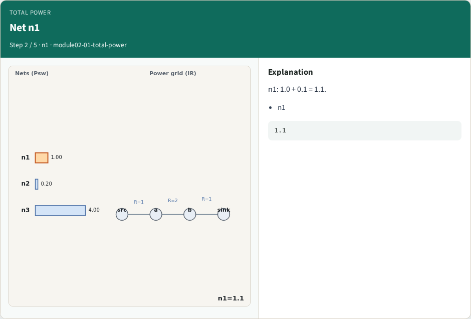
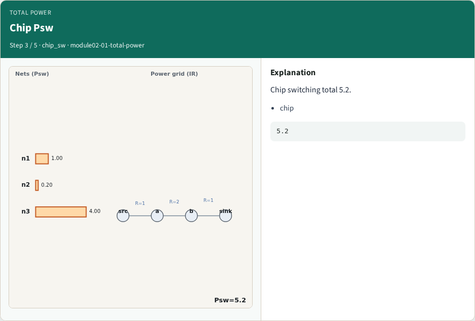
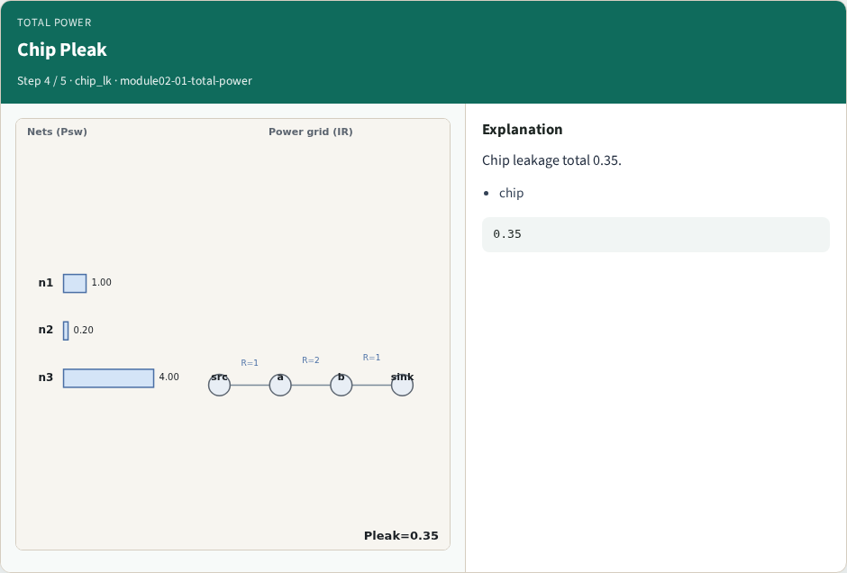
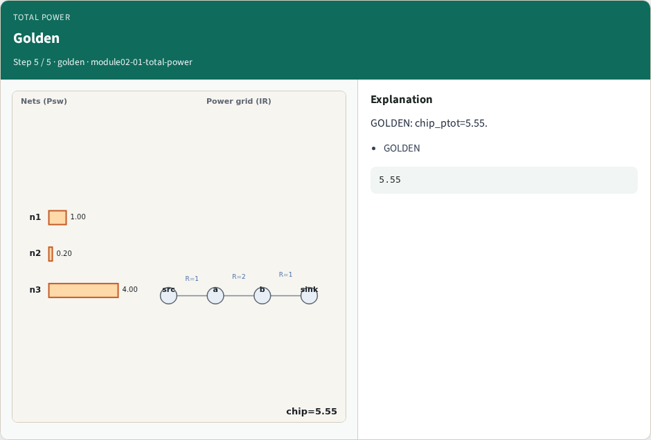

# Total power — step-by-step (for slides / transcript)

**Module:** `module02-01-total-power`  
**Lab / algo:** `total-power`  
**Viewer:** `/tools/algorithm-walkthrough/?algo=total-power&step=1`

Use each **Caption** as spoken prose (or a shortened slide note).
Use **Bullets** on the PPT; pair with the PNG in `assets/steps/`.

## Step 1 — Chip Ptot



**Caption (transcript):** Ptot = Psw + Pleak per net; sum for chip.

**Slide bullets:**

- Ptot

**On-screen metrics:**

```
sw+lk
```

## Step 2 — Net n1



**Caption (transcript):** n1: 1.0 + 0.1 = 1.1.

**Slide bullets:**

- n1

**On-screen metrics:**

```
1.1
```

## Step 3 — Chip Psw



**Caption (transcript):** Chip switching total 5.2.

**Slide bullets:**

- chip

**On-screen metrics:**

```
5.2
```

## Step 4 — Chip Pleak



**Caption (transcript):** Chip leakage total 0.35.

**Slide bullets:**

- chip

**On-screen metrics:**

```
0.35
```

## Step 5 — Golden



**Caption (transcript):** GOLDEN: chip_ptot=5.55.

**Slide bullets:**

- GOLDEN

**On-screen metrics:**

```
5.55
```

