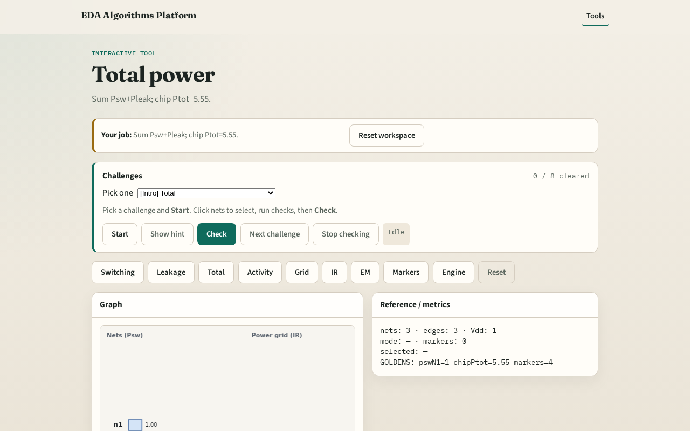

# Why total

Signoff reports chip Ptot = sum of switching and leakage

---

## The idea
- GOLDEN: chip_ptot=5.55

---

## Chip Ptot

---

## Net n1

---

## Chip Psw

---

## Chip Pleak

---

## Golden

---

## Browser lab track

---

## Implement track
- Call total_power(); assert total==5.55

---

## Pitfalls
- Summing only one component
- Double-counting nets

---

## Your turn
- Next: activity factors

