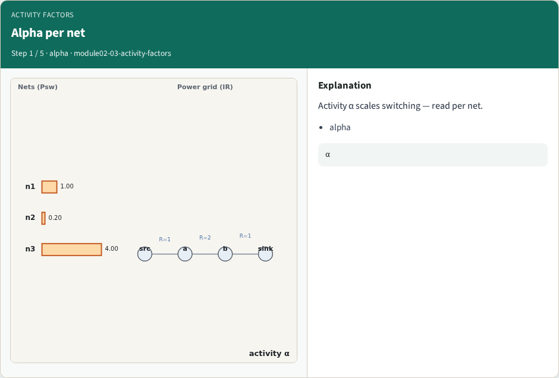
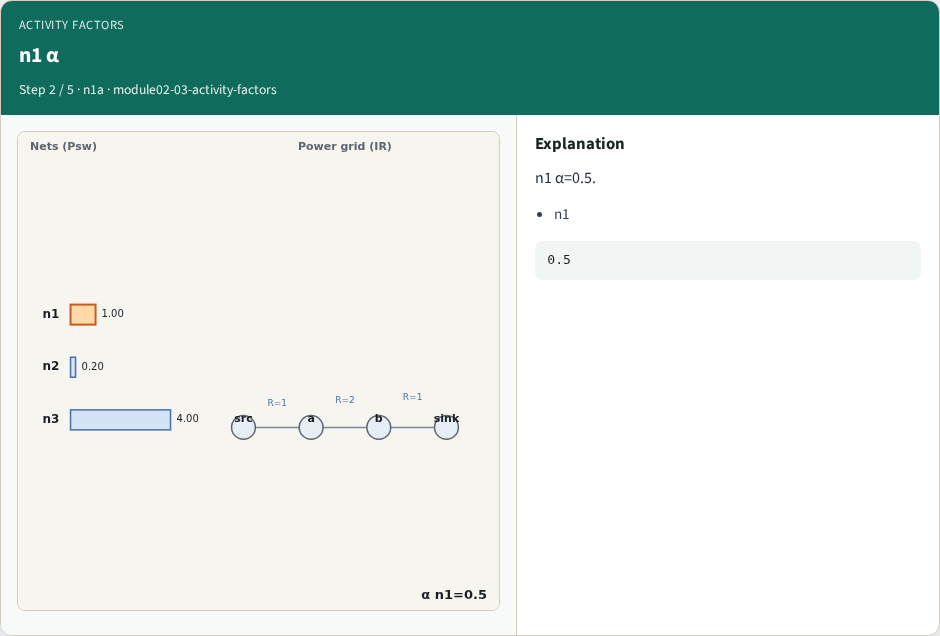
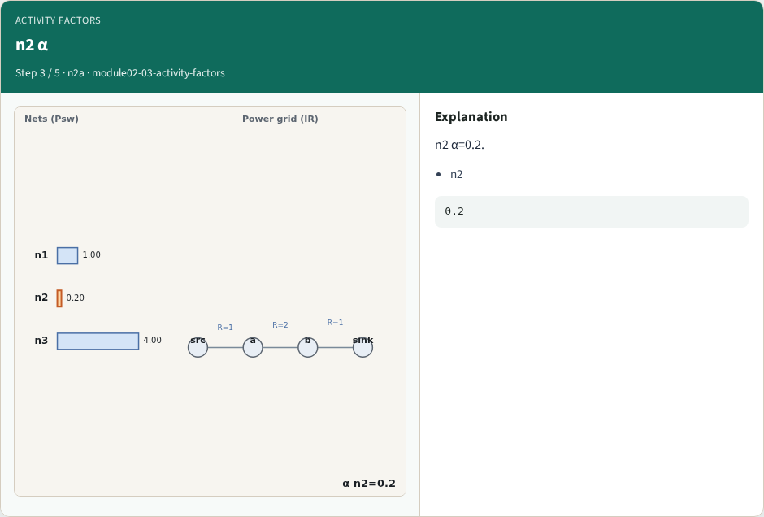
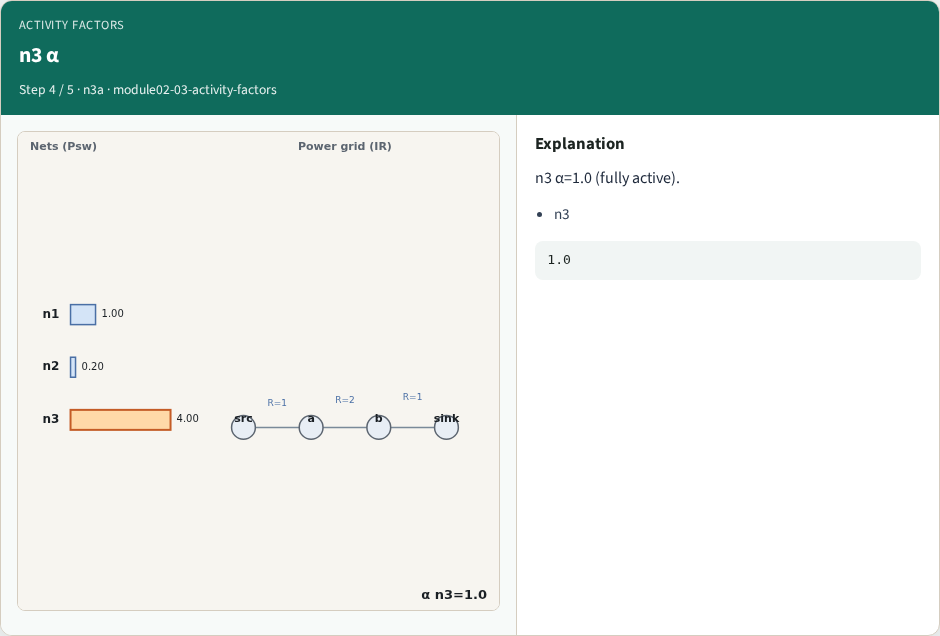
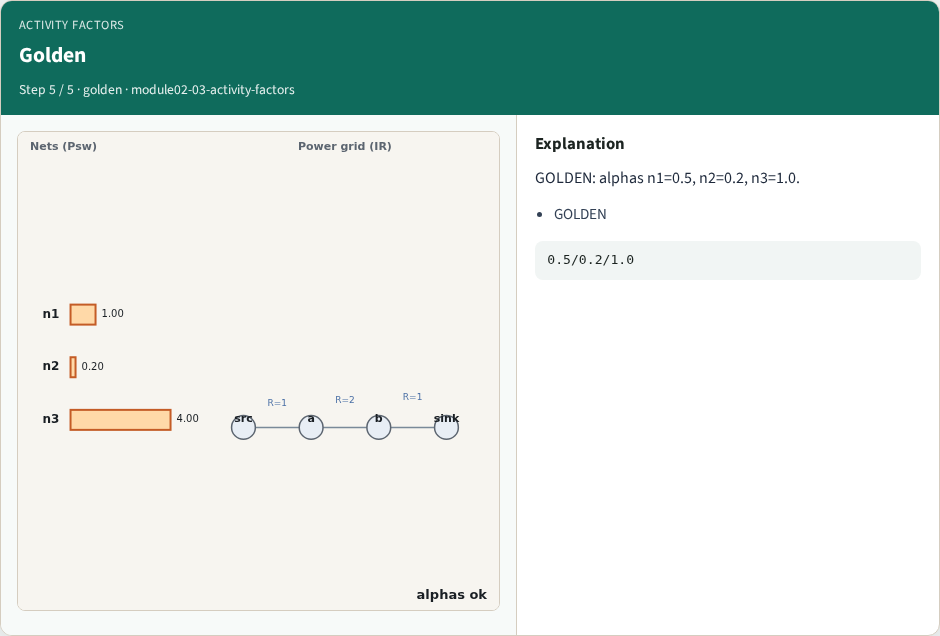
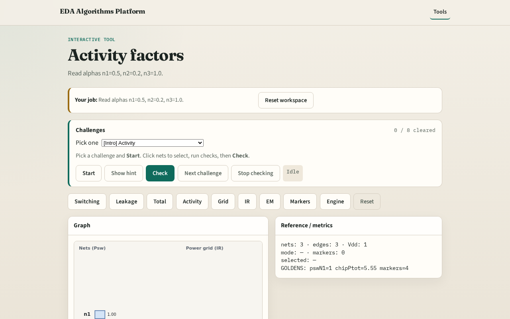

# Why activity

Lower α on quiet nets reduces reported switching power

---

## The idea
- GOLDEN: alphas n1=0.5, n2=0.2, n3=1.0

---

## Alpha per net

---

## n1 α

---

## n2 α

---

## n3 α

---

## Golden

---

## Browser lab track

---

## Implement track
- Call activity_factors(); assert alphas match goldens

---

## Pitfalls
- Confusing α with Ileak
- Using mean instead of per-net

---

## Your turn
- Next: power grid

