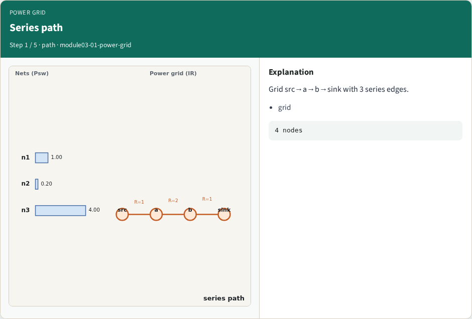
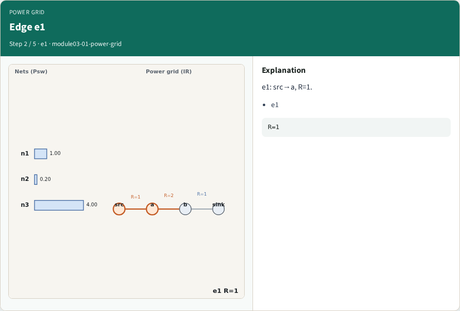
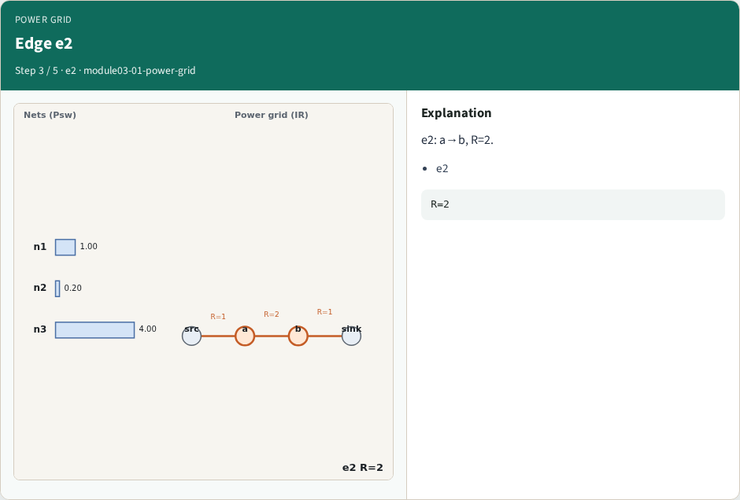
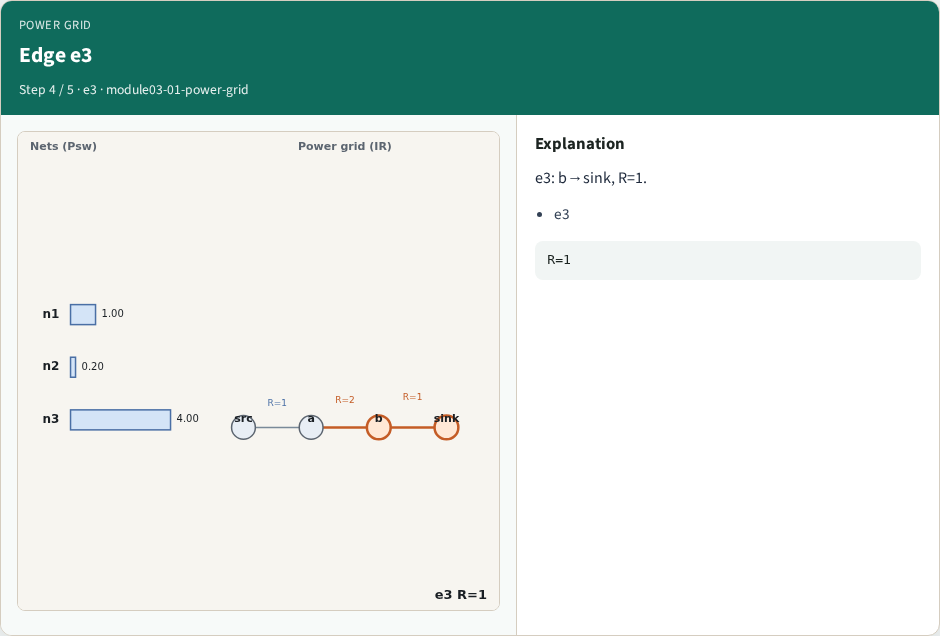
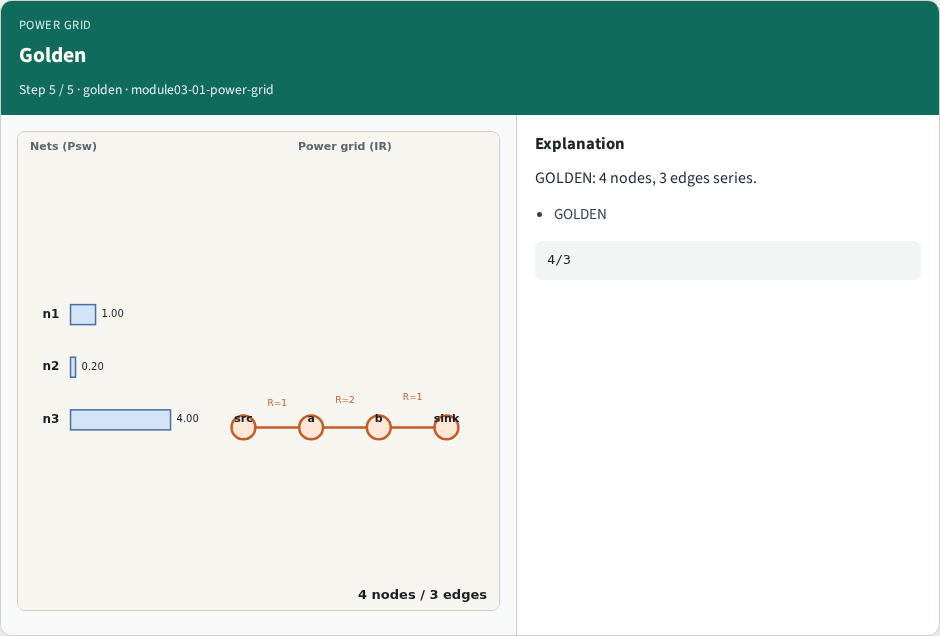
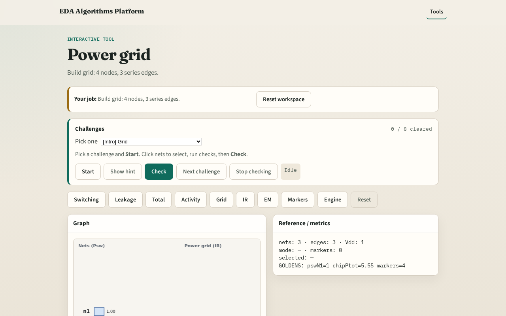

# Power grid

**Module id:** module03-01-power-grid
**Lab:** power-grid
**Tracks:** A (implement) · B (browser lab)

## Slide 1 — Why grid

IR analysis starts from a resistive grid and sink current.

## Slide 2 — The idea

GOLDEN: 4 nodes, 3 series edges.

<!-- algorithm-walkthrough -->

## Slide 3 — Series path

Grid src→a→b→sink with 3 series edges.

## Slide 4 — Edge e1

e1: src→a, R=1.

## Slide 5 — Edge e2

e2: a→b, R=2.

## Slide 6 — Edge e3

e3: b→sink, R=1.

## Slide 7 — Golden

GOLDEN: 4 nodes, 3 edges series.

<!-- /algorithm-walkthrough -->

## Slide 8 — Browser lab track

Open **power-grid**. Confirm 4 nodes and 3 edges.

## Slide 9 — Implement track

Call build_power_grid(); assert edge_count==3.

## Slide 10 — Pitfalls

Treating grid as parallel. Wrong node order.

## Slide 11 — Your turn

Next: IR drop.
