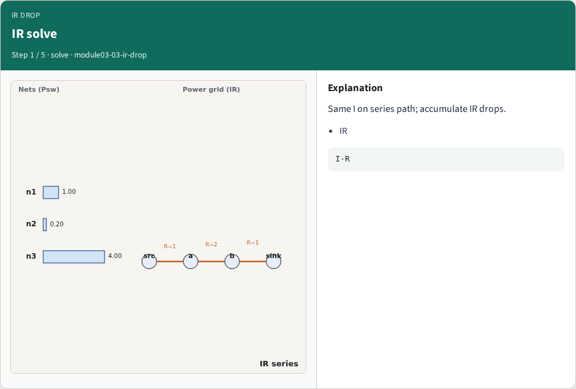
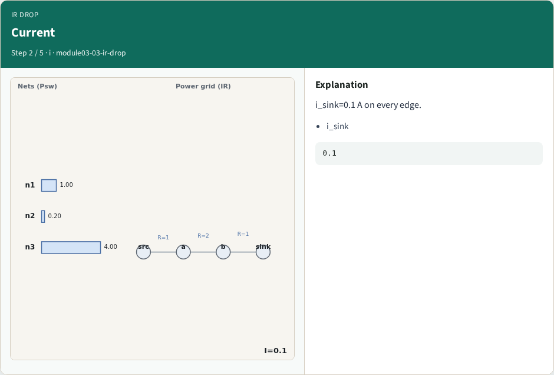
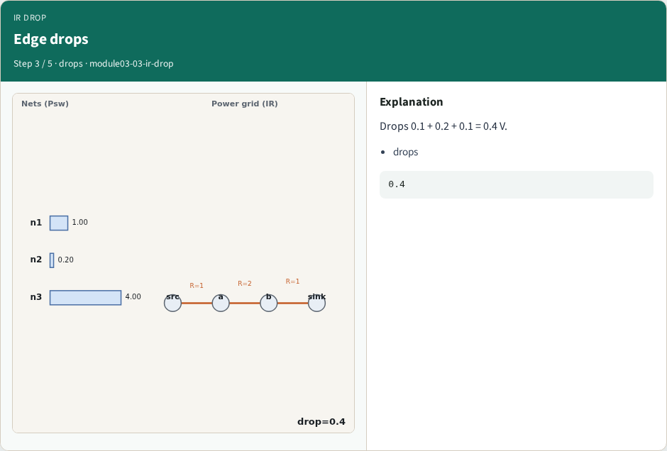
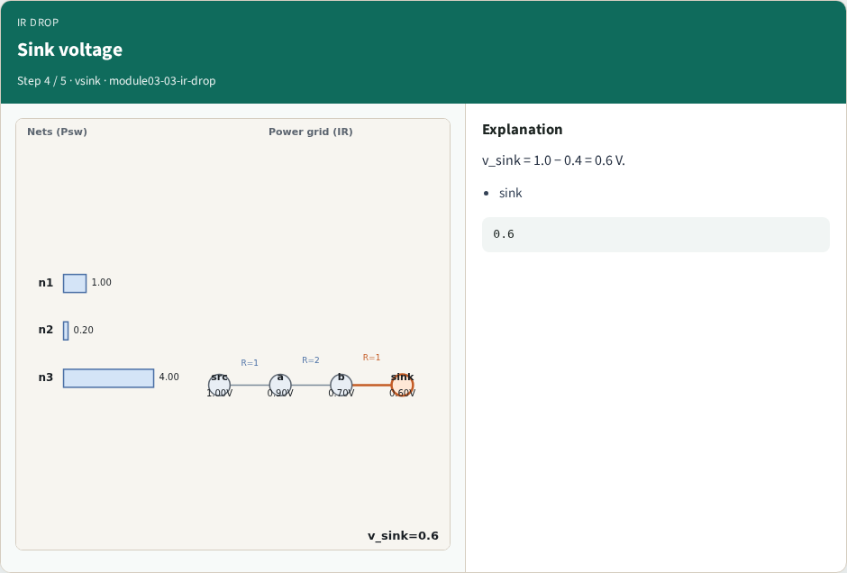
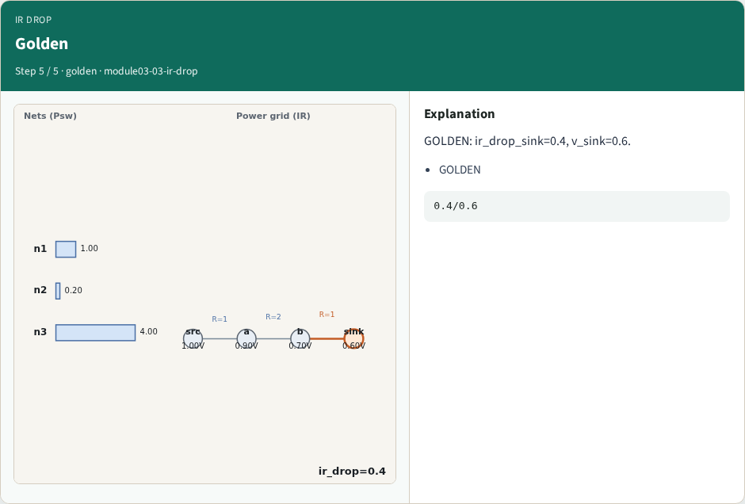
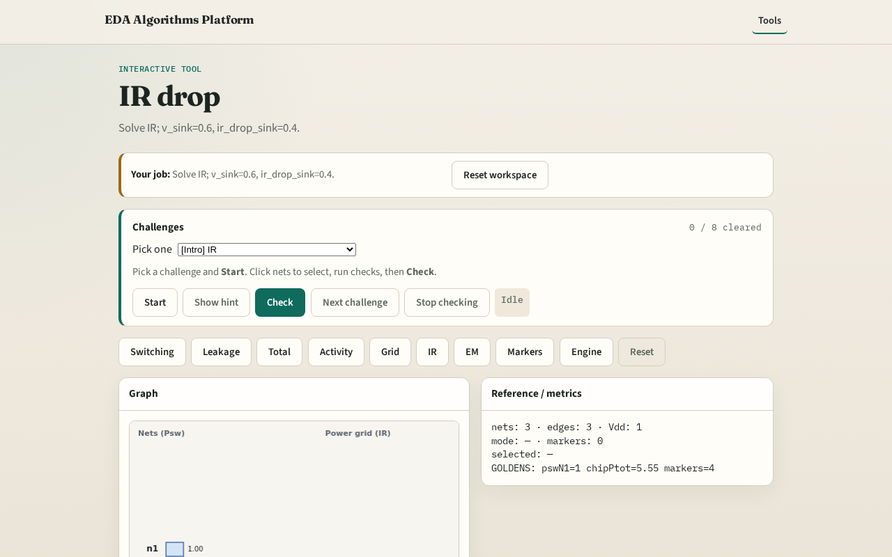

# IR drop

**Module id:** module03-03-ir-drop
**Lab:** ir-drop
**Tracks:** A (implement) · B (browser lab)

## Slide 1 — Why IR drop

Same sink current on every edge; accumulate I·R drops.

## Slide 2 — The idea

GOLDEN: ir_drop_sink=0.4, v_sink=0.6.

<!-- algorithm-walkthrough -->

## Slide 3 — IR solve

Same I on series path; accumulate IR drops.

## Slide 4 — Current

i_sink=0.1 A on every edge.

## Slide 5 — Edge drops

Drops 0.1 + 0.2 + 0.1 = 0.4 V.

## Slide 6 — Sink voltage

v_sink = 1.0 − 0.4 = 0.6 V.

## Slide 7 — Golden

GOLDEN: ir_drop_sink=0.4, v_sink=0.6.

<!-- /algorithm-walkthrough -->

## Slide 8 — Browser lab track

Open **ir-drop**. Confirm v_sink=0.6 and ir_drop=0.4.

## Slide 9 — Implement track

Call ir_drop_solve(); assert v_sink==0.6 and ir_drop_sink==0.4.

## Slide 10 — Pitfalls

Using parallel formula. Wrong edge order.

## Slide 11 — Your turn

Next: EM literacy.
