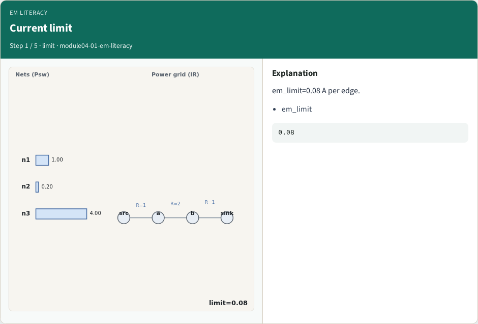
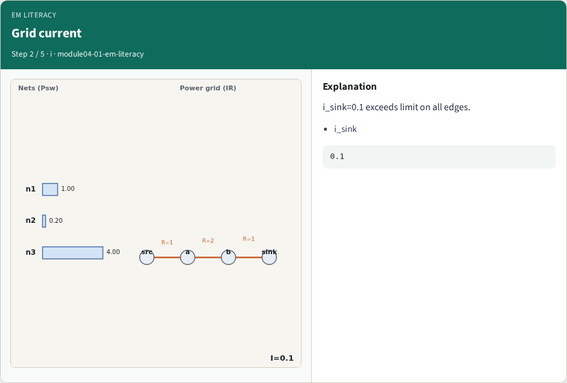
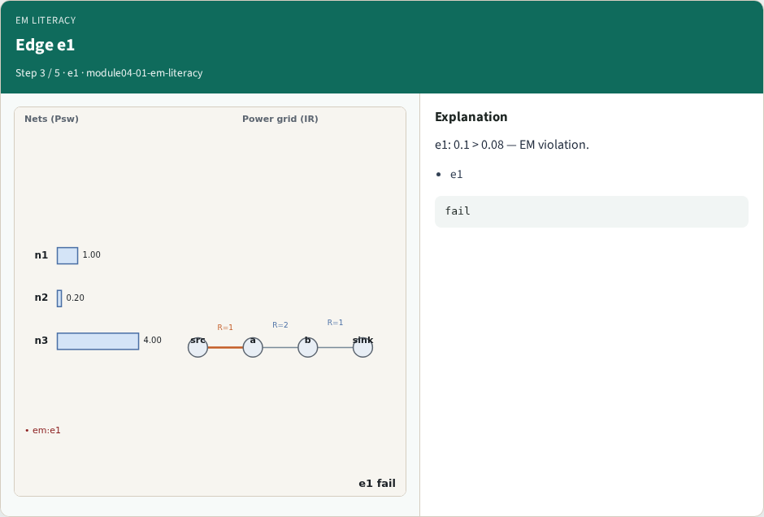
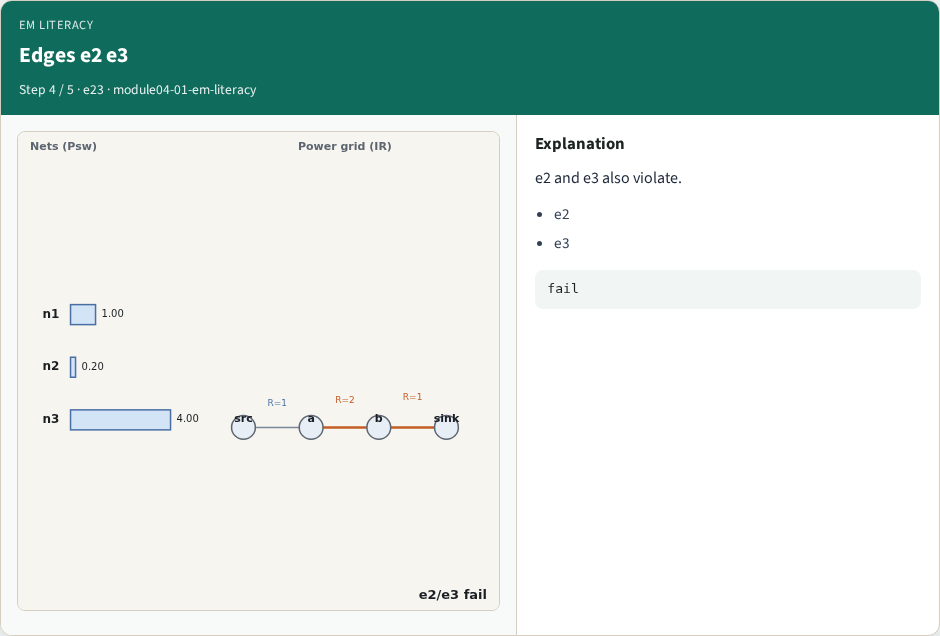
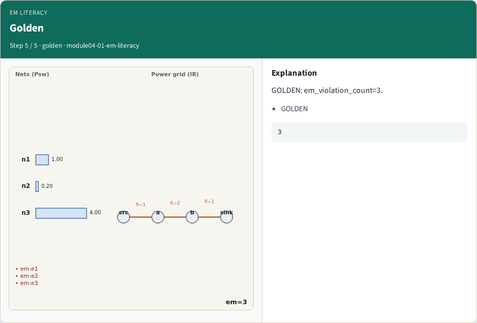
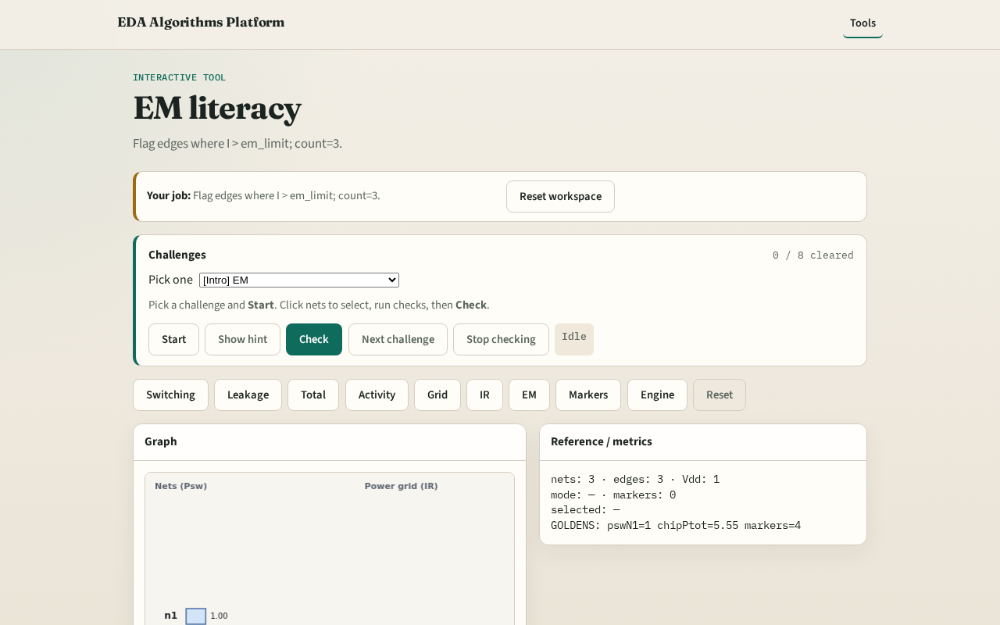

# Why EM

Electromigration limits peak current per grid edge

---

## The idea
- GOLDEN: em_violation_count=3

---

## Current limit

---

## Grid current

---

## Edge e1

---

## Edges e2 e3

---

## Golden

---

## Browser lab track

---

## Implement track
- Call find_em_violations(); assert count==3

---

## Pitfalls
- Checking IR instead of per-edge I
- Wrong limit units

---

## Your turn
- Next: power markers

