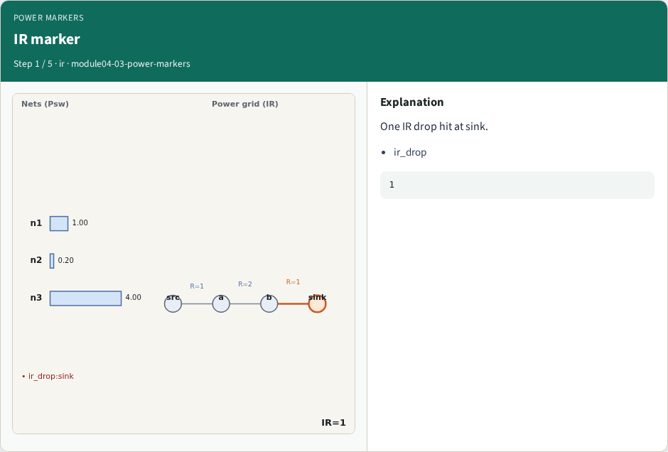
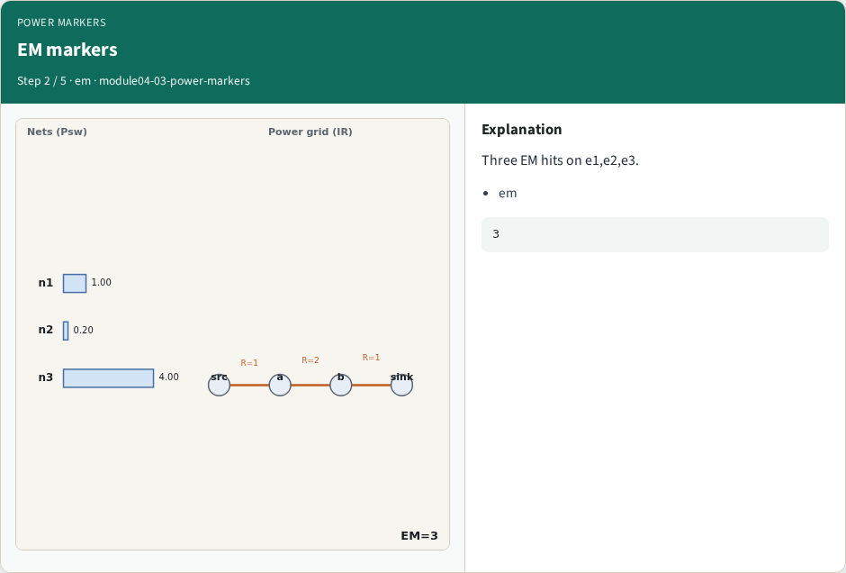
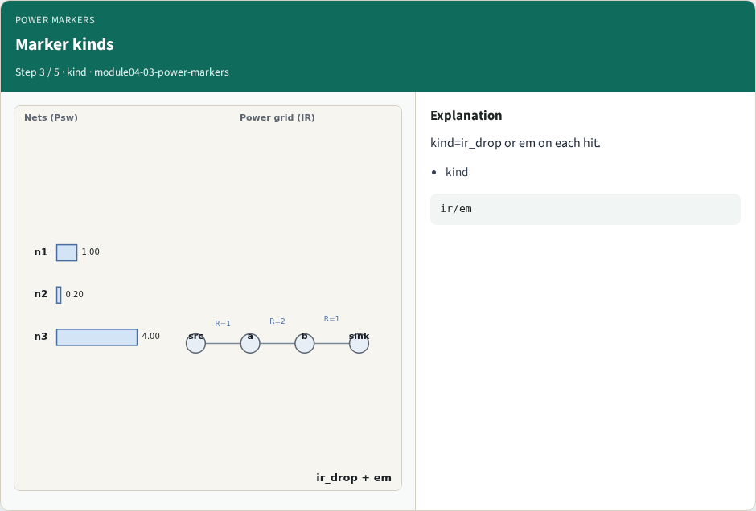
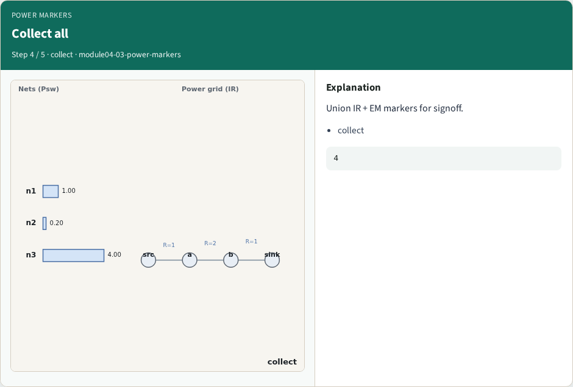
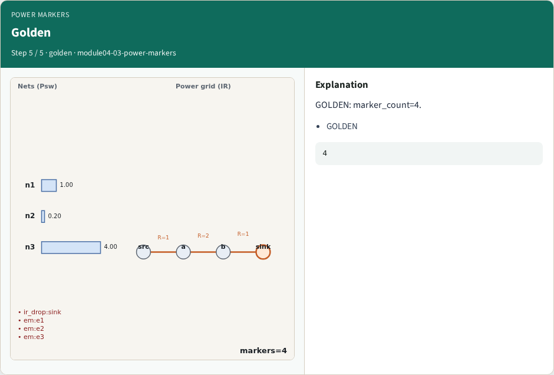
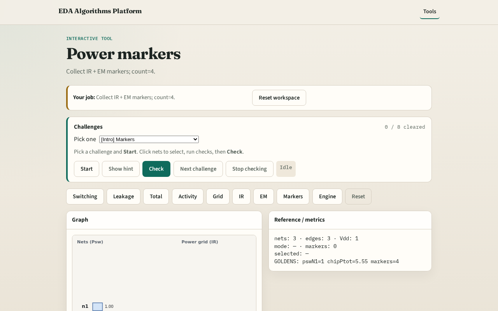

# Why markers

Signoff power/IR emits markers for IR drop and EM hits

---

## The idea
- GOLDEN: marker_count=4

---

## IR marker

---

## EM markers

---

## Marker kinds

---

## Collect all

---

## Golden

---

## Browser lab track

---

## Implement track
- Call collect_markers(); assert count==4

---

## Pitfalls
- Counting only IR
- Missing EM edges

---

## Your turn
- Next: power engine

