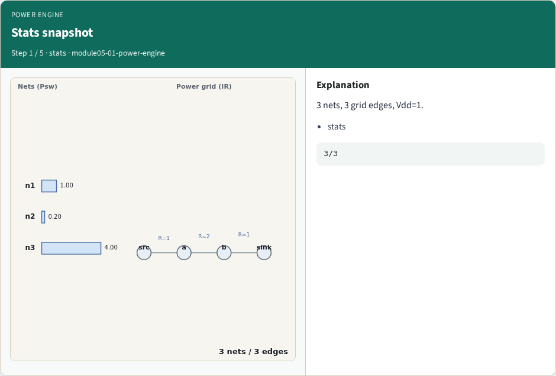
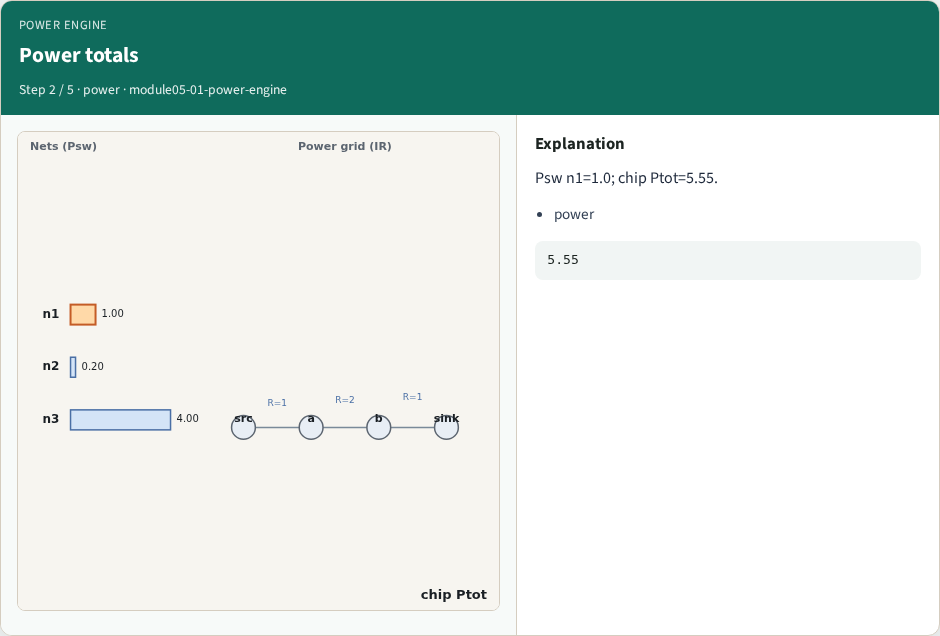
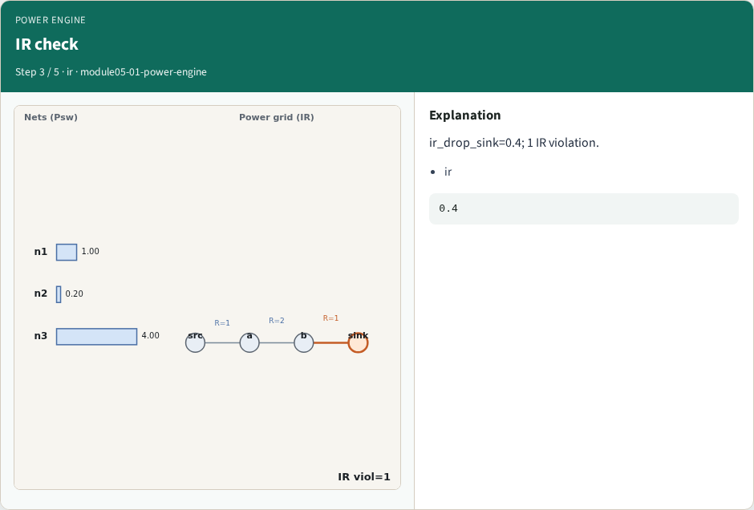
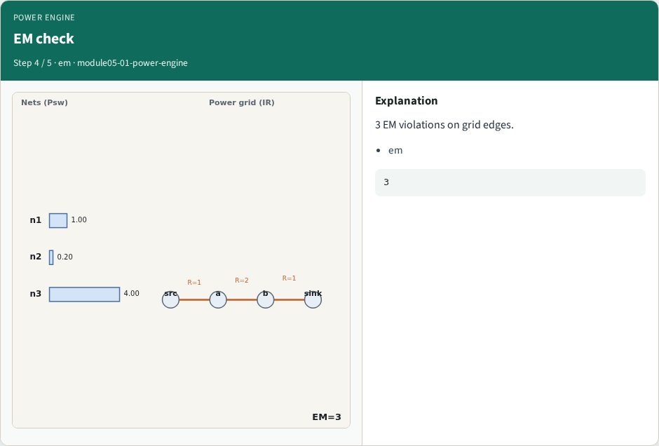
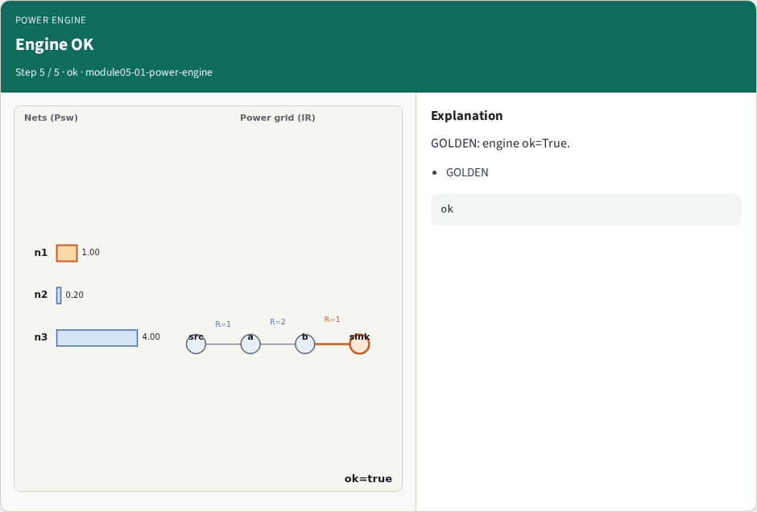

# Power engine integration — step-by-step (for slides / transcript)

**Module:** `module05-01-power-engine`  
**Lab / algo:** `power-engine`  
**Viewer:** `/tools/algorithm-walkthrough/?algo=power-engine&step=1`

Use each **Caption** as spoken prose (or a shortened slide note).
Use **Bullets** on the PPT; pair with the PNG in `assets/steps/`.

## Step 1 — Stats snapshot



**Caption (transcript):** 3 nets, 3 grid edges, Vdd=1.

**Slide bullets:**

- stats

**On-screen metrics:**

```
3/3
```

## Step 2 — Power totals



**Caption (transcript):** Psw n1=1.0; chip Ptot=5.55.

**Slide bullets:**

- power

**On-screen metrics:**

```
5.55
```

## Step 3 — IR check



**Caption (transcript):** ir_drop_sink=0.4; 1 IR violation.

**Slide bullets:**

- ir

**On-screen metrics:**

```
0.4
```

## Step 4 — EM check



**Caption (transcript):** 3 EM violations on grid edges.

**Slide bullets:**

- em

**On-screen metrics:**

```
3
```

## Step 5 — Engine OK



**Caption (transcript):** GOLDEN: engine ok=True.

**Slide bullets:**

- GOLDEN

**On-screen metrics:**

```
ok
```

