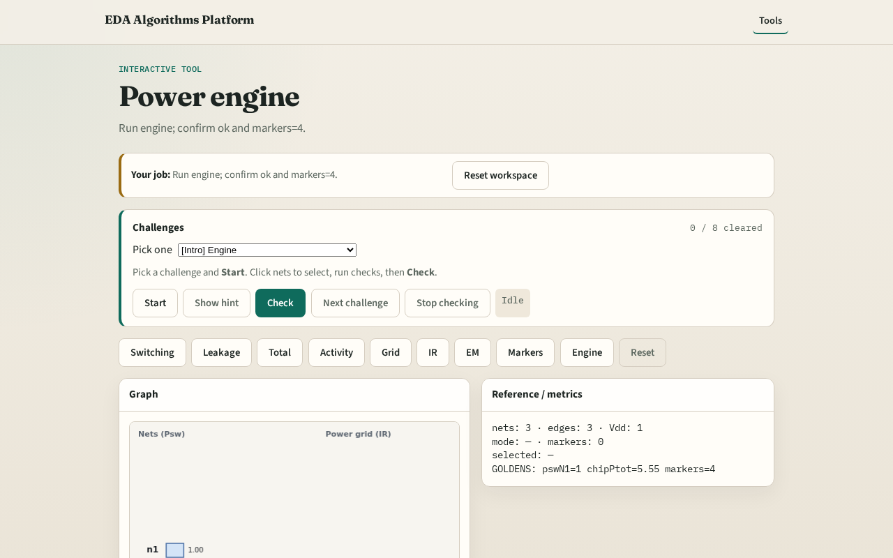

# Power engine integration

**Module id:** module05-01-power-engine
**Lab:** power-engine
**Tracks:** A (implement) · B (browser lab)

## Slide 1 — Engine

A tiny engine chains power, IR, EM, and markers.

## Slide 2 — The idea

GOLDEN: chip Ptot=5.55, ir_drop=0.4, markers=4, ok=True.

<!-- algorithm-walkthrough -->

## Slide 3 — Stats snapshot

3 nets, 3 grid edges, Vdd=1.

## Slide 4 — Power totals

Psw n1=1.0; chip Ptot=5.55.

## Slide 5 — IR check

ir_drop_sink=0.4; 1 IR violation.

## Slide 6 — EM check

3 EM violations on grid edges.

## Slide 7 — Engine OK

GOLDEN: engine ok=True.

<!-- /algorithm-walkthrough -->

## Slide 8 — Browser lab track

Open **power-engine**. Run engine; confirm ok.

## Slide 9 — Implement track

Call power_engine(); assert ok and markers.count==4.

## Slide 10 — Pitfalls

Reporting partial checks. Changing toy without updating goldens.

## Slide 11 — Your turn

Next: offline compare, then wrap.
