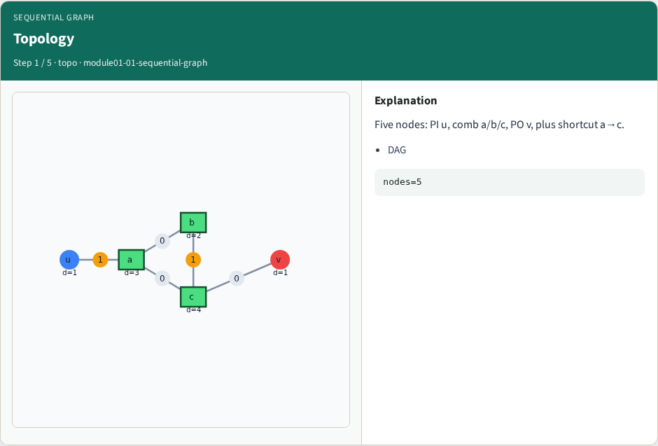
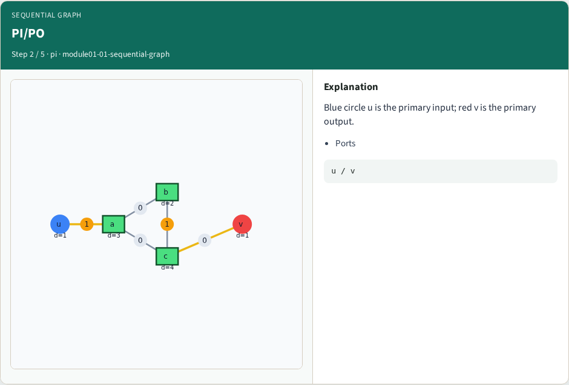
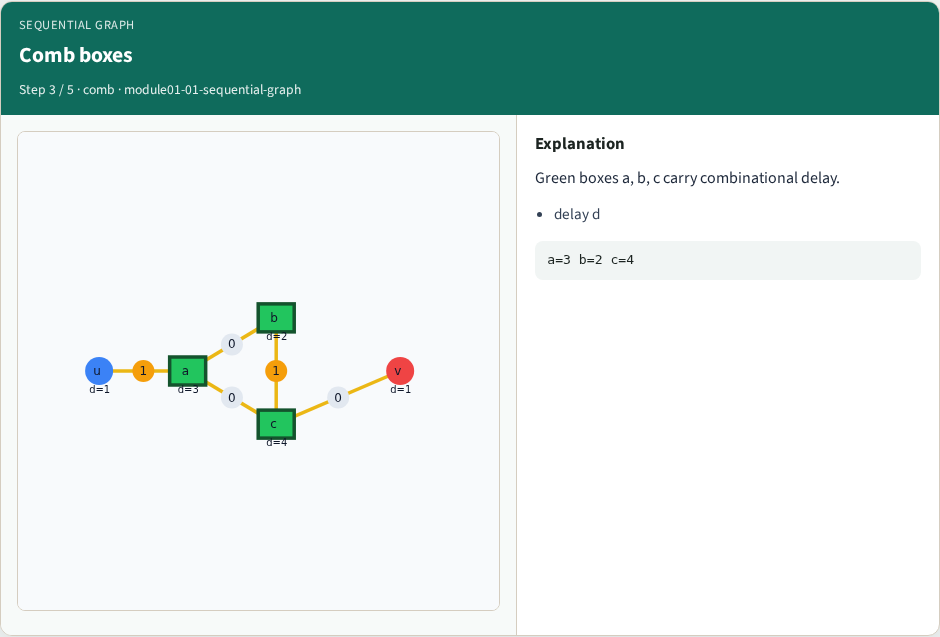
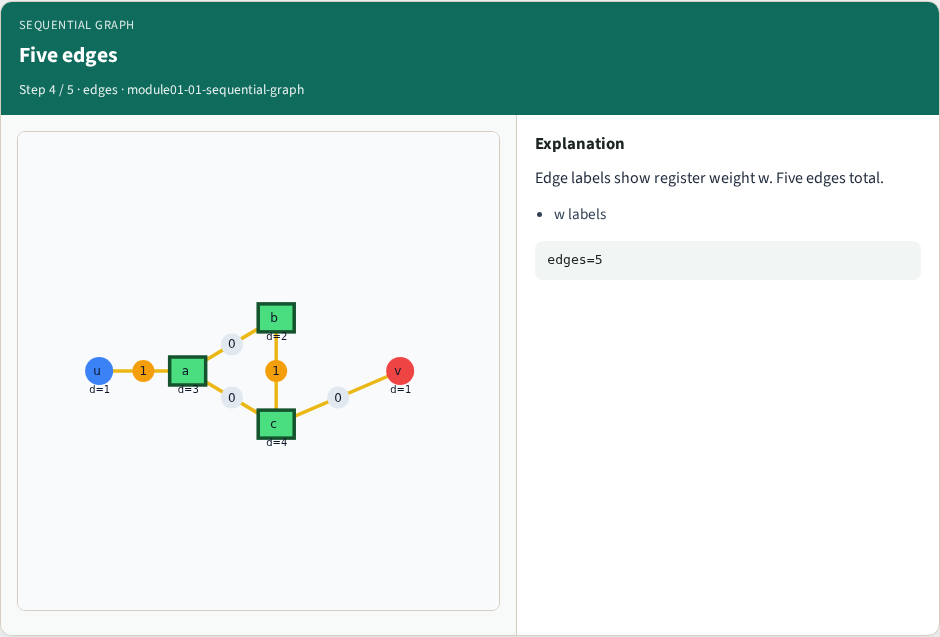
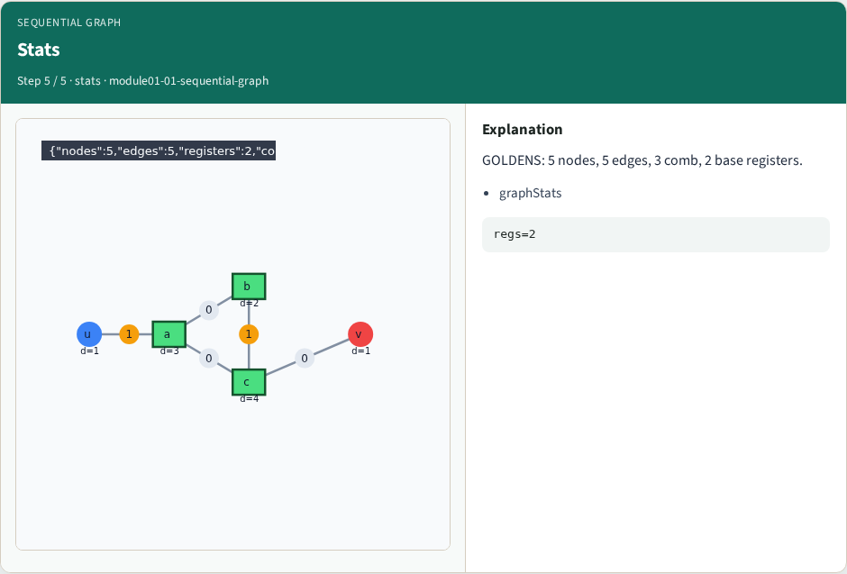
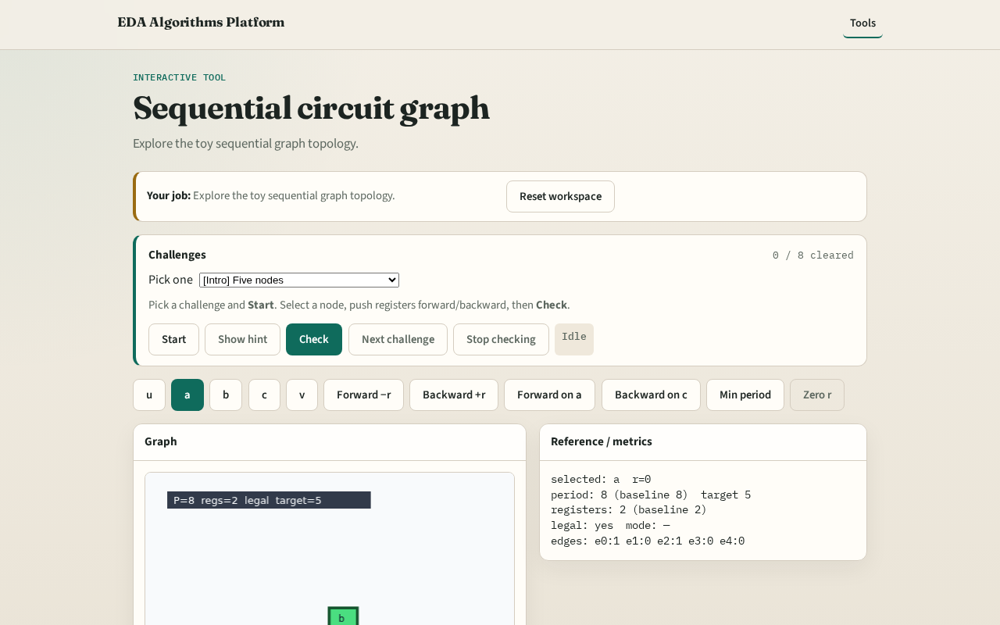

# Seq graph

Retiming starts from a sequential circuit graph , not just a Boolean network

---

## The idea
- Nodes carry combinational delay; edges carry register counts w
- Our toy has five nodes and five edges

---

## Topology

---

## PI/PO

---

## Comb boxes

---

## Five edges

---

## Stats

---

## Browser lab track

---

## Implement track
- Load tiny_retime.json; call graph_stats , expect 5 nodes, 5 edges

---

## Pitfalls
- Treating edge w as delay
- Confusing PO v with a comb node

---

## Your turn
- Next: edge register counts in detail

