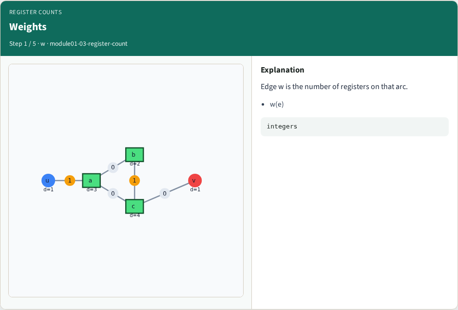
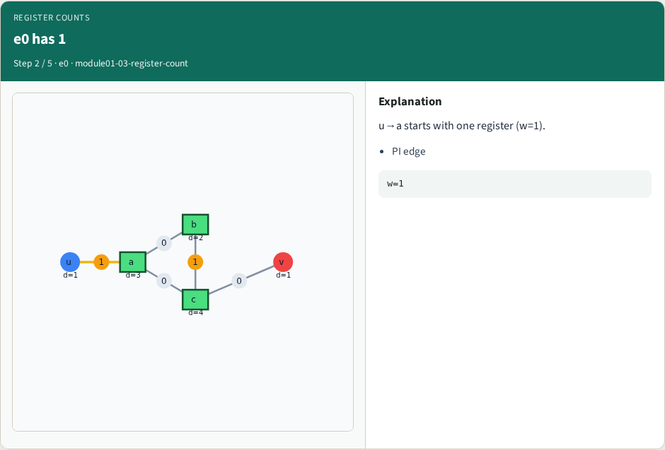
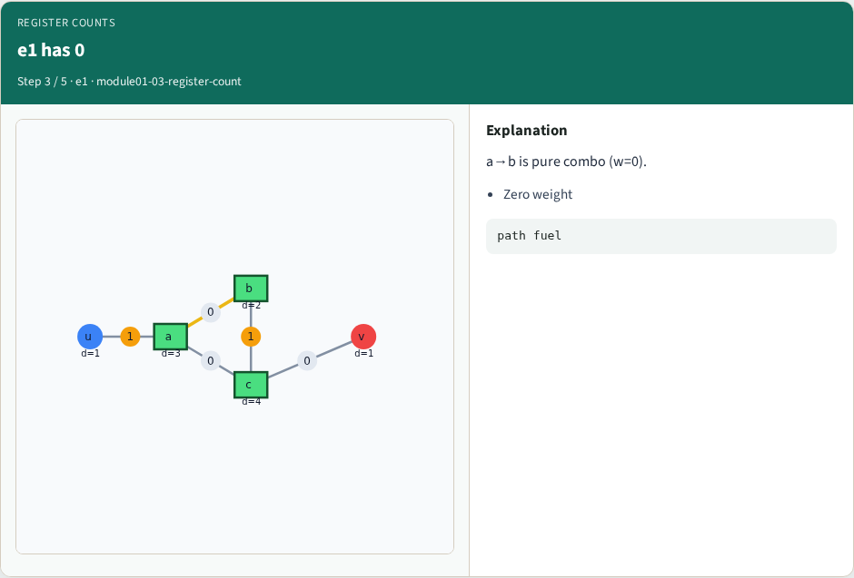
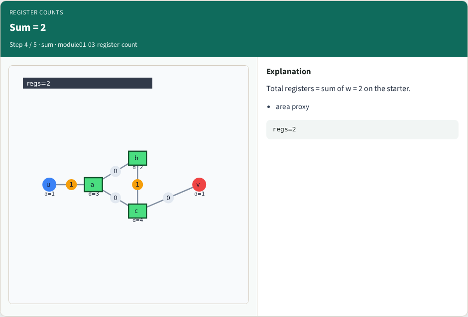
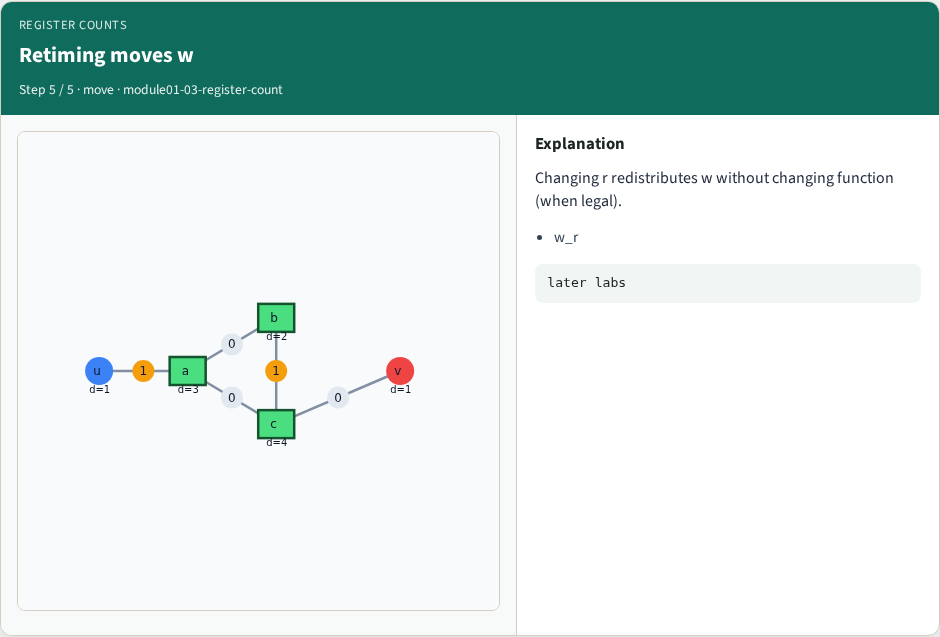

# Edge register counts — step-by-step (for slides / transcript)

**Module:** `module01-03-register-count`  
**Lab / algo:** `register-count`  
**Viewer:** `/tools/algorithm-walkthrough/?algo=register-count&step=1`

Use each **Caption** as spoken prose (or a shortened slide note).
Use **Bullets** on the PPT; pair with the PNG in `assets/steps/`.

## Step 1 — Weights



**Caption (transcript):** Edge w is the number of registers on that arc.

**Slide bullets:**

- w(e)

**On-screen metrics:**

```
integers
```

## Step 2 — e0 has 1



**Caption (transcript):** u→a starts with one register (w=1).

**Slide bullets:**

- PI edge

**On-screen metrics:**

```
w=1
```

## Step 3 — e1 has 0



**Caption (transcript):** a→b is pure combo (w=0).

**Slide bullets:**

- Zero weight

**On-screen metrics:**

```
path fuel
```

## Step 4 — Sum = 2



**Caption (transcript):** Total registers = sum of w = 2 on the starter.

**Slide bullets:**

- area proxy

**On-screen metrics:**

```
regs=2
```

## Step 5 — Retiming moves w



**Caption (transcript):** Changing r redistributes w without changing function (when legal).

**Slide bullets:**

- w_r

**On-screen metrics:**

```
later labs
```

