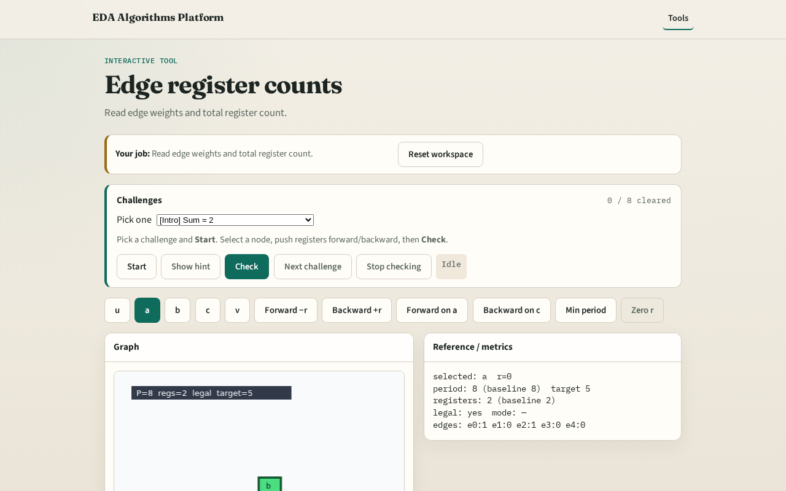

# Edge register counts

**Module id:** module01-03-register-count
**Lab:** register-count
**Tracks:** A (implement) · B (browser lab)

## Slide 1 — Registers

In Leiserson–Saxe form, each edge weight w is how many registers sit on that wire.

## Slide 2 — The idea

e0 u→a has w=1; e2 b→c has w=1; zero-weight edges are combinational.

<!-- algorithm-walkthrough -->

## Slide 3 — Weights

Edge w is the number of registers on that arc.

## Slide 4 — e0 has 1

u→a starts with one register (w=1).

## Slide 5 — e1 has 0

a→b is pure combo (w=0).

## Slide 6 — Sum = 2

Total registers = sum of w = 2 on the starter.

## Slide 7 — Retiming moves w

Changing r redistributes w without changing function (when legal).

<!-- /algorithm-walkthrough -->

## Slide 8 — Browser lab track

Open **register-count**. Highlight e0 and e2; confirm total 2.

## Slide 9 — Implement track

Call total_registers(edges); assert sum == 2.

## Slide 10 — Pitfalls

Counting nodes instead of edges. Forgetting w on u→a.

## Slide 11 — Your turn

Next: zero-weight path delay / clock period.
