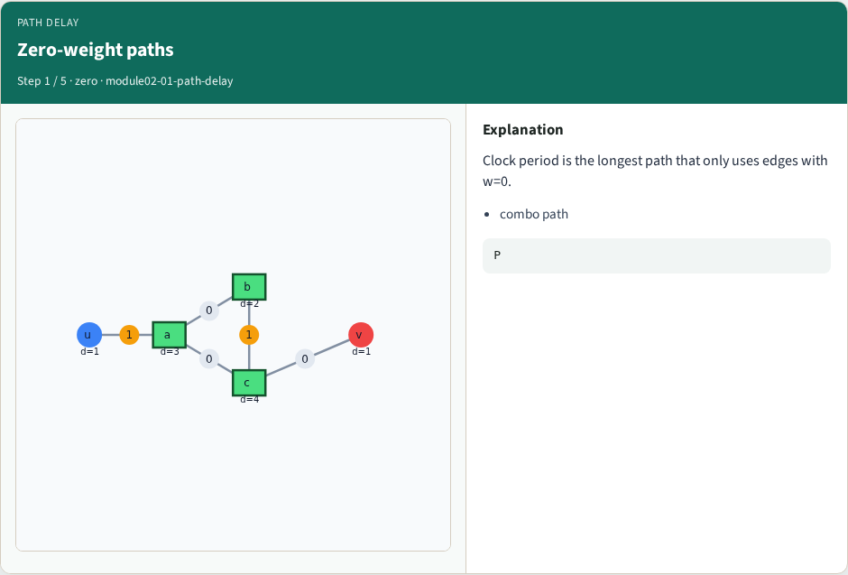
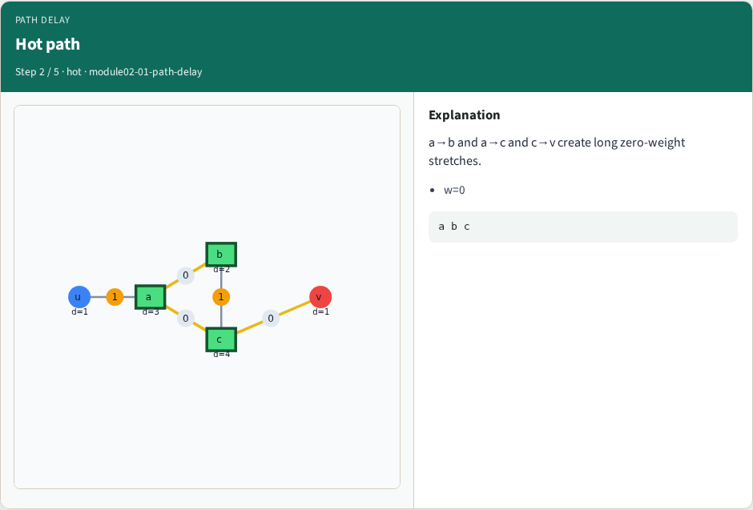
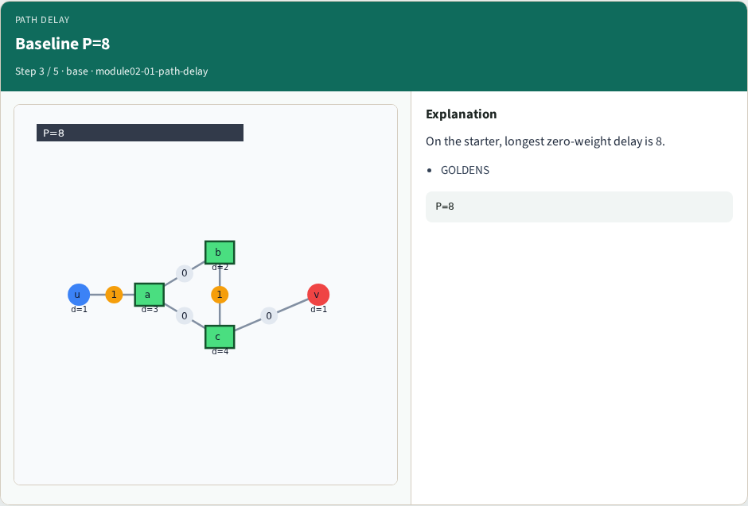
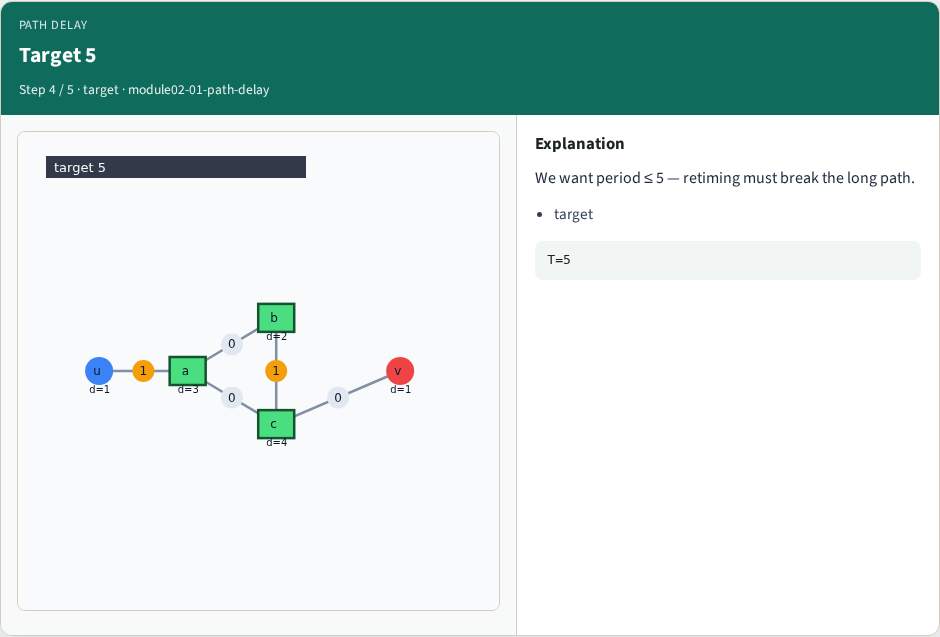
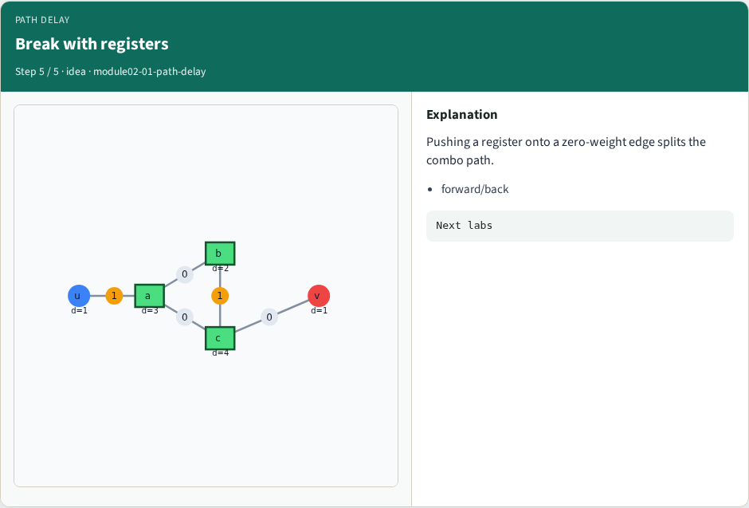
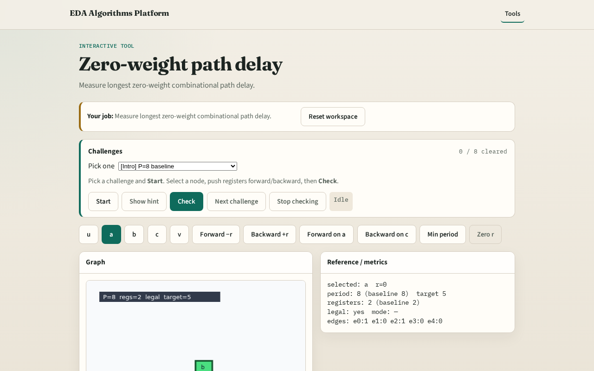

# Zero-weight path delay

**Module id:** module02-01-path-delay
**Lab:** path-delay
**Tracks:** A (implement) · B (browser lab)

## Slide 1 — Path delay

Clock period is the longest delay along paths that use only w=0 edges (registers break paths).

## Slide 2 — The idea

Zero edges e1, e3, e4 form comb segments; longest chain a→b→c hits delays 3+2+4 → period 8.

<!-- algorithm-walkthrough -->

## Slide 3 — Zero-weight paths

Clock period is the longest path that only uses edges with w=0.

## Slide 4 — Hot path

a→b and a→c and c→v create long zero-weight stretches.

## Slide 5 — Baseline P=8

On the starter, longest zero-weight delay is 8.

## Slide 6 — Target 5

We want period ≤ 5 — retiming must break the long path.

## Slide 7 — Break with registers

Pushing a register onto a zero-weight edge splits the combo path.

<!-- /algorithm-walkthrough -->

## Slide 8 — Browser lab track

Open **path-delay**. Trace the critical zero-weight path; read period 8.

## Slide 9 — Implement track

Call clock_period(data, zero_retime(data)); assert ≈ 8.

## Slide 10 — Pitfalls

Including w=1 edges in the critical path. Summing edge delays instead of node delays.

## Slide 11 — Your turn

Next: forward retiming on node a.
