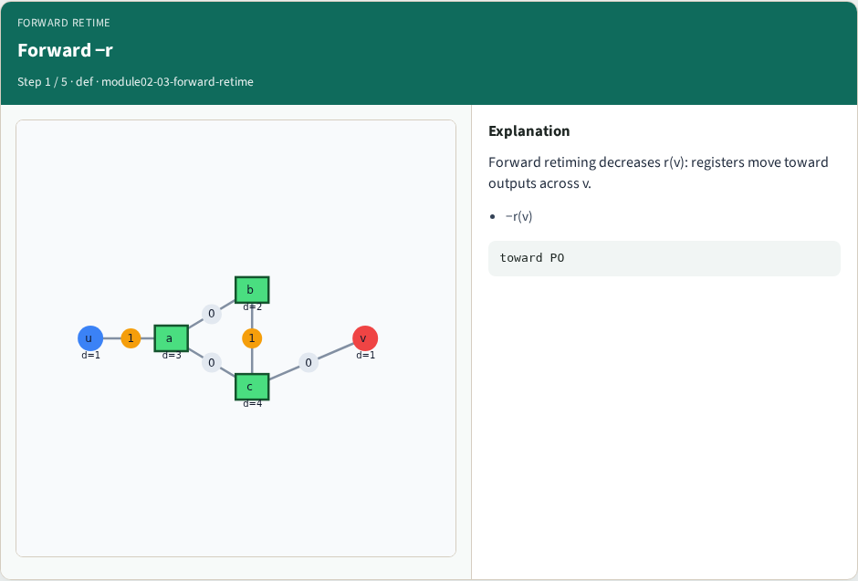
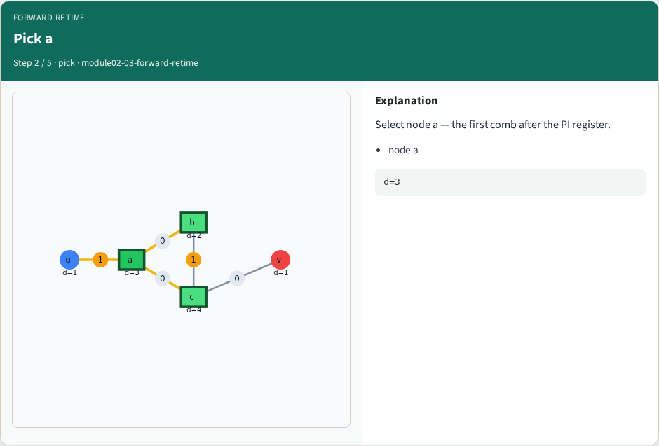
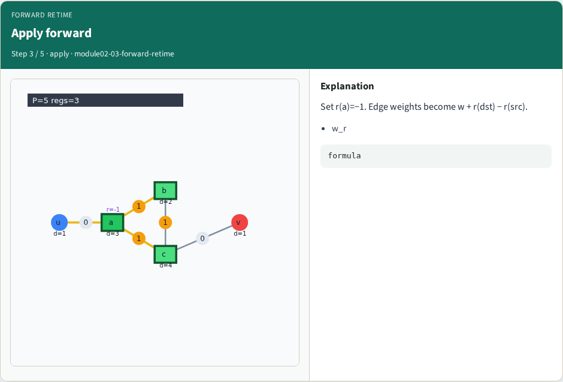
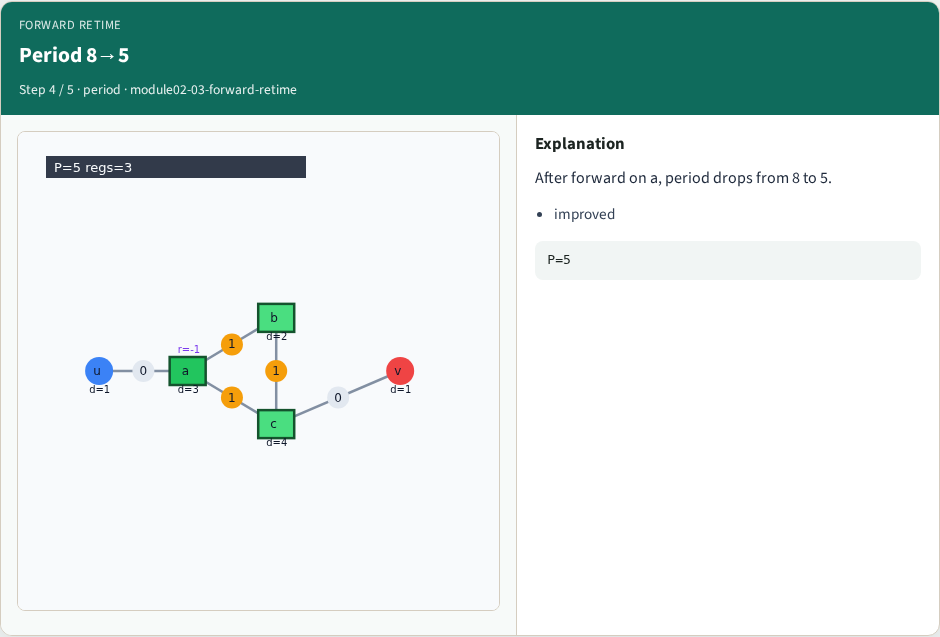

# Forward retiming — step-by-step (for slides / transcript)

**Module:** `module02-03-forward-retime`  
**Lab / algo:** `forward-retime`  
**Viewer:** `/tools/algorithm-walkthrough/?algo=forward-retime&step=1`

Use each **Caption** as spoken prose (or a shortened slide note).
Use **Bullets** on the PPT; pair with the PNG in `assets/steps/`.

## Step 1 — Forward −r



**Caption (transcript):** Forward retiming decreases r(v): registers move toward outputs across v.

**Slide bullets:**

- −r(v)

**On-screen metrics:**

```
toward PO
```

## Step 2 — Pick a



**Caption (transcript):** Select node a — the first comb after the PI register.

**Slide bullets:**

- node a

**On-screen metrics:**

```
d=3
```

## Step 3 — Apply forward



**Caption (transcript):** Set r(a)=−1. Edge weights become w + r(dst) − r(src).

**Slide bullets:**

- w_r

**On-screen metrics:**

```
formula
```

## Step 4 — Period 8→5



**Caption (transcript):** After forward on a, period drops from 8 to 5.

**Slide bullets:**

- improved

**On-screen metrics:**

```
P=5
```

## Step 5 — Registers 2→3


**Caption (transcript):** Register count rises to 3 — timing vs area tradeoff.

**Slide bullets:**

- area

**On-screen metrics:**

```
regs=3
```

