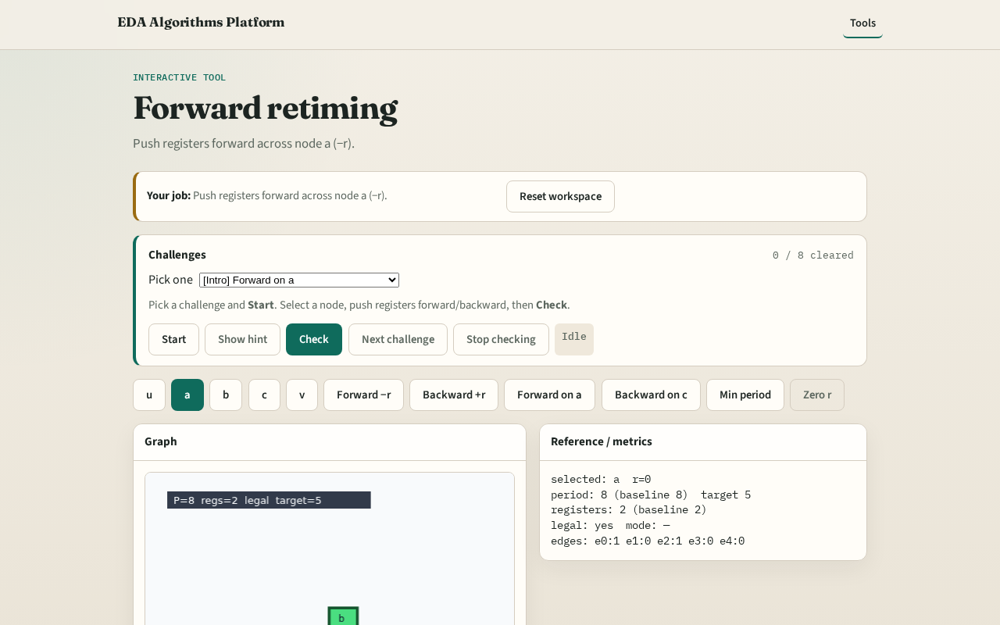

# Forward

Forward retiming pulls registers toward outputs , decrease r(v) on the chosen node

---

## The idea
- Forward_retime('a', r, 1) sets r(a)=−1; e0 w_r becomes 0; e1/e4 gain registers

---

## Forward −r

---

## Pick a

---

## Apply forward

---

## Period 8→5

---

## Registers 2→3

---

## Browser lab track

---

## Implement track
- Call forward_retime('a', r, 1); print apply_retime edges and clock_period

---

## Pitfalls
- Decreasing r on PI/PO
- Applying forward on c first and breaking legality

---

## Your turn
- Next: backward retiming on c

