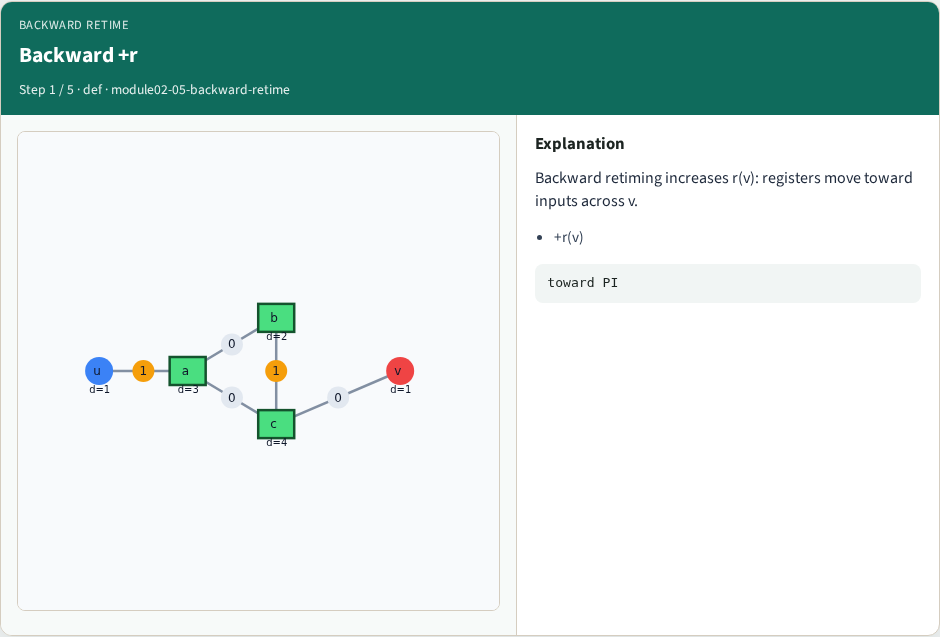
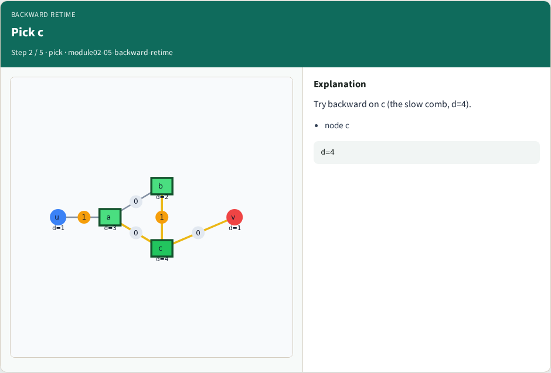
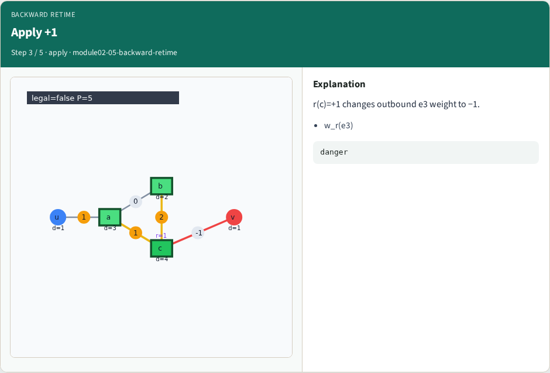
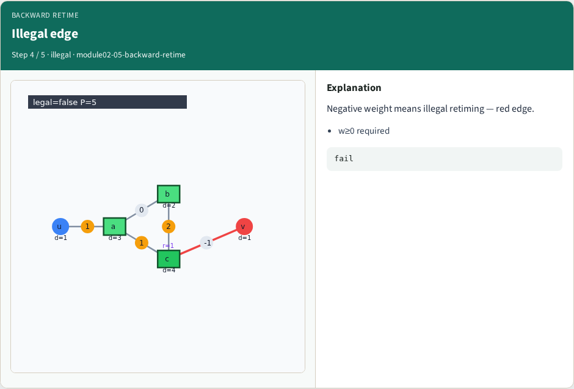
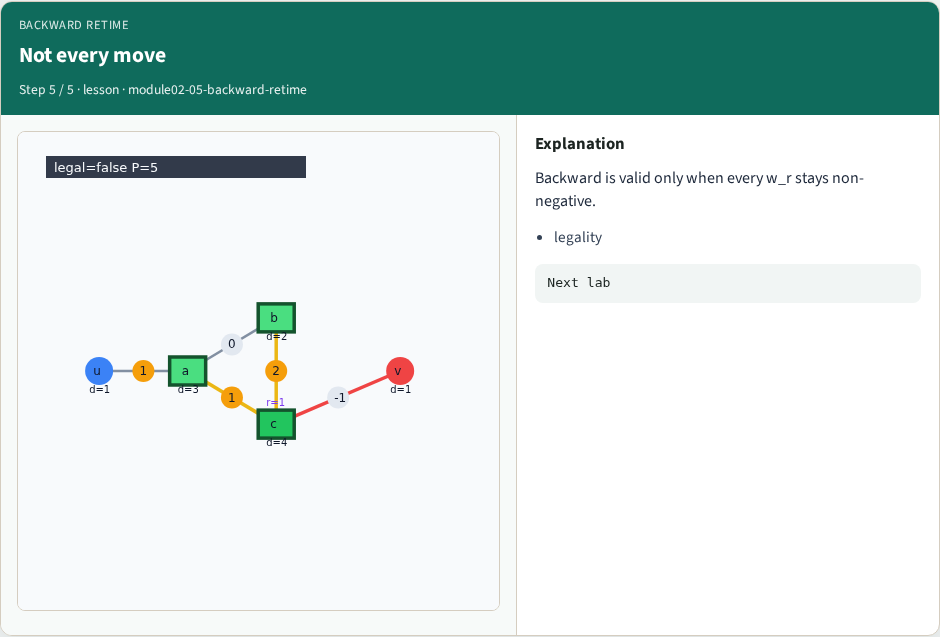

# Backward retiming — step-by-step (for slides / transcript)

**Module:** `module02-05-backward-retime`  
**Lab / algo:** `backward-retime`  
**Viewer:** `/tools/algorithm-walkthrough/?algo=backward-retime&step=1`

Use each **Caption** as spoken prose (or a shortened slide note).
Use **Bullets** on the PPT; pair with the PNG in `assets/steps/`.

## Step 1 — Backward +r



**Caption (transcript):** Backward retiming increases r(v): registers move toward inputs across v.

**Slide bullets:**

- +r(v)

**On-screen metrics:**

```
toward PI
```

## Step 2 — Pick c



**Caption (transcript):** Try backward on c (the slow comb, d=4).

**Slide bullets:**

- node c

**On-screen metrics:**

```
d=4
```

## Step 3 — Apply +1



**Caption (transcript):** r(c)=+1 changes outbound e3 weight to −1.

**Slide bullets:**

- w_r(e3)

**On-screen metrics:**

```
danger
```

## Step 4 — Illegal edge



**Caption (transcript):** Negative weight means illegal retiming — red edge.

**Slide bullets:**

- w≥0 required

**On-screen metrics:**

```
fail
```

## Step 5 — Not every move



**Caption (transcript):** Backward is valid only when every w_r stays non-negative.

**Slide bullets:**

- legality

**On-screen metrics:**

```
Next lab
```

