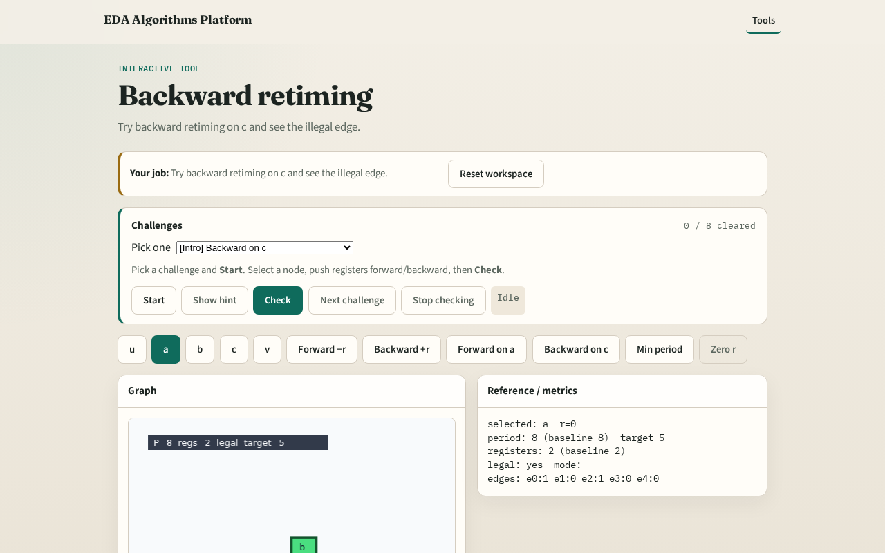

# Backward retiming

**Module id:** module02-05-backward-retime
**Lab:** backward-retime
**Tracks:** A (implement) · B (browser lab)

## Slide 1 — Backward

Backward retiming pushes registers toward inputs — increase r(v) on the chosen node.

## Slide 2 — The idea

backward_retime('c', r, 1) sets r(c)=+1; e3 w_r = 0+0−1 = −1 violates w_r ≥ 0.

<!-- algorithm-walkthrough -->

## Slide 3 — Backward +r

Backward retiming increases r(v): registers move toward inputs across v.

## Slide 4 — Pick c

Try backward on c (the slow comb, d=4).

## Slide 5 — Apply +1

r(c)=+1 changes outbound e3 weight to −1.

## Slide 6 — Illegal edge

Negative weight means illegal retiming — red edge.

## Slide 7 — Not every move

Backward is valid only when every w_r stays non-negative.

<!-- /algorithm-walkthrough -->

## Slide 8 — Browser lab track

Open **backward-retime**. Try Backward on c; see illegal flag on e3.

## Slide 9 — Implement track

Call backward_retime('c', r, 1); assert not is_legal(edges, r).

## Slide 10 — Pitfalls

Assuming backward is always safe. Ignoring PO-adjacent edges.

## Slide 11 — Your turn

Next: legal retiming check for all edges.
