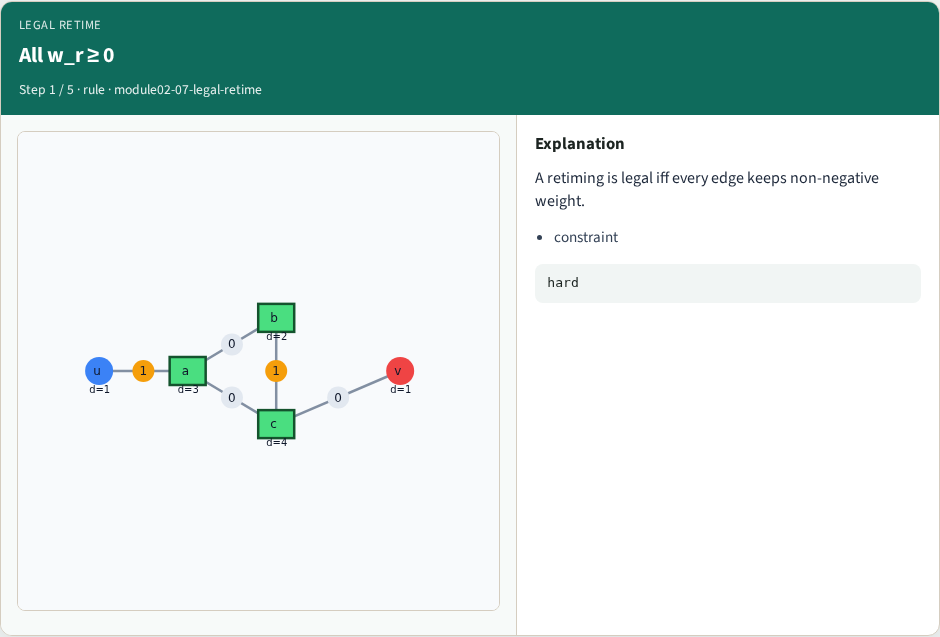
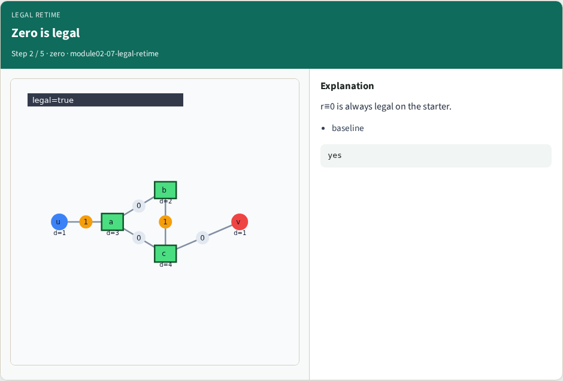
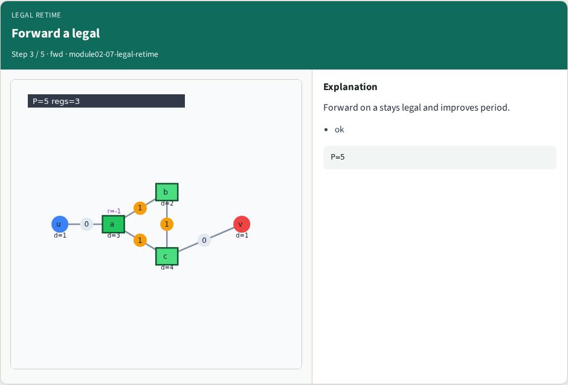
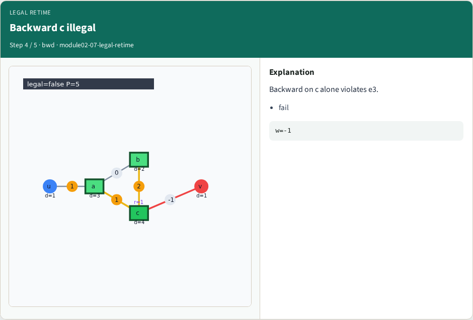
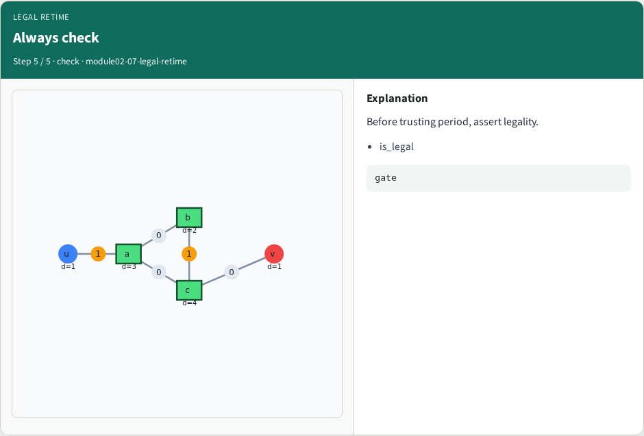
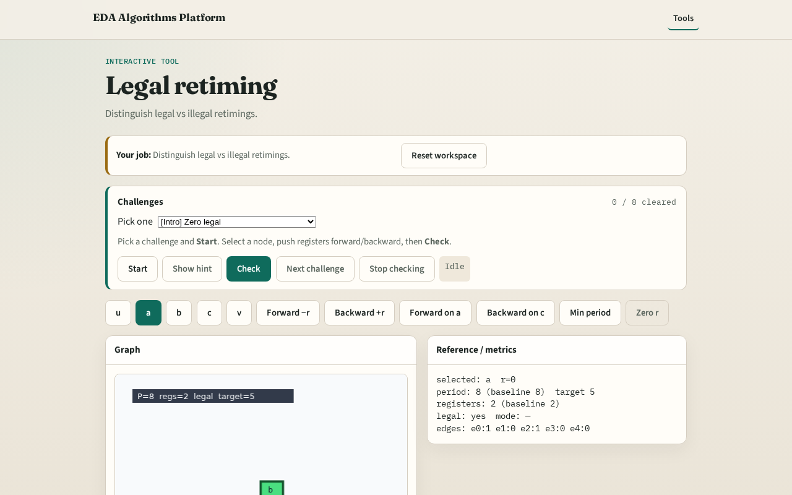

# Legal

A retiming lag assignment r is legal only if every edge keeps a non-negative register count

---

## The idea
- Check w_r = w + r(dst) − r(src) for e0…e4; one negative edge breaks legality

---

## All w_r ≥ 0

---

## Zero is legal

---

## Forward a legal

---

## Backward c illegal

---

## Always check

---

## Browser lab track

---

## Implement track
- Test is_legal after forward on a (True) and backward on c (False)

---

## Pitfalls
- Checking only one edge
- Allowing fractional or negative w in the UI

---

## Your turn
- Next: period bound / FEAS lite

