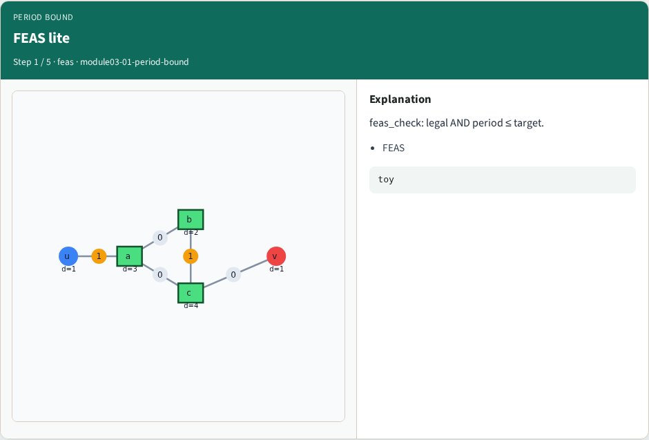
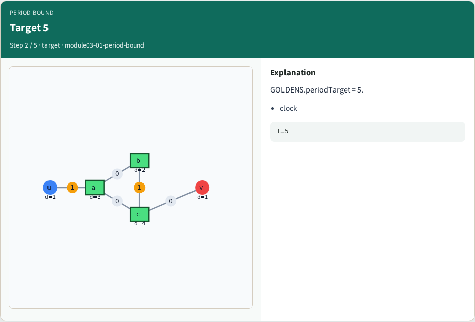
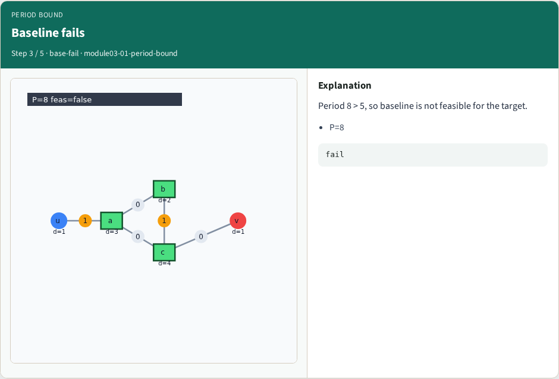
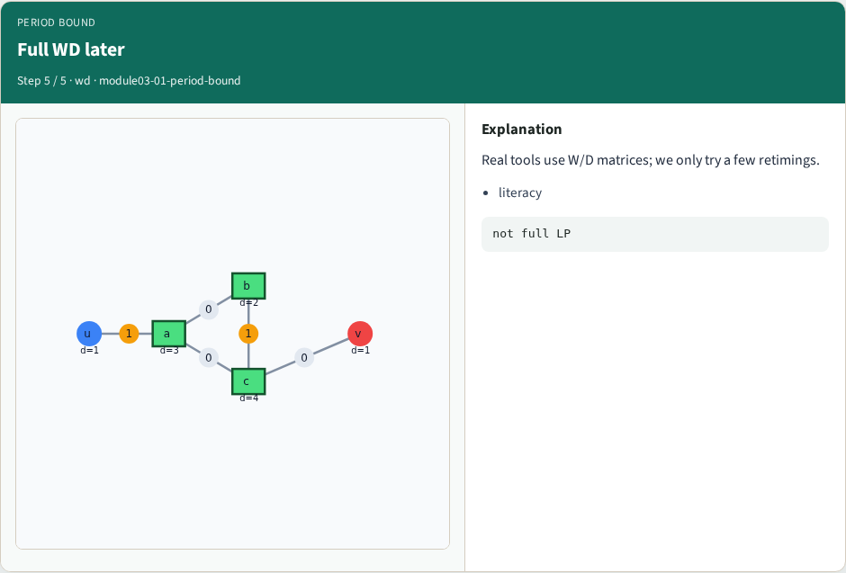
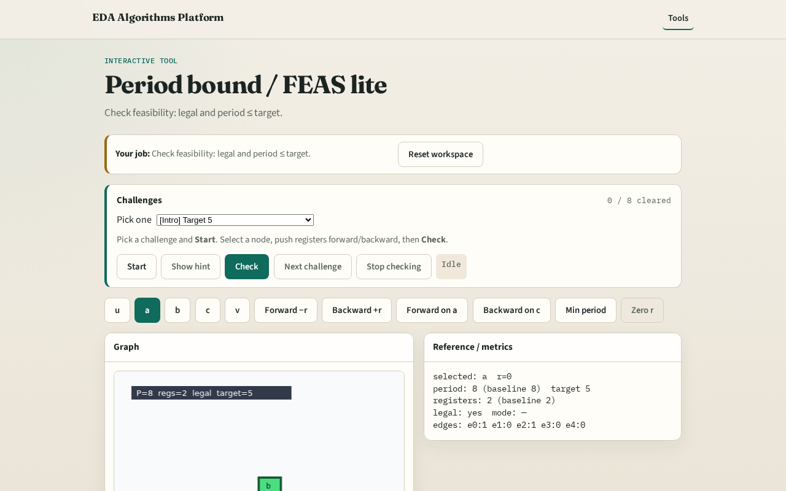

# Period bound

Given target period φ, a retiming is feasible if it is legal and the clock period is at most φ

---

## The idea
- Feas_check(data, 5, r) after forward on a: period 5 ≤ target 5 , passes

---

## FEAS lite

---

## Target 5

---

## Baseline fails

---

## Forward passes

---

## Full WD later

---

## Browser lab track

---

## Implement track
- Call feas_check(DATA, 5, r) with forward-on-a r; expect True

---

## Pitfalls
- Forgetting legality in FEAS
- Comparing to target 8 instead of 5

---

## Your turn
- Next: min-period search across candidate retimings

