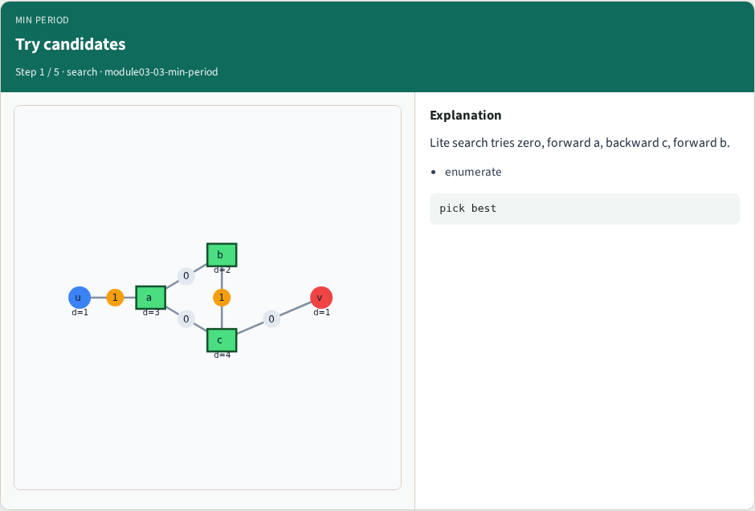
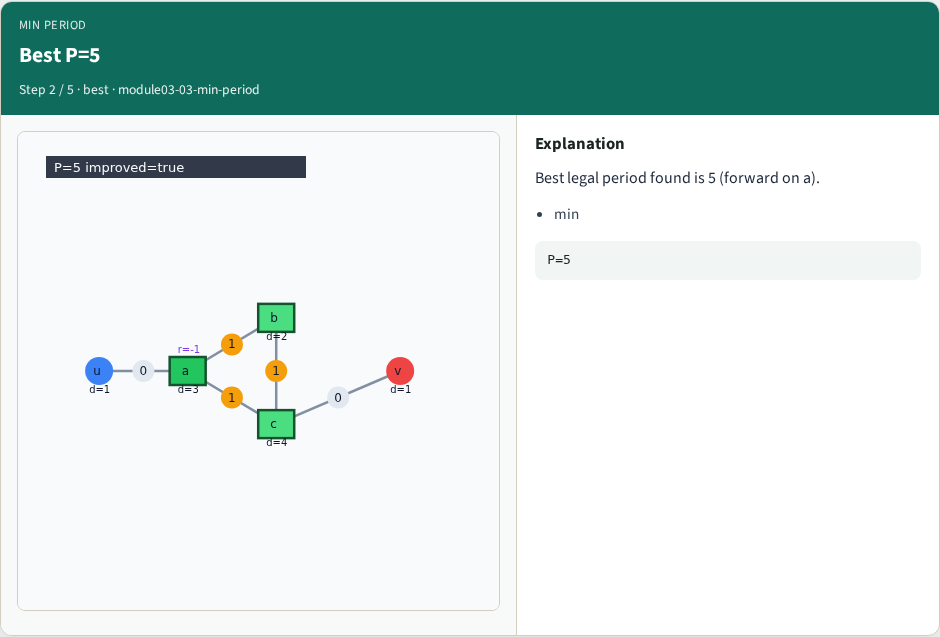
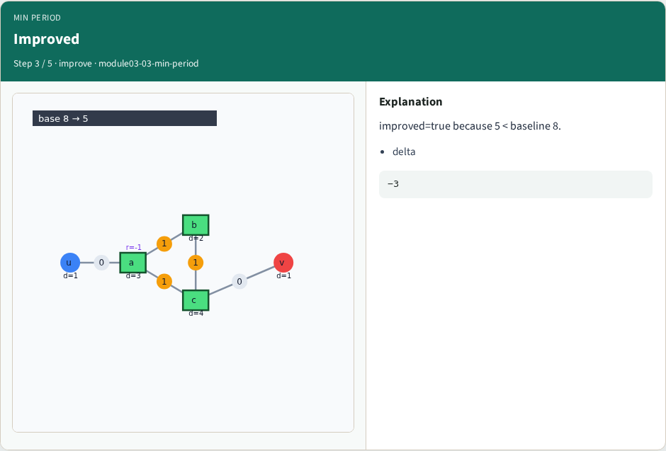

# Min-period search — step-by-step (for slides / transcript)

**Module:** `module03-03-min-period`  
**Lab / algo:** `min-period`  
**Viewer:** `/tools/algorithm-walkthrough/?algo=min-period&step=1`

Use each **Caption** as spoken prose (or a shortened slide note).
Use **Bullets** on the PPT; pair with the PNG in `assets/steps/`.

## Step 1 — Try candidates



**Caption (transcript):** Lite search tries zero, forward a, backward c, forward b.

**Slide bullets:**

- enumerate

**On-screen metrics:**

```
pick best
```

## Step 2 — Best P=5



**Caption (transcript):** Best legal period found is 5 (forward on a).

**Slide bullets:**

- min

**On-screen metrics:**

```
P=5
```

## Step 3 — Improved



**Caption (transcript):** improved=true because 5 < baseline 8.

**Slide bullets:**

- delta

**On-screen metrics:**

```
−3
```

## Step 4 — Cost registers


**Caption (transcript):** Best solution uses 3 registers vs 2 baseline.

**Slide bullets:**

- area

**On-screen metrics:**

```
+1 FF
```

## Step 5 — Sequential API


**Caption (transcript):** sequential_retime(min_period) wraps the same search.

**Slide bullets:**

- pipeline

**On-screen metrics:**

```
one call
```

