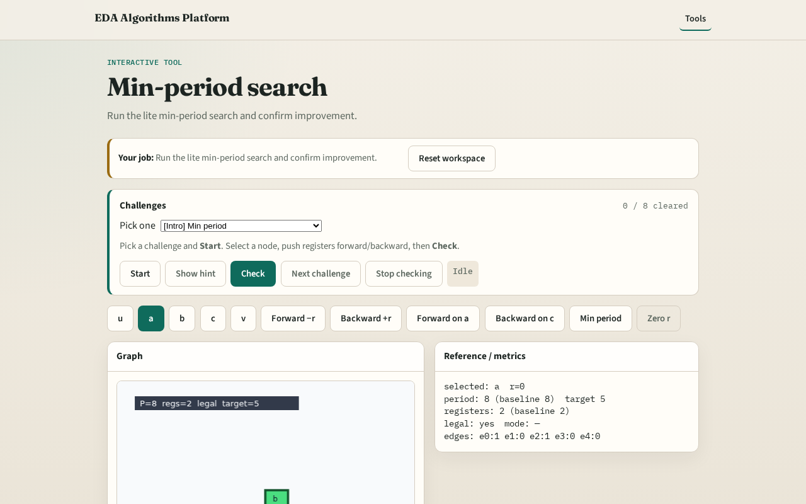

# Min period

Search a small candidate set of retimings , not full WD/FEAS , and pick the smallest legal period

---

## The idea
- Candidates include r=0, forward on a/b, backward on c; best is forward on a with period 5

---

## Try candidates

---

## Best P=5

---

## Improved

---

## Cost registers

---

## Sequential API

---

## Browser lab track

---

## Implement track
- Call min_period_binary_search(DATA); assert period==5 and legal

---

## Pitfalls
- Assuming backward on c helps
- Expecting full LP optimality

---

## Your turn
- Next: register/area tradeoff

