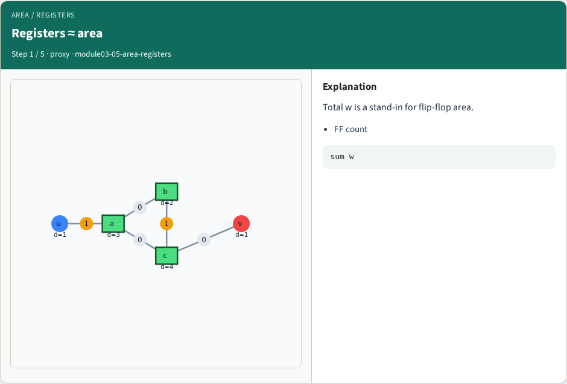
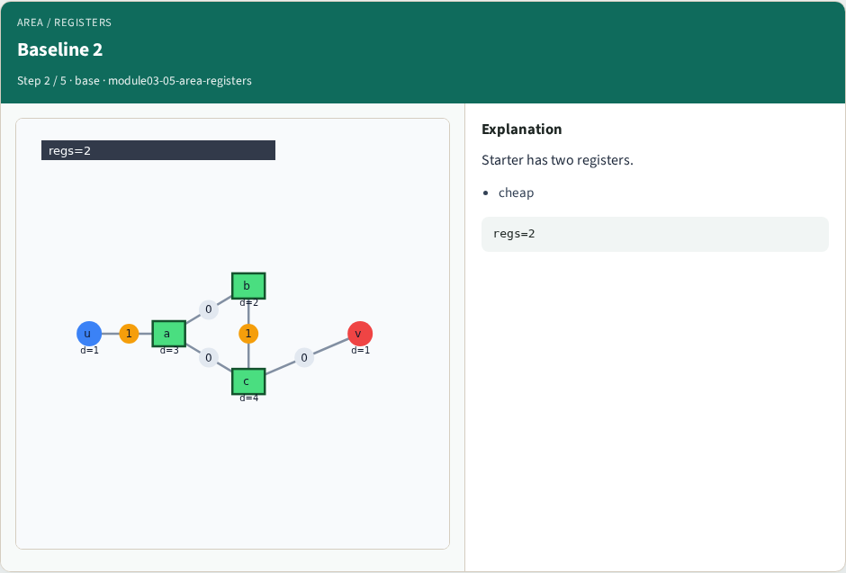
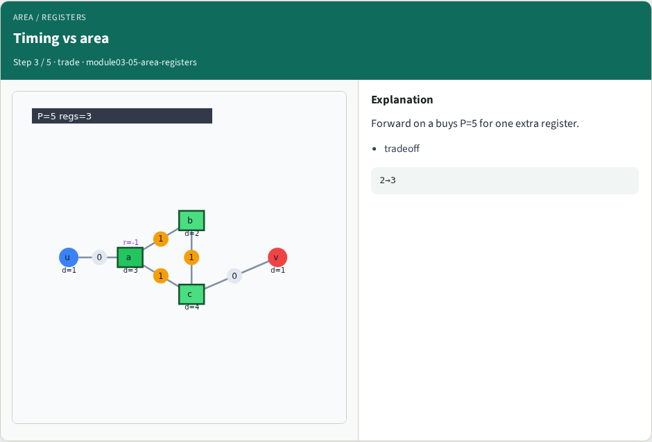
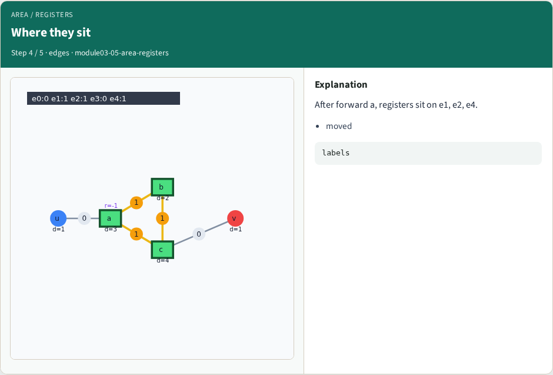
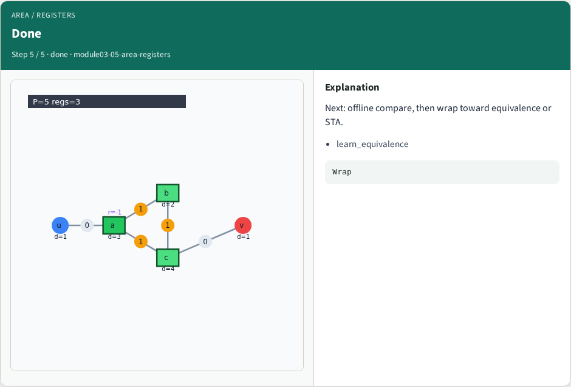
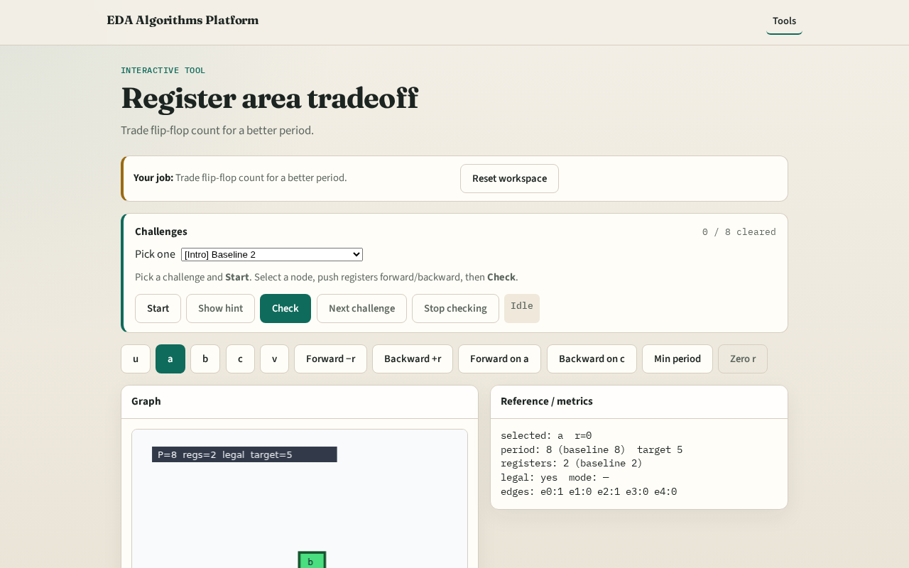

# Area/regs

Retiming trades register area for shorter clock period , same function, different register placement

---

## The idea
- Forward on a

---

## Registers ≈ area

---

## Baseline 2

---

## Timing vs area

---

## Where they sit

---

## Done

---

## Browser lab track

---

## Implement track
- Print register_count at r=0 and after forward on a (2 vs 3)

---

## Pitfalls
- Assuming retiming always reduces registers
- Ignoring period when counting area

---

## Your turn
- Next: offline benchmark, then wrap

