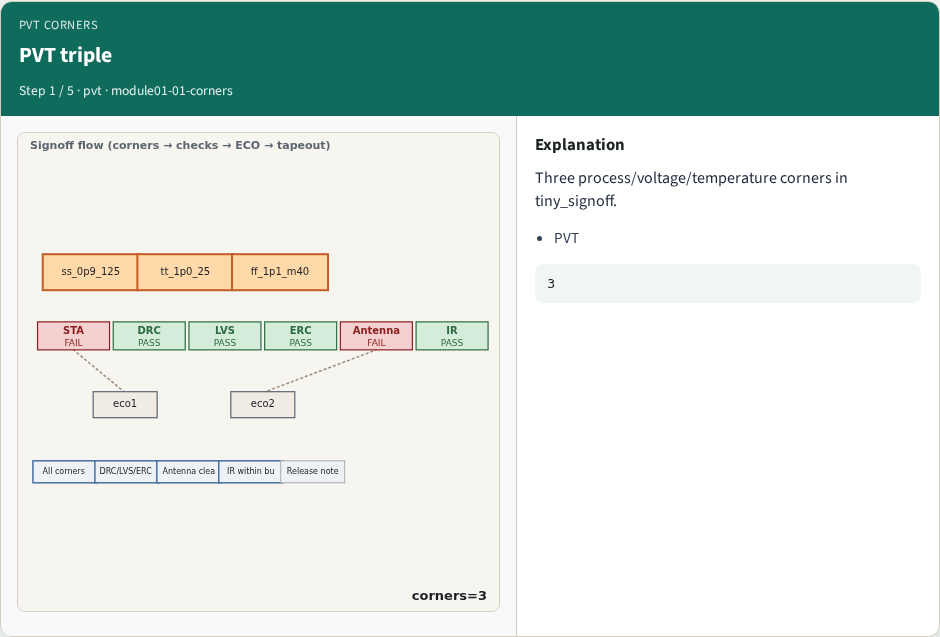
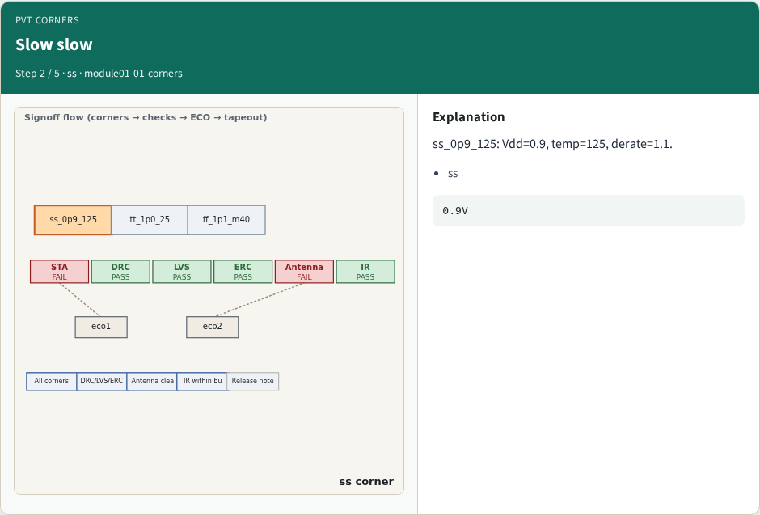
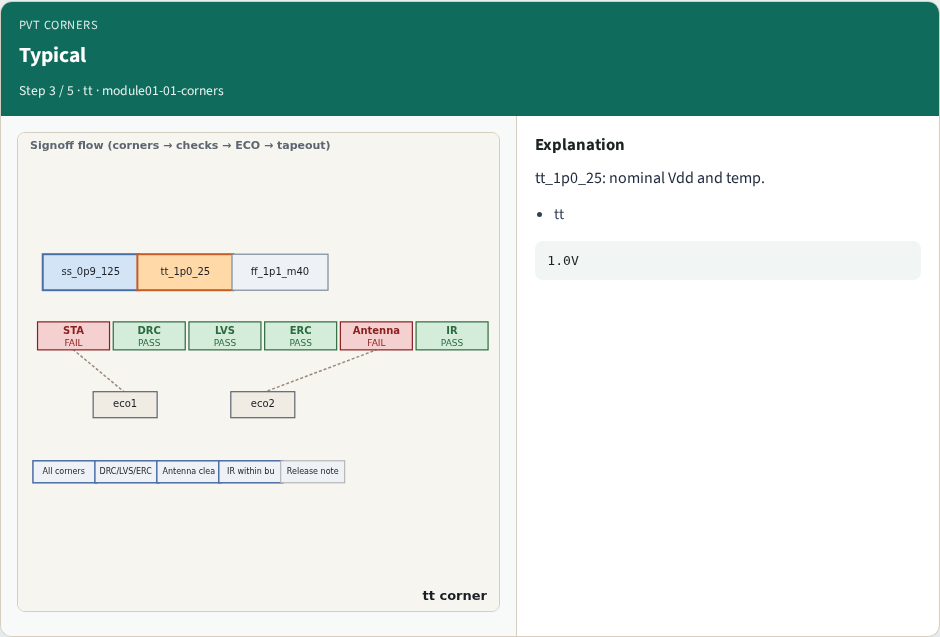
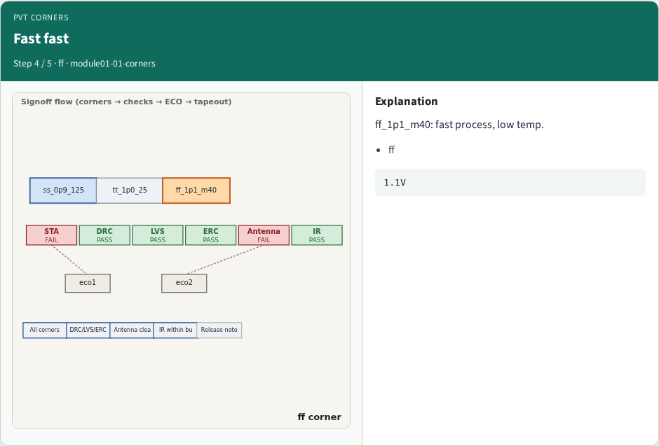
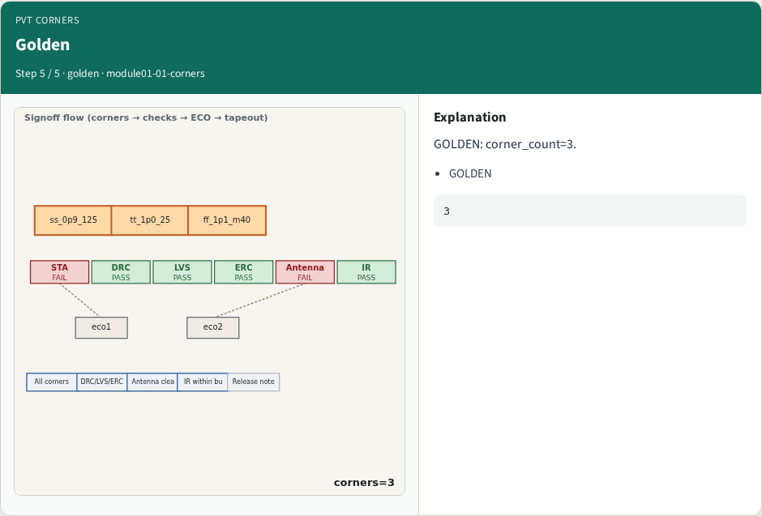
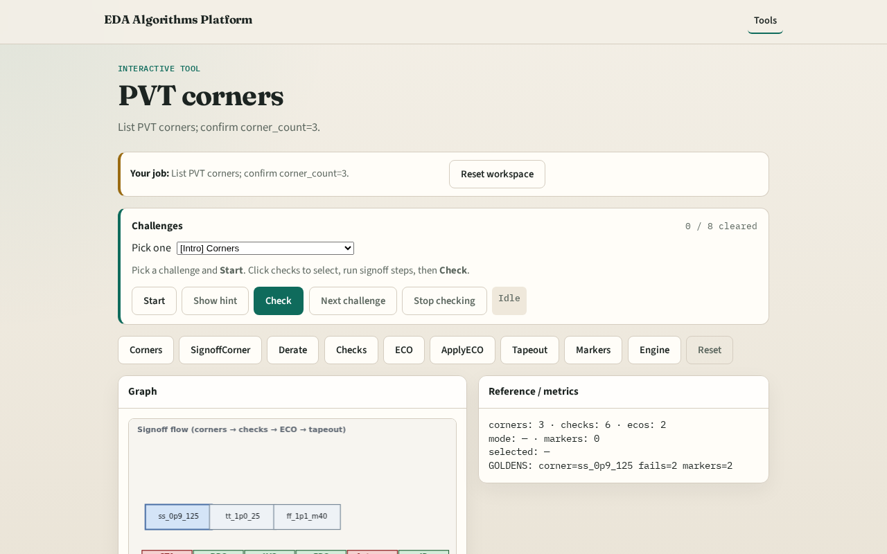

# PVT corners

**Module id:** module01-01-corners
**Lab:** corners
**Tracks:** A (implement) · B (browser lab)

## Slide 1 — Why corners

Signoff starts from a small set of process/voltage/temperature corners.

## Slide 2 — The idea

GOLDEN: corner_count=3.

<!-- algorithm-walkthrough -->

## Slide 3 — PVT triple

Three process/voltage/temperature corners in tiny_signoff.

## Slide 4 — Slow slow

ss_0p9_125: Vdd=0.9, temp=125, derate=1.1.

## Slide 5 — Typical

tt_1p0_25: nominal Vdd and temp.

## Slide 6 — Fast fast

ff_1p1_m40: fast process, low temp.

## Slide 7 — Golden

GOLDEN: corner_count=3.

<!-- /algorithm-walkthrough -->

## Slide 8 — Browser lab track

Open **corners**. Inspect tiny_signoff; confirm 3 corners.

## Slide 9 — Implement track

Call list_corners(); assert count==3.

## Slide 10 — Pitfalls

Confusing signoff corner with full MCMM. Missing derate field.

## Slide 11 — Your turn

Next: pick signoff corner.
