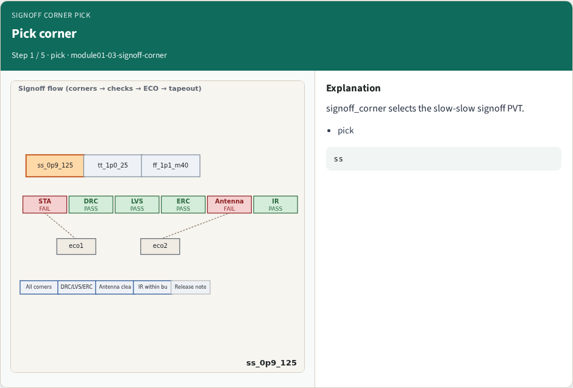
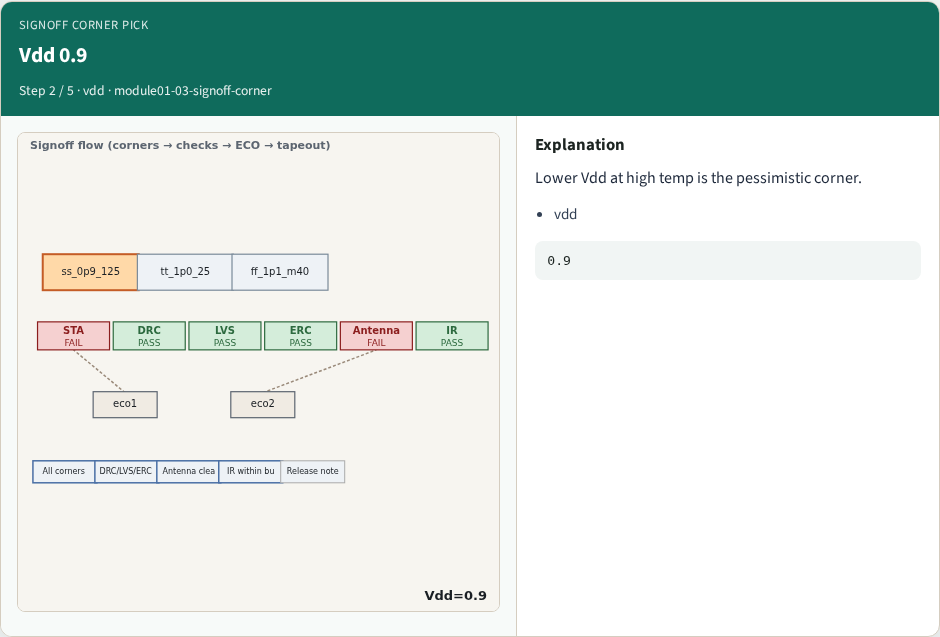
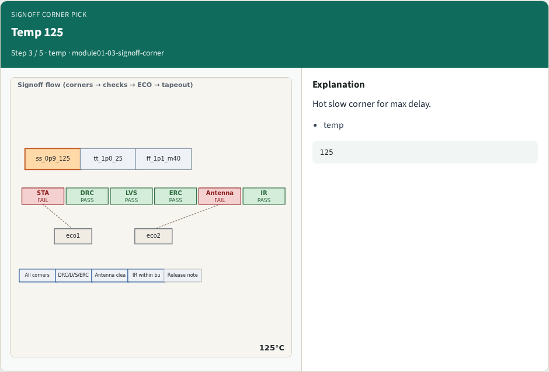
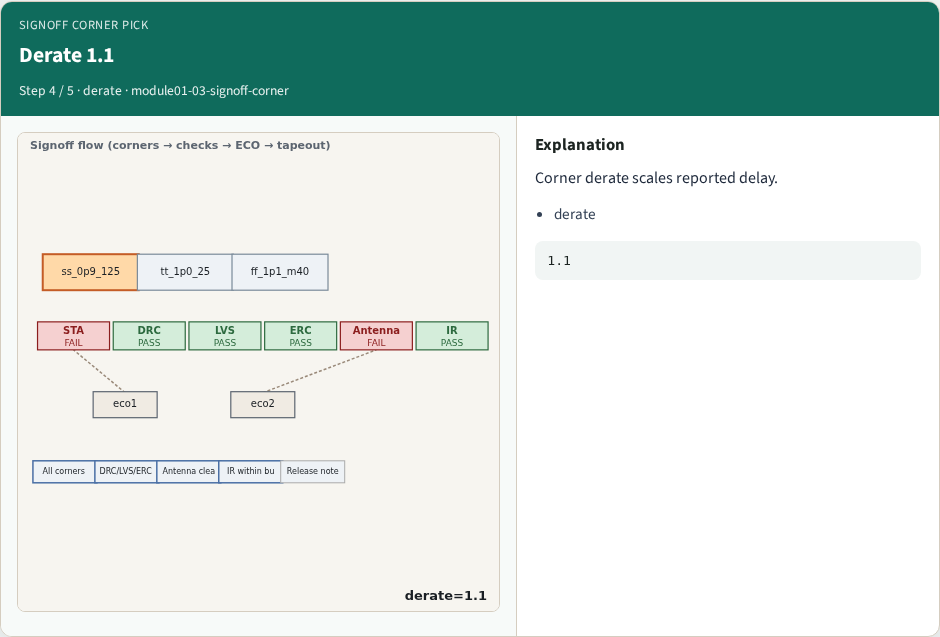
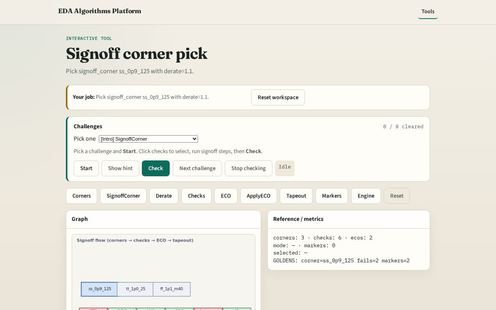

# Why signoff corner

The slow-slow hot corner is the pessimistic signoff PVT for delay

---

## The idea
- GOLDEN: signoff_corner=ss_0p9_125, derate=1.1

---

## Pick corner

---

## Vdd 0.9

---

## Temp 125

---

## Derate 1.1

---

## Golden

---

## Browser lab track

---

## Implement track
- Call pick_signoff_corner(); assert id and derate match goldens

---

## Pitfalls
- Using tt for signoff
- Ignoring derate on ss

---

## Your turn
- Next: apply derate

