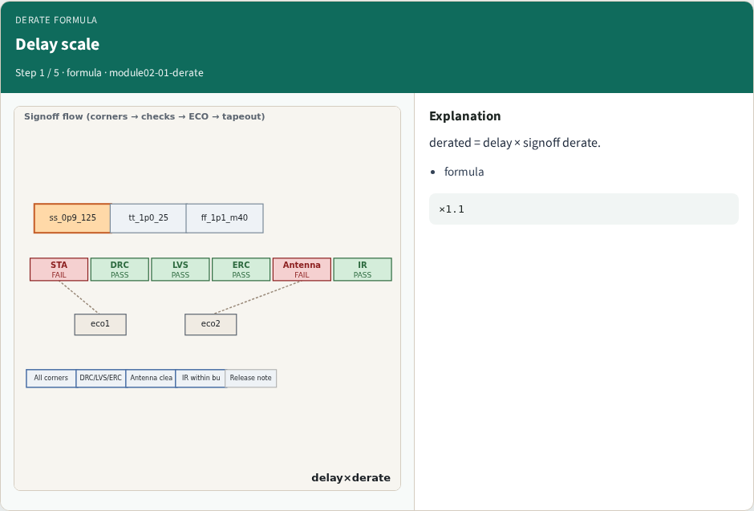
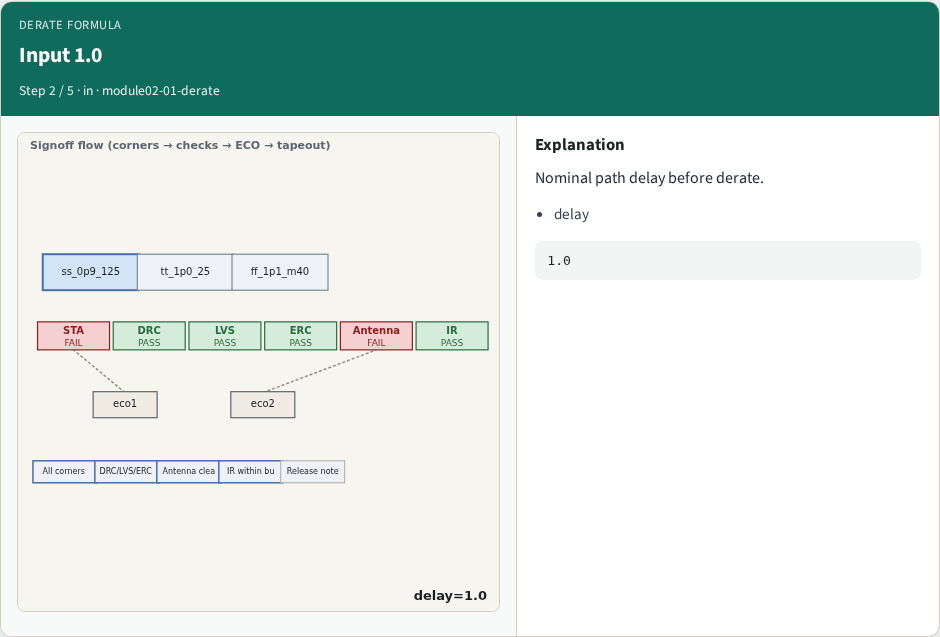
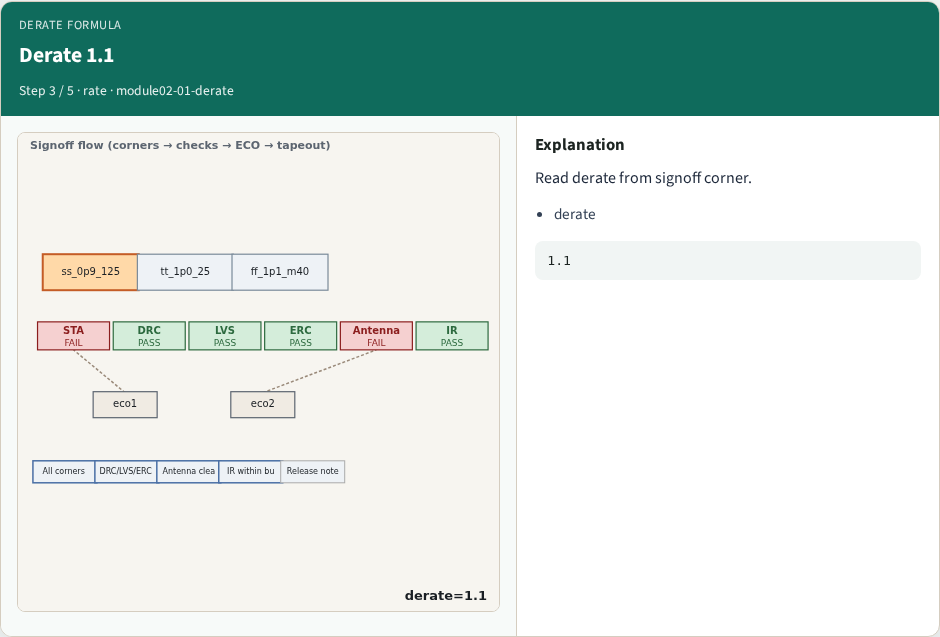
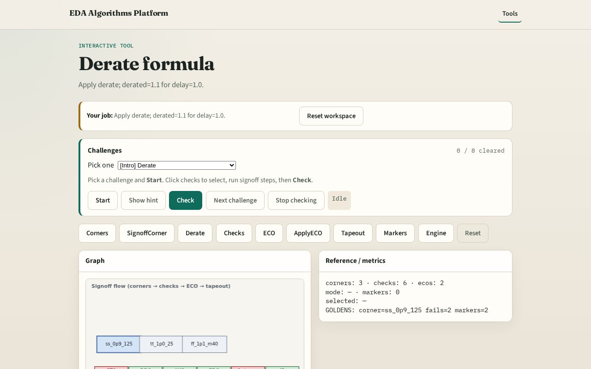

# Why derate

Reported path delay scales by the signoff corner derate

---

## The idea
- GOLDEN: derated=1.1 for delay=1.0

---

## Delay scale

---

## Input 1.0

---

## Derate 1.1

---

## Result 1.1

---

## Golden

---

## Browser lab track

---

## Implement track
- Call apply_derate(1.0); assert derated==1.1

---

## Pitfalls
- Using wrong corner derate
- Forgetting multiply order

---

## Your turn
- Next: check suite

