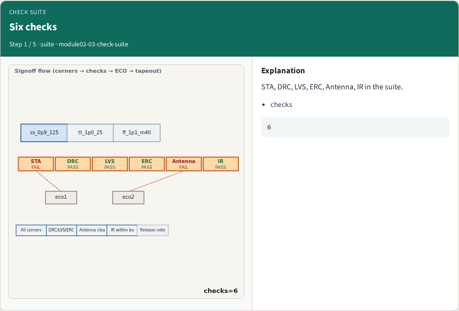
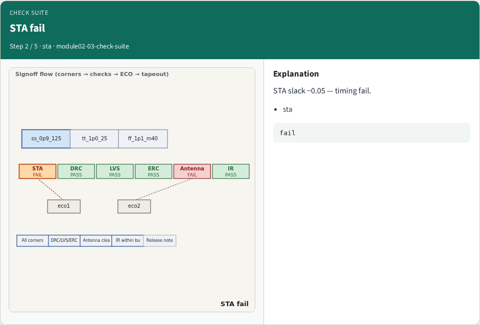
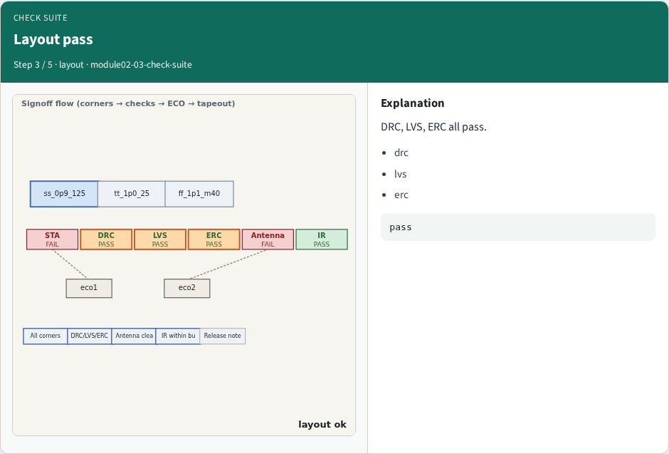
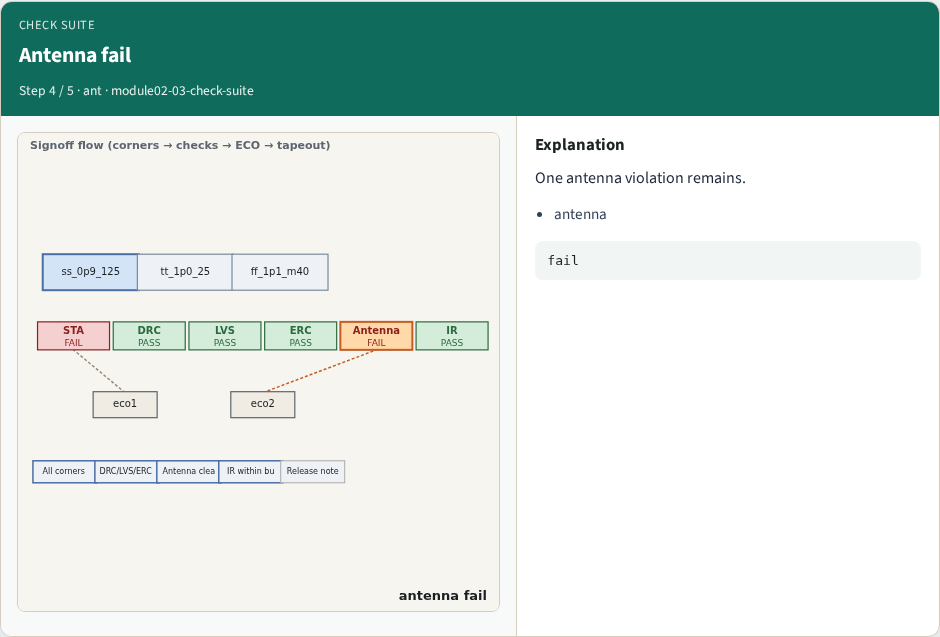
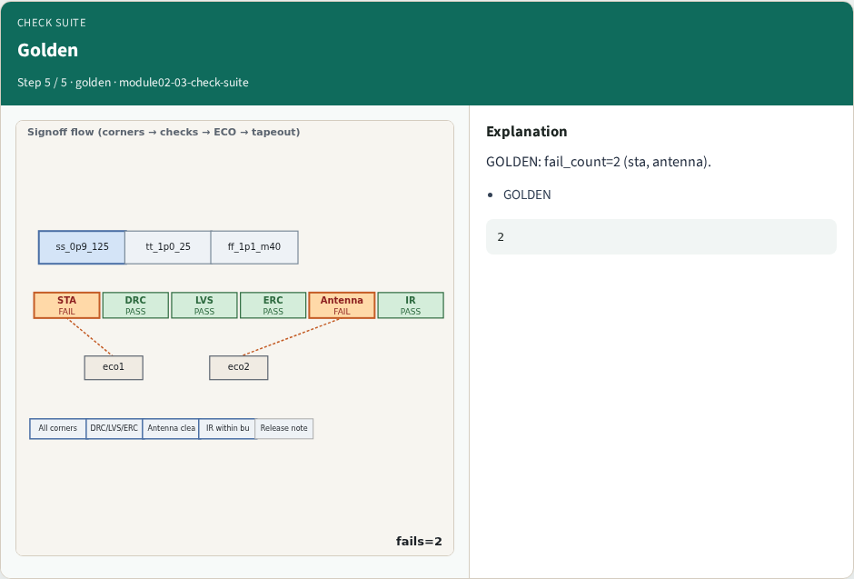
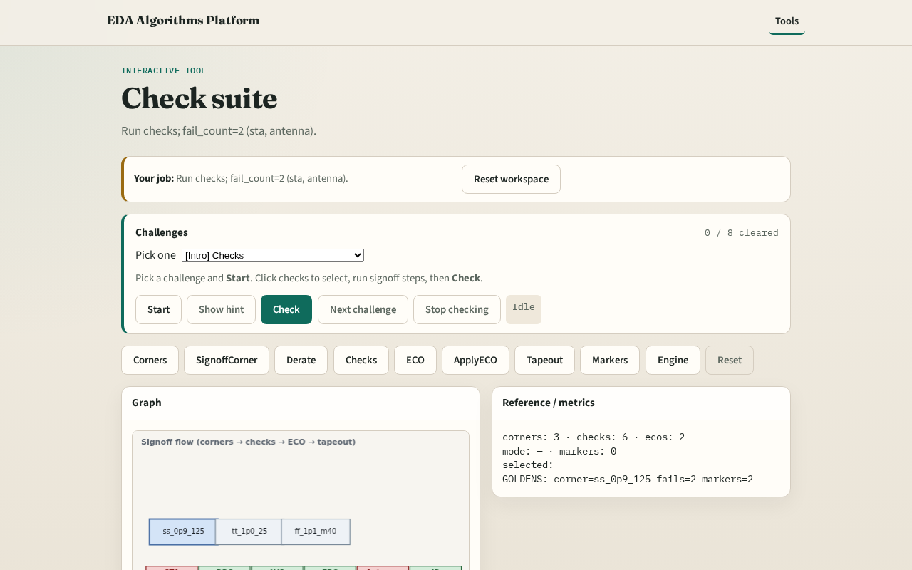

# Why check suite

STA, DRC, LVS, ERC, antenna, and IR form the toy check suite

---

## The idea
- GOLDEN: fail_count=2, pass_count=4

---

## Six checks

---

## STA fail

---

## Layout pass

---

## Antenna fail

---

## Golden

---

## Browser lab track

---

## Implement track
- Call run_checks(); assert fail_count==2 and pass_count==4

---

## Pitfalls
- Counting IR as fail
- Missing antenna in fail set

---

## Your turn
- Next: ECO loop

