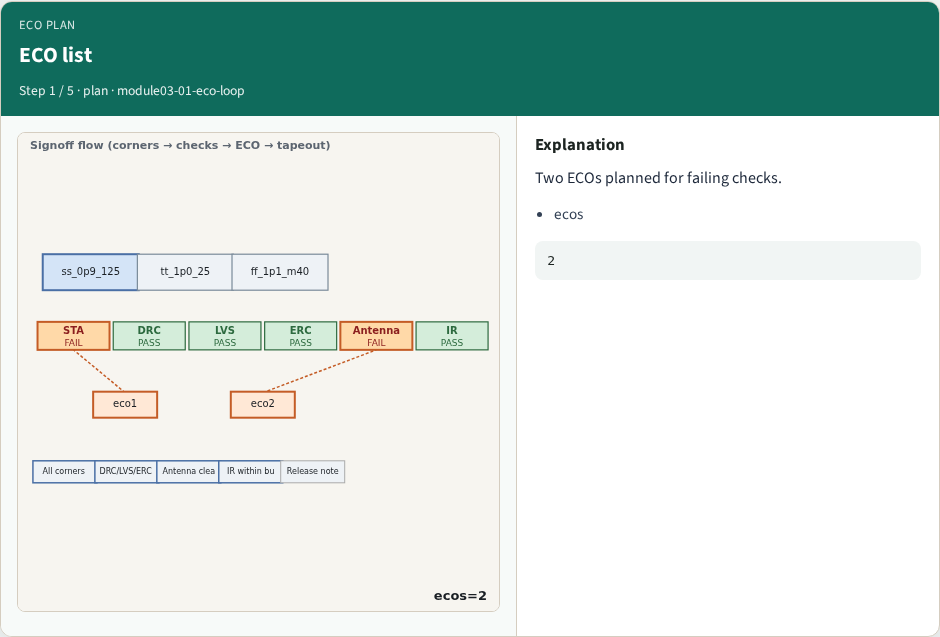
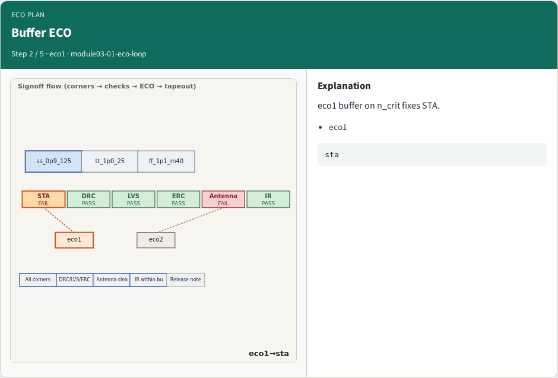
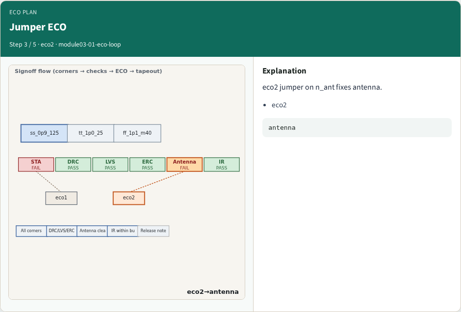
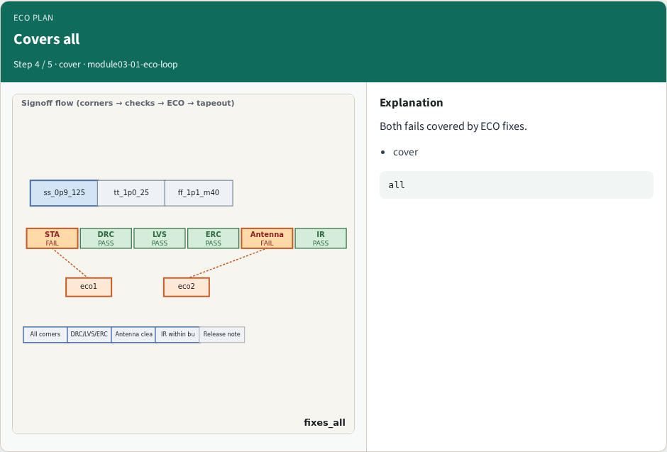
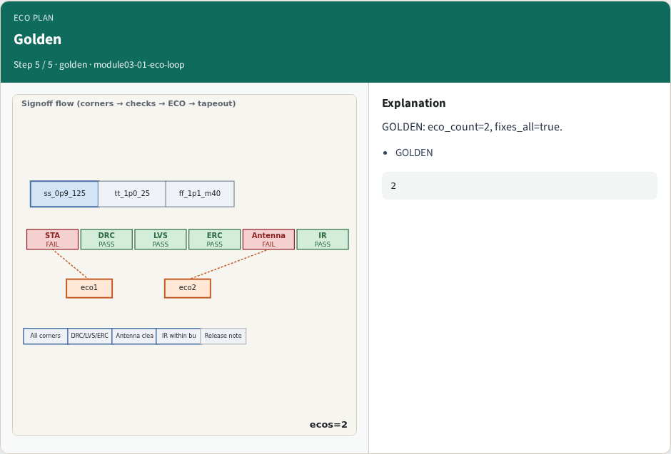
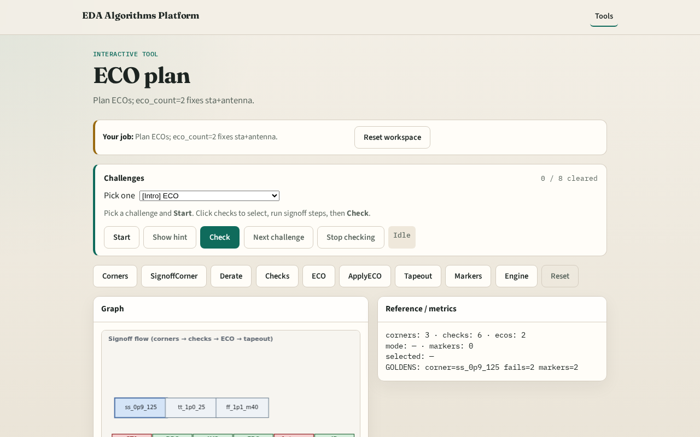

# Why ECO loop

Engineering change orders map fixes to failing checks

---

## The idea
- GOLDEN: eco_count=2, fixes_all=true

---

## ECO list

---

## Buffer ECO

---

## Jumper ECO

---

## Covers all

---

## Golden

---

## Browser lab track

---

## Implement track
- Call eco_plan(); assert eco_count==2 and fixes_all

---

## Pitfalls
- ECO missing a fail
- Double-counting ECOs

---

## Your turn
- Next: apply ECOs

