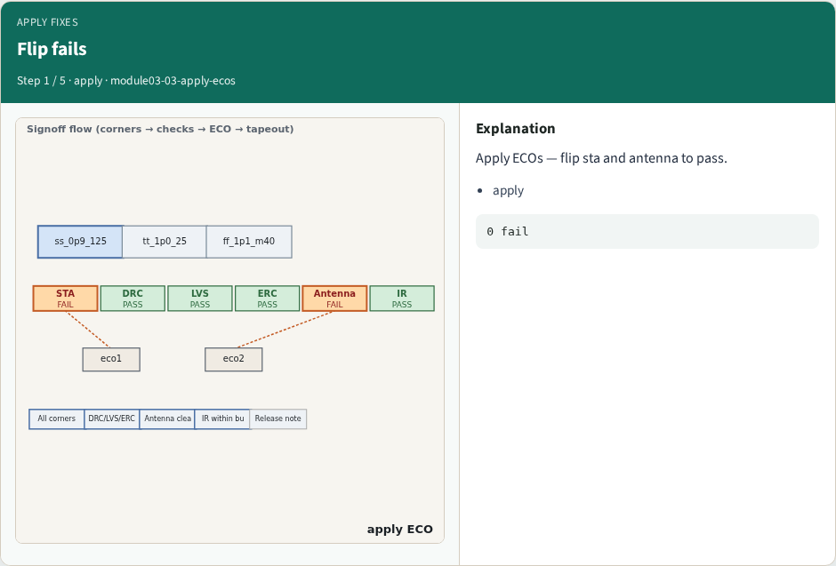
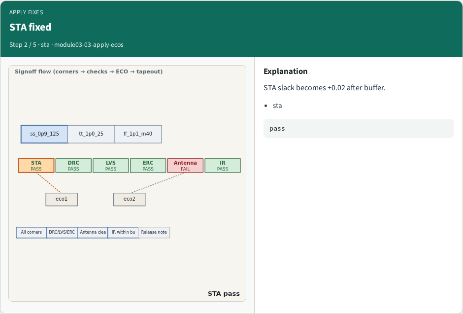
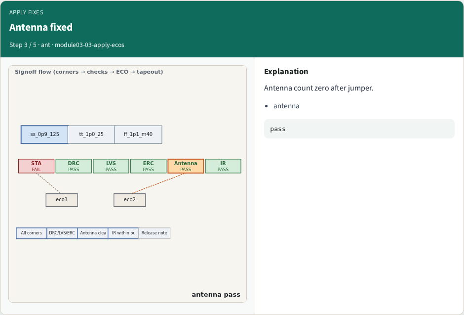
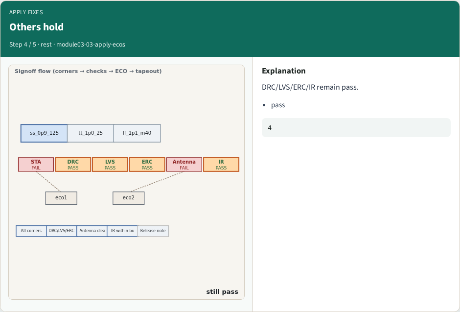
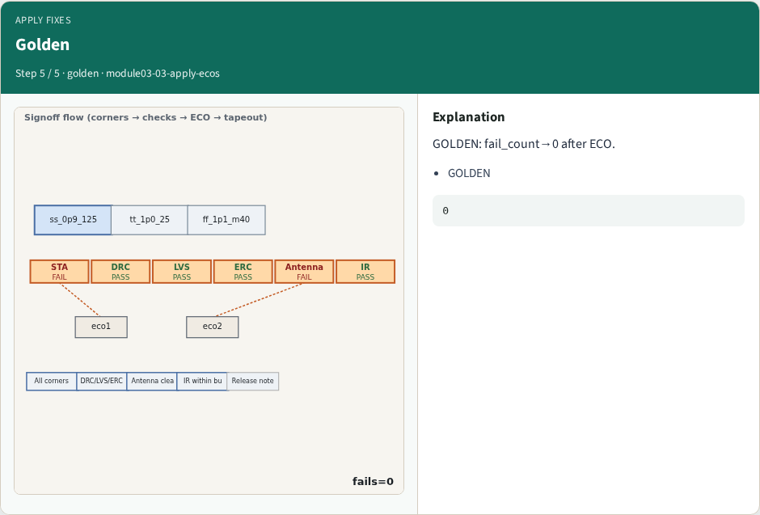
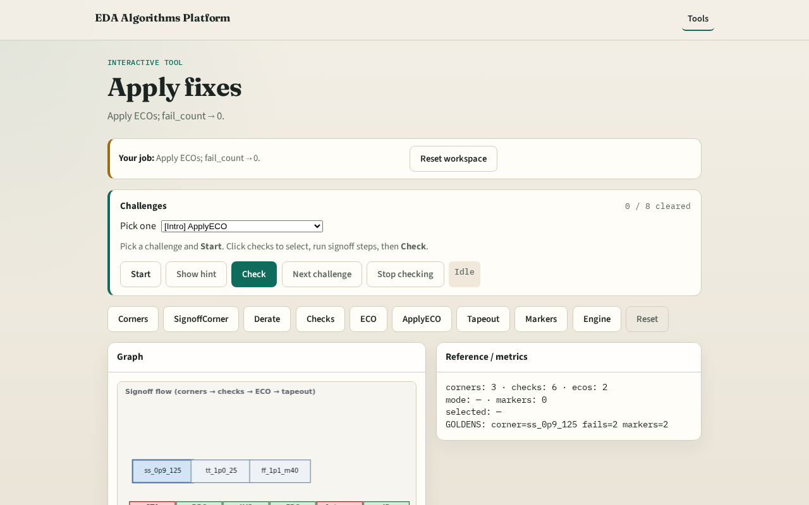

# Apply fixes

**Module id:** module03-03-apply-ecos
**Lab:** apply-ecos
**Tracks:** A (implement) · B (browser lab)

## Slide 1 — Why apply ECOs

Applying ECOs flips fixed checks from fail to pass.

## Slide 2 — The idea

GOLDEN: fail_count→0 after apply_ecos.

<!-- algorithm-walkthrough -->

## Slide 3 — Flip fails

Apply ECOs — flip sta and antenna to pass.

## Slide 4 — STA fixed

STA slack becomes +0.02 after buffer.

## Slide 5 — Antenna fixed

Antenna count zero after jumper.

## Slide 6 — Others hold

DRC/LVS/ERC/IR remain pass.

## Slide 7 — Golden

GOLDEN: fail_count→0 after ECO.

<!-- /algorithm-walkthrough -->

## Slide 8 — Browser lab track

Open **apply-ecos**. Apply ECOs; confirm fail_count=0.

## Slide 9 — Implement track

Call apply_ecos(); assert fail_count==0.

## Slide 10 — Pitfalls

Applying ECO without updating check status. Partial apply.

## Slide 11 — Your turn

Next: tapeout checklist.
