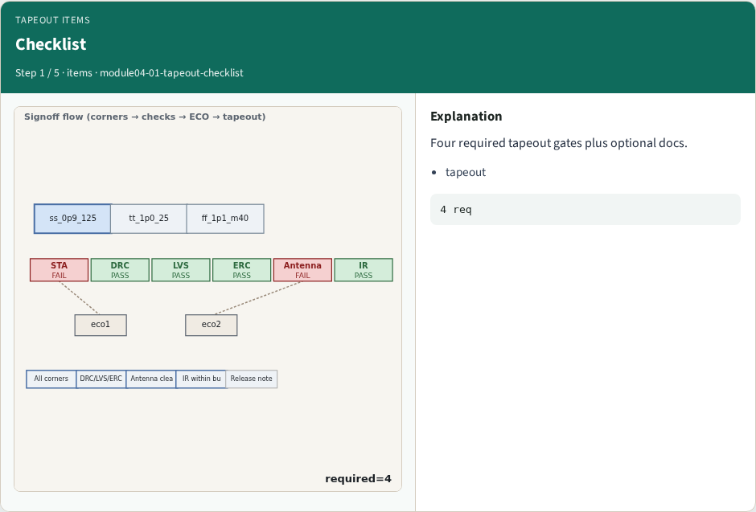
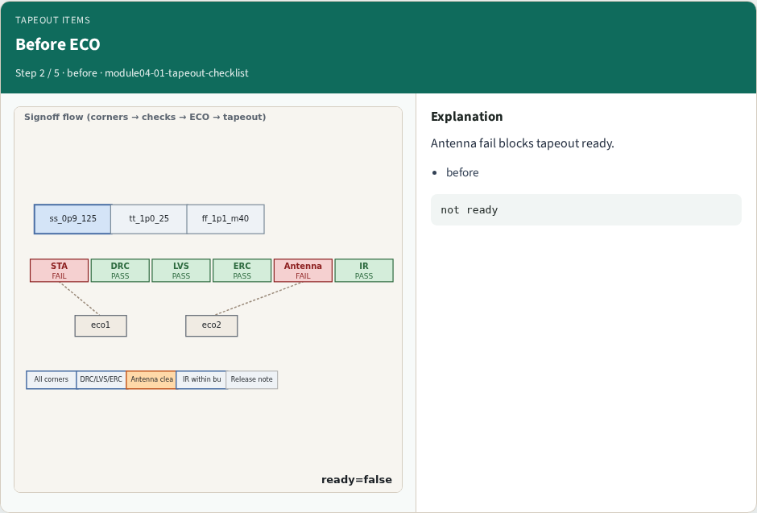
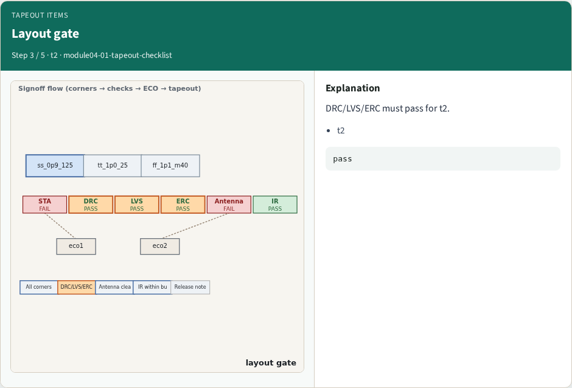
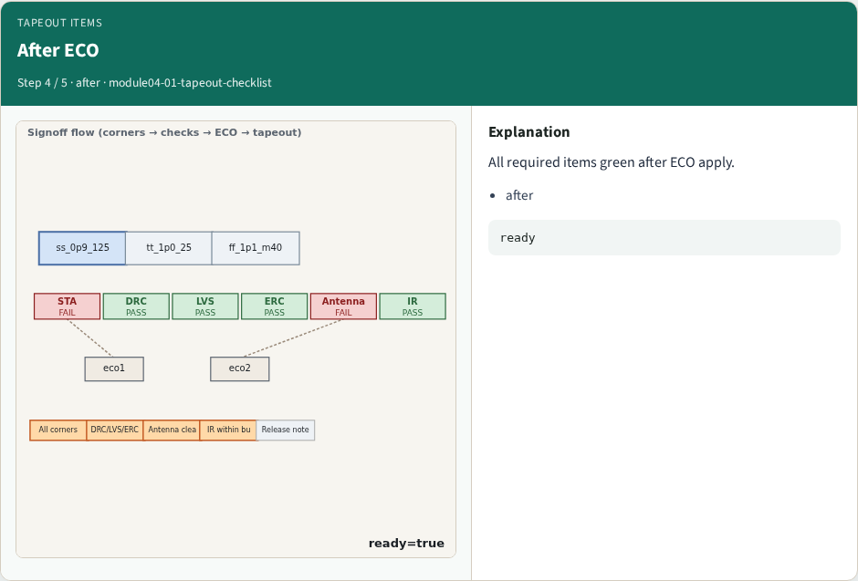
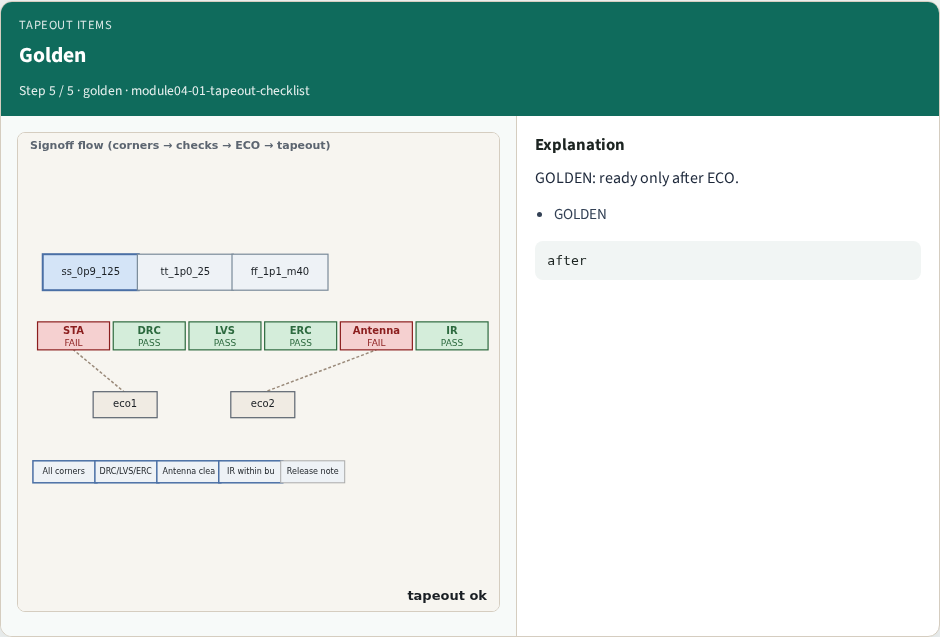
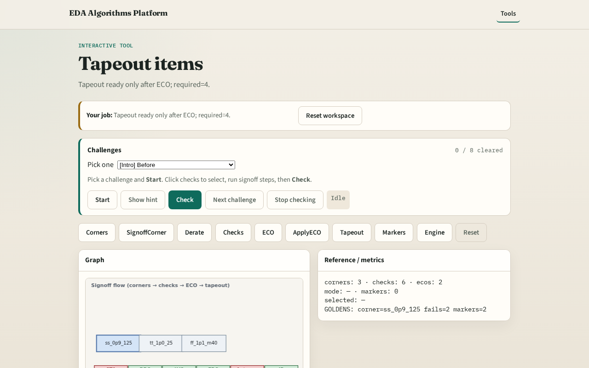

# Tapeout items

**Module id:** module04-01-tapeout-checklist
**Lab:** tapeout-checklist
**Tracks:** A (implement) · B (browser lab)

## Slide 1 — Why tapeout

Required tapeout gates block release until checks are clean.

## Slide 2 — The idea

GOLDEN: ready=false before ECO, ready=true after.

<!-- algorithm-walkthrough -->

## Slide 3 — Checklist

Four required tapeout gates plus optional docs.

## Slide 4 — Before ECO

Antenna fail blocks tapeout ready.

## Slide 5 — Layout gate

DRC/LVS/ERC must pass for t2.

## Slide 6 — After ECO

All required items green after ECO apply.

## Slide 7 — Golden

GOLDEN: ready only after ECO.

<!-- /algorithm-walkthrough -->

## Slide 8 — Browser lab track

Open **tapeout-checklist**. Compare before/after ECO ready flags.

## Slide 9 — Implement track

Call tapeout_checklist(after_eco=False/True); assert ready flags.

## Slide 10 — Pitfalls

Ignoring optional vs required. Checking before ECO only.

## Slide 11 — Your turn

Next: signoff markers.
