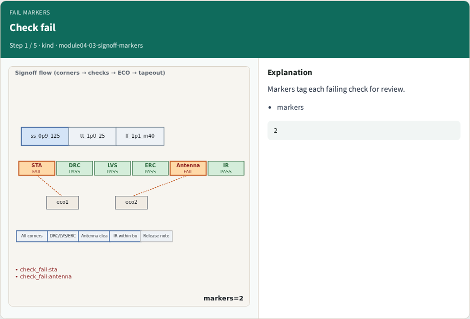
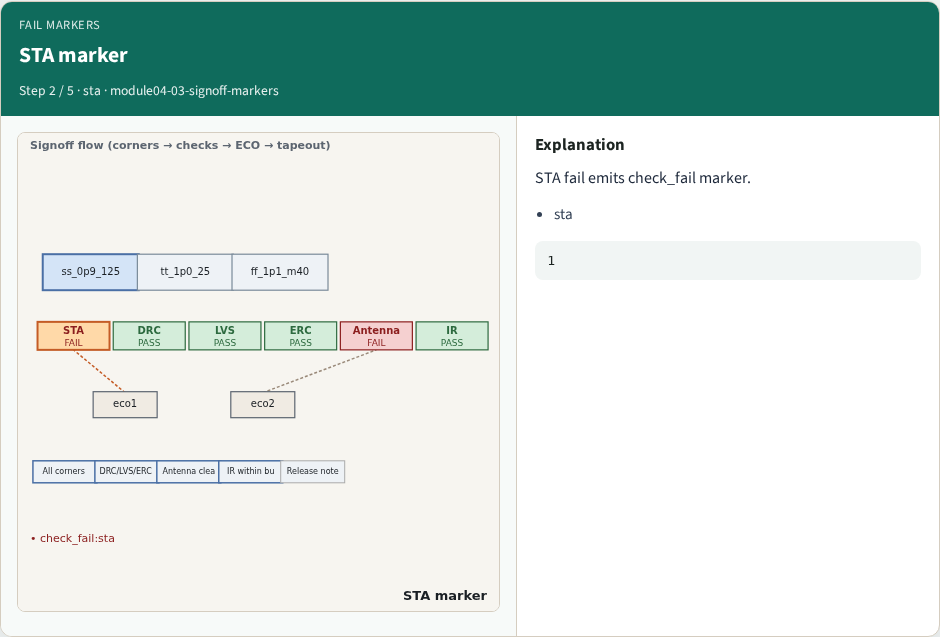
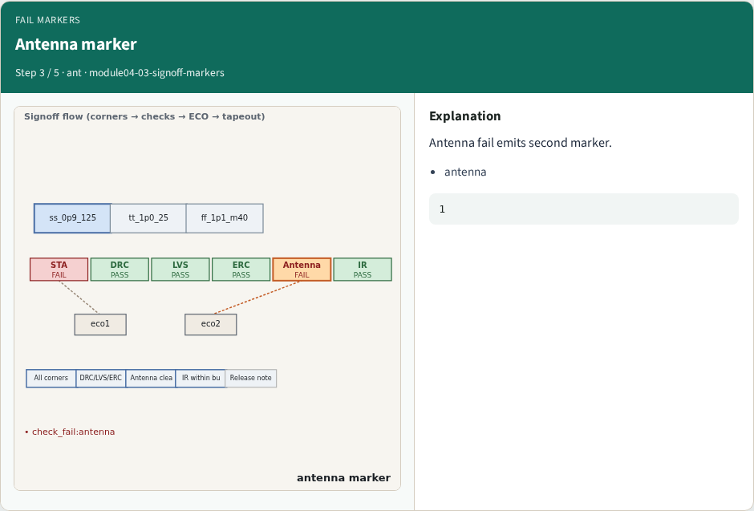
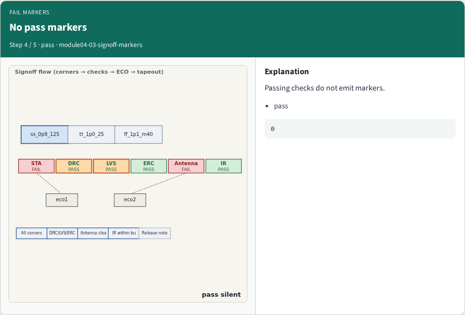
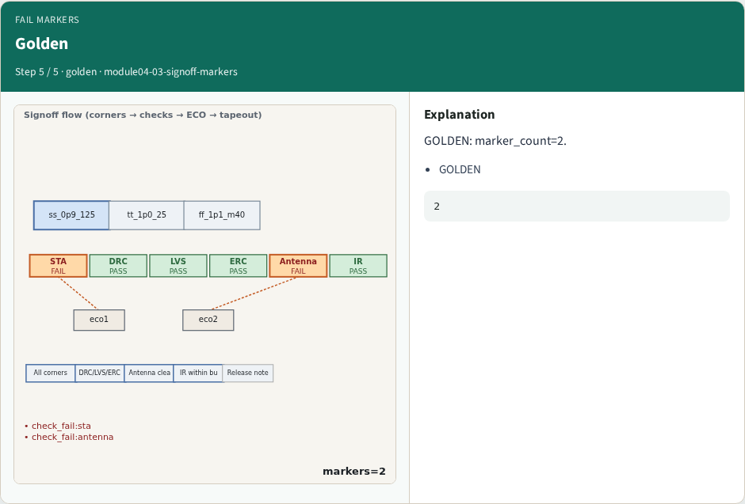
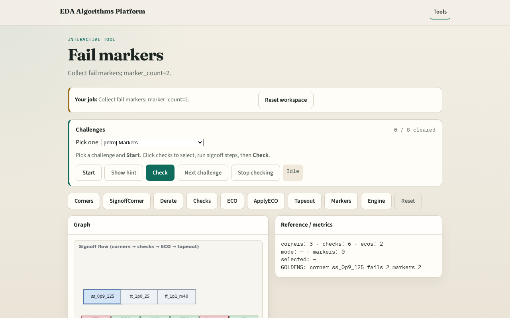

# Fail markers

**Module id:** module04-03-signoff-markers
**Lab:** signoff-markers
**Tracks:** A (implement) · B (browser lab)

## Slide 1 — Why markers

Signoff emits markers for each failing check before ECO.

## Slide 2 — The idea

GOLDEN: marker_count=2.

<!-- algorithm-walkthrough -->

## Slide 3 — Check fail

Markers tag each failing check for review.

## Slide 4 — STA marker

STA fail emits check_fail marker.

## Slide 5 — Antenna marker

Antenna fail emits second marker.

## Slide 6 — No pass markers

Passing checks do not emit markers.

## Slide 7 — Golden

GOLDEN: marker_count=2.

<!-- /algorithm-walkthrough -->

## Slide 8 — Browser lab track

Open **signoff-markers**. Run collect; confirm 2 markers.

## Slide 9 — Implement track

Call collect_markers(); assert count==2.

## Slide 10 — Pitfalls

Counting pass checks. Markers after ECO without reset.

## Slide 11 — Your turn

Next: signoff engine.
