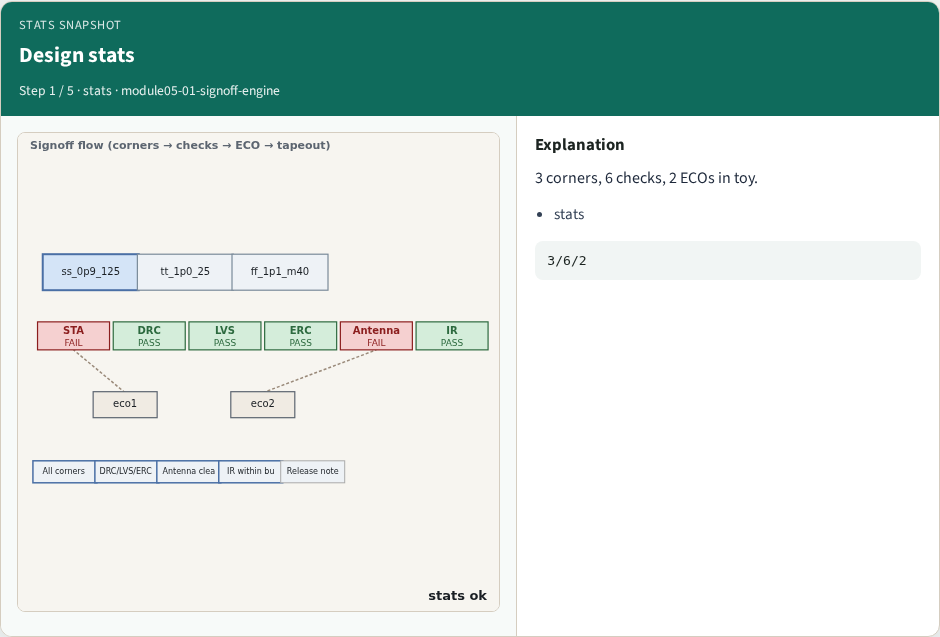
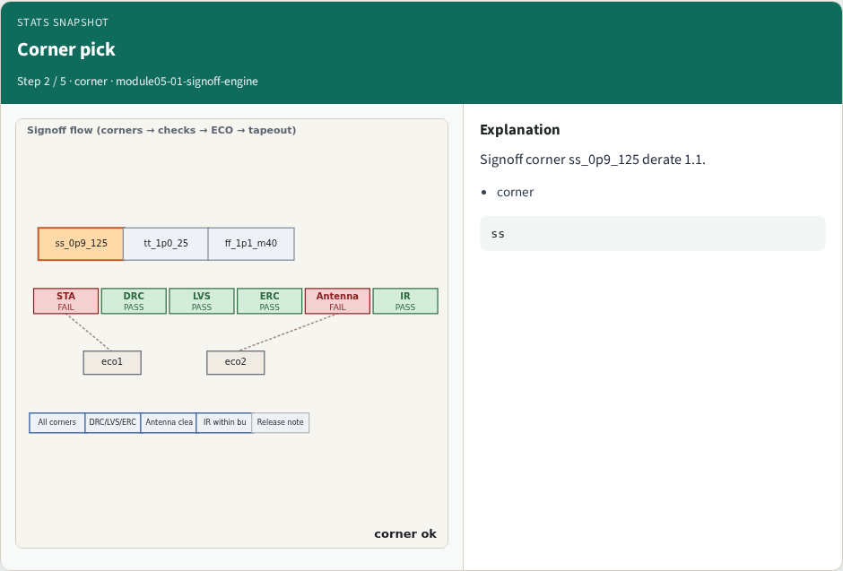
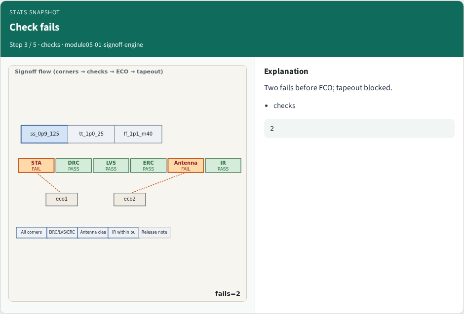
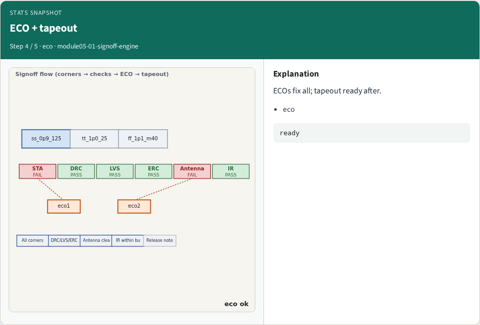
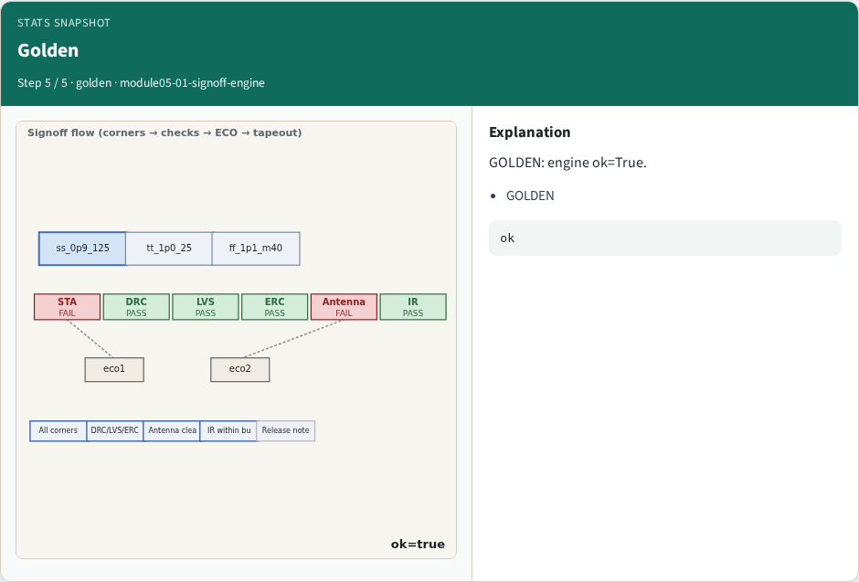
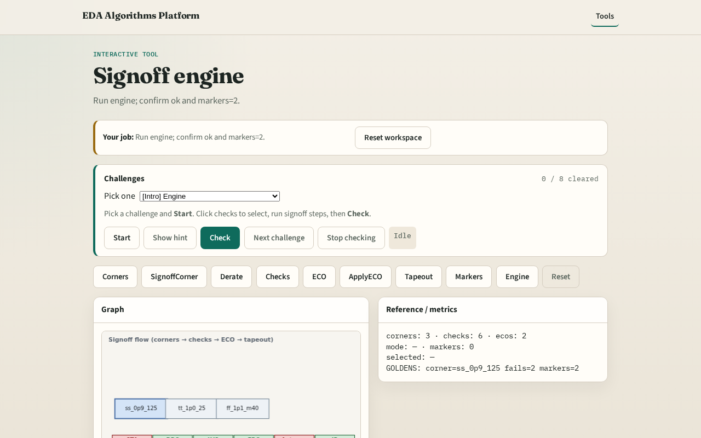

# Engine

A tiny engine chains corners, checks, ECO, tapeout, and markers

---

## The idea
- GOLDEN: corners=3, fails=2, ecos=2, markers=2, ok=True

---

## Design stats

---

## Corner pick

---

## Check fails

---

## ECO + tapeout

---

## Golden

---

## Browser lab track

---

## Implement track
- Call signoff_engine(); assert ok and markers.count==2

---

## Pitfalls
- Reporting partial checks
- Changing toy without updating goldens

---

## Your turn
- Next: offline compare, then wrap

