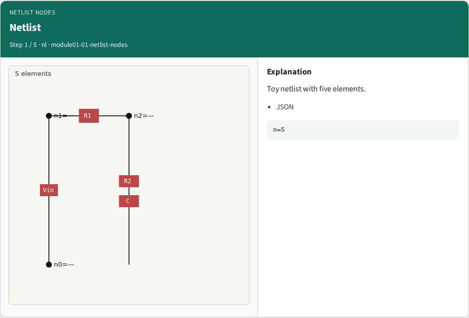
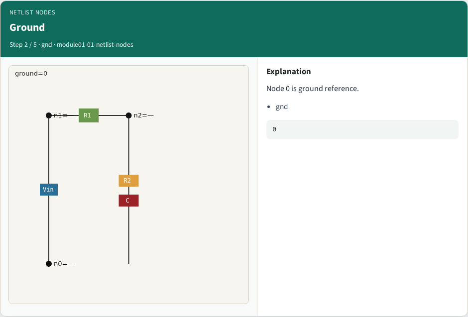
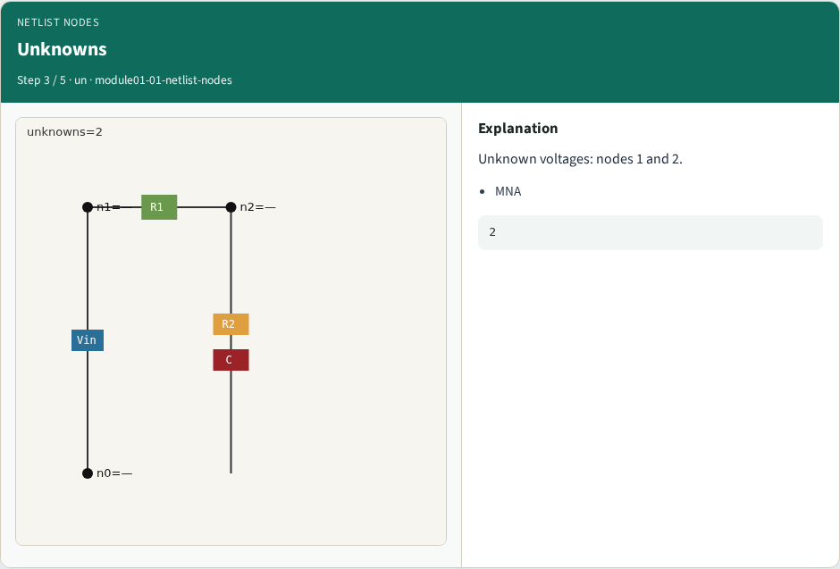
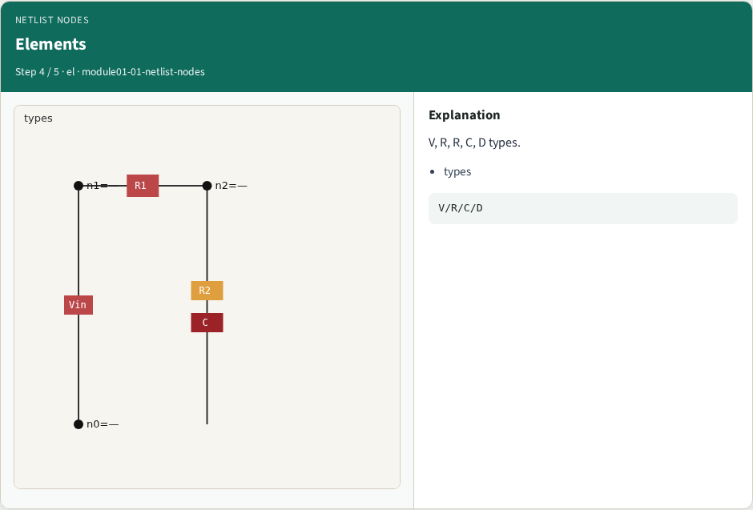
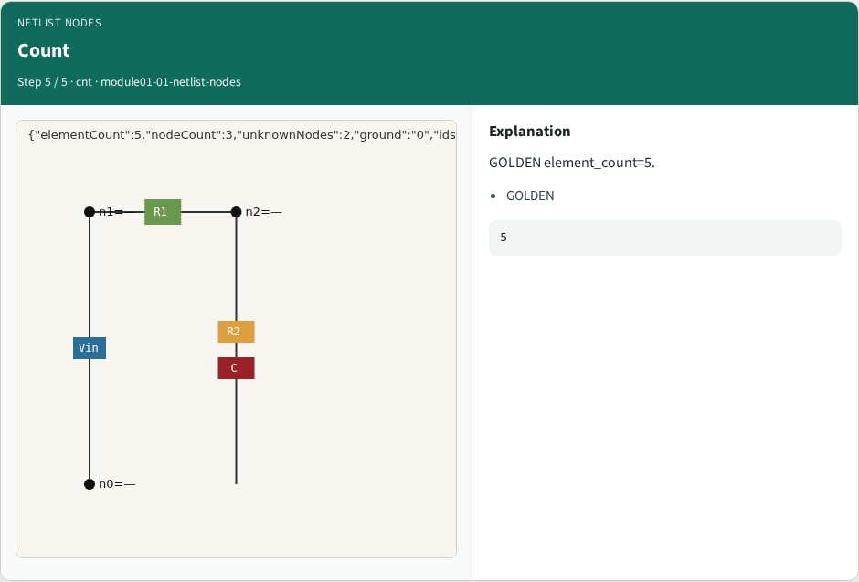
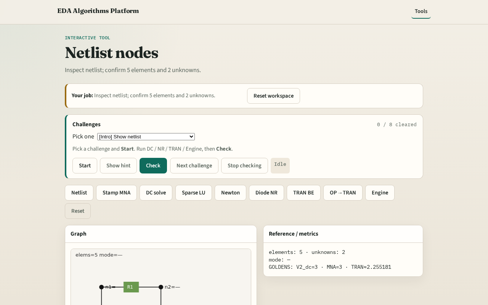

# Why netlists

Every SPICE solve starts from a netlist , nodes, elements, and a ground reference

---

## The idea
- GOLDEN: 5 elements, 2 unknown nodes (1, 2), ground 0

---

## Netlist

---

## Ground

---

## Unknowns

---

## Elements

---

## Count

---

## Browser lab track

---

## Implement track
- Call netlist_stats(); assert element_count==5, unknown_nodes==2, ground=='0'

---

## Pitfalls
- Counting ground as unknown
- Ignoring element ids vs node names

---

## Your turn
- Next: stamp R and V into MNA

