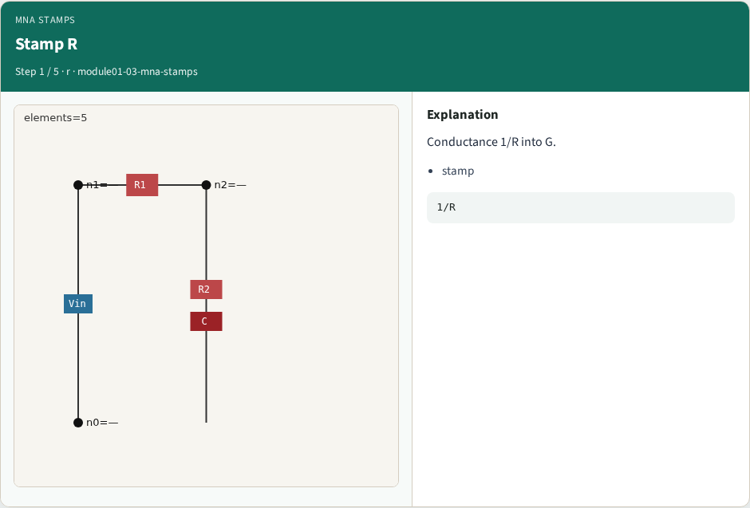
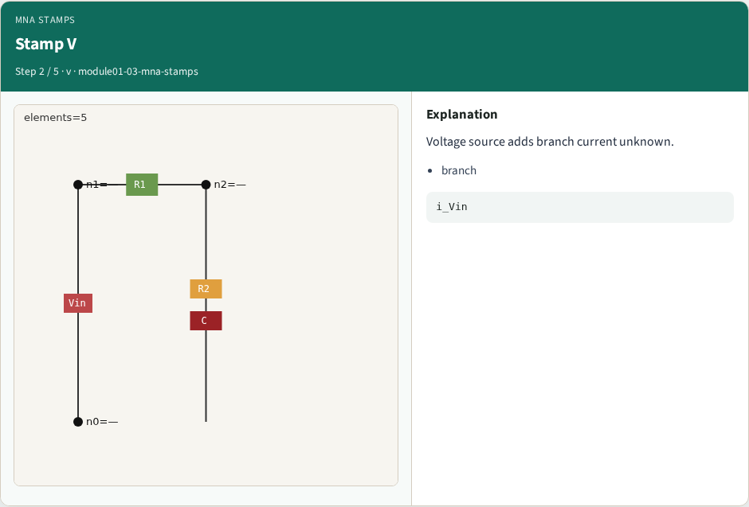
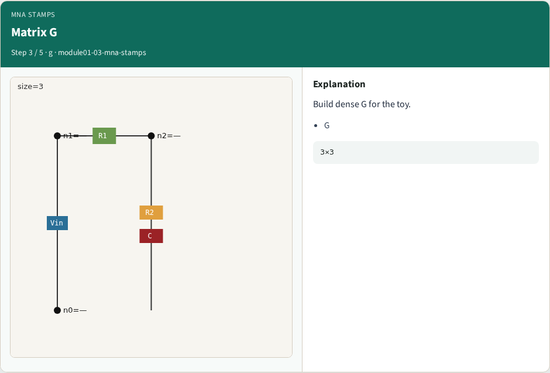
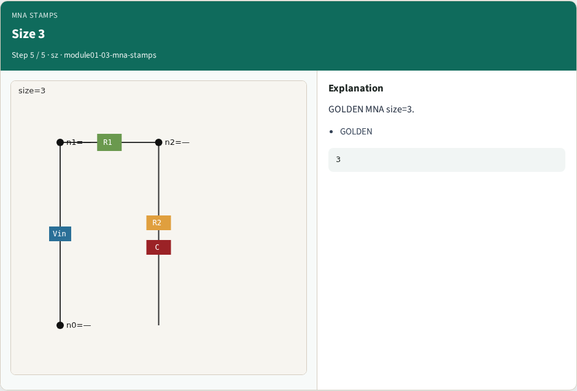

# MNA stamping (R and V) — step-by-step (for slides / transcript)

**Module:** `module01-03-mna-stamps`  
**Lab / algo:** `mna-stamps`  
**Viewer:** `/tools/algorithm-walkthrough/?algo=mna-stamps&step=1`

Use each **Caption** as spoken prose (or a shortened slide note).
Use **Bullets** on the PPT; pair with the PNG in `assets/steps/`.

## Step 1 — Stamp R



**Caption (transcript):** Conductance 1/R into G.

**Slide bullets:**

- stamp

**On-screen metrics:**

```
1/R
```

## Step 2 — Stamp V



**Caption (transcript):** Voltage source adds branch current unknown.

**Slide bullets:**

- branch

**On-screen metrics:**

```
i_Vin
```

## Step 3 — Matrix G



**Caption (transcript):** Build dense G for the toy.

**Slide bullets:**

- G

**On-screen metrics:**

```
3×3
```

## Step 4 — RHS b


**Caption (transcript):** RHS holds source values.

**Slide bullets:**

- b

**On-screen metrics:**

```
Vin.dc
```

## Step 5 — Size 3



**Caption (transcript):** GOLDEN MNA size=3.

**Slide bullets:**

- GOLDEN

**On-screen metrics:**

```
3
```

