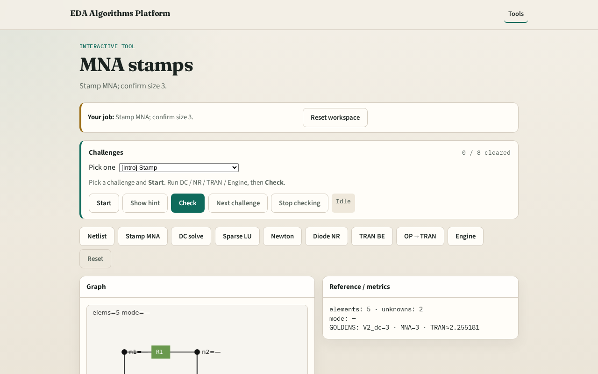

# Why MNA

Modified nodal analysis builds G and b by stamping each element into a shared matrix

---

## The idea
- GOLDEN: mna size 3 , unknowns v1, v2, branch current i_Vin

---

## Stamp R

---

## Stamp V

---

## Matrix G

---

## RHS b

---

## Size 3

---

## Browser lab track

---

## Implement track
- Call build_mna_linear_dc(); assert size==3

---

## Pitfalls
- Forgetting voltage-source branch currents
- Stamping C or D in linear DC MNA

---

## Your turn
- Next: solve linear DC for V2=3

