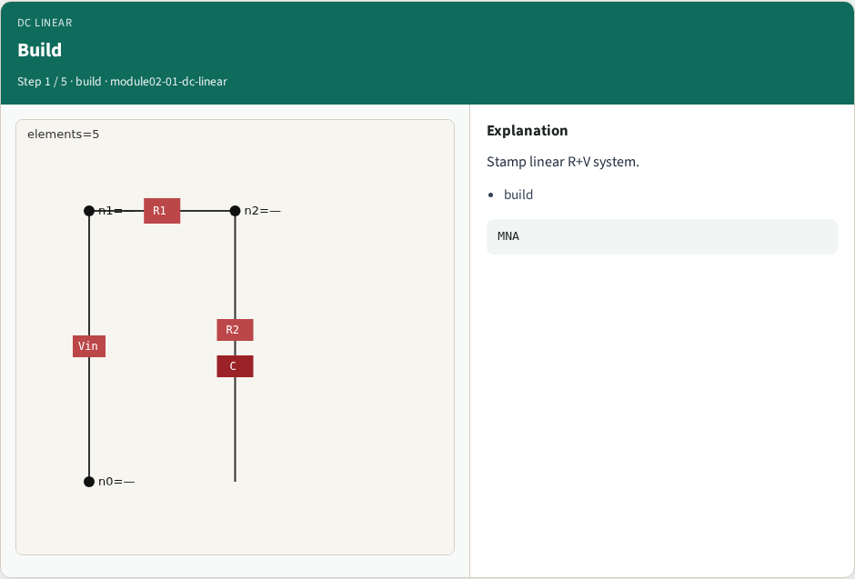
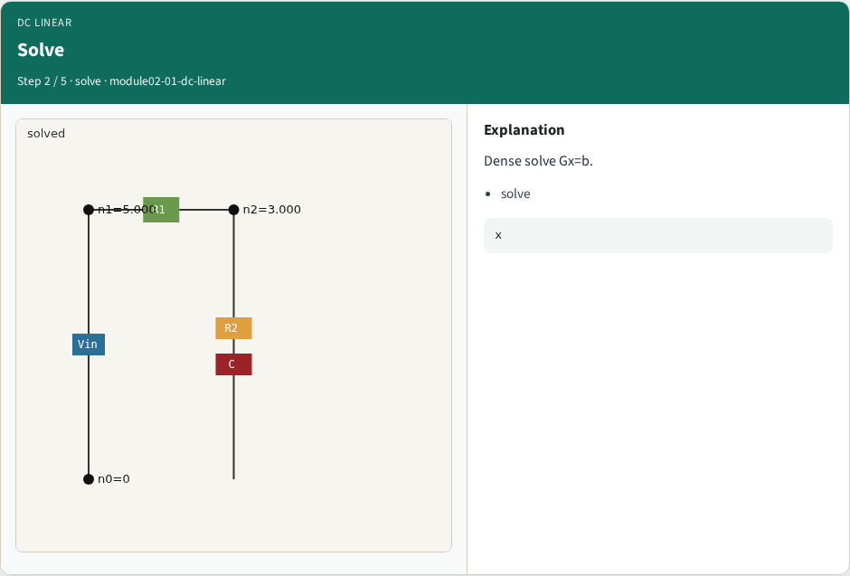
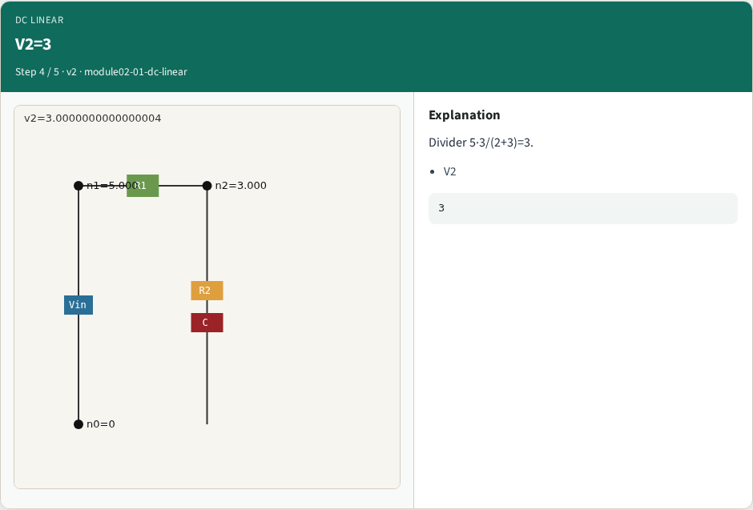
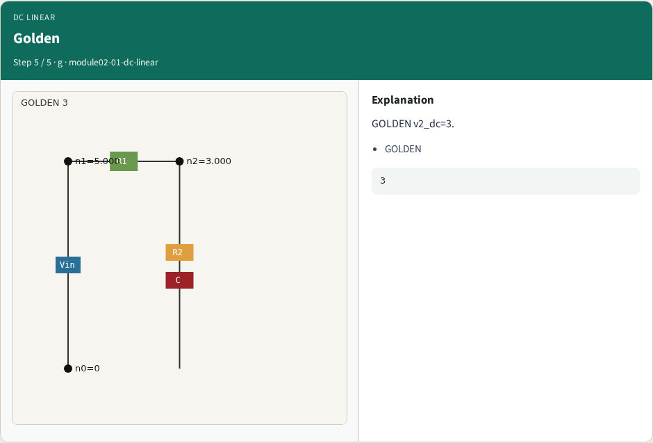

# Why DC

Linear DC finds the operating point before Newton or transient analysis

---

## The idea
- GOLDEN: V1=5.0, V2=3.0 from the divider 5×3/(2+3)

---

## Build

---

## Solve

---

## V1=5

---

## V2=3

---

## Golden

---

## Browser lab track

---

## Implement track
- Call dc_linear_solve(); assert abs(volts['2']-3.0)<1e-9 and volts['1']==5.0

---

## Pitfalls
- Including diode in linear DC
- Wrong divider formula

---

## Your turn
- Next: sparse LU literacy on G

