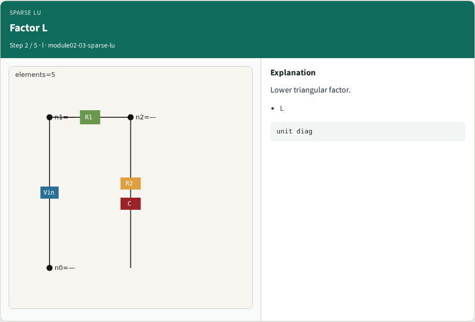
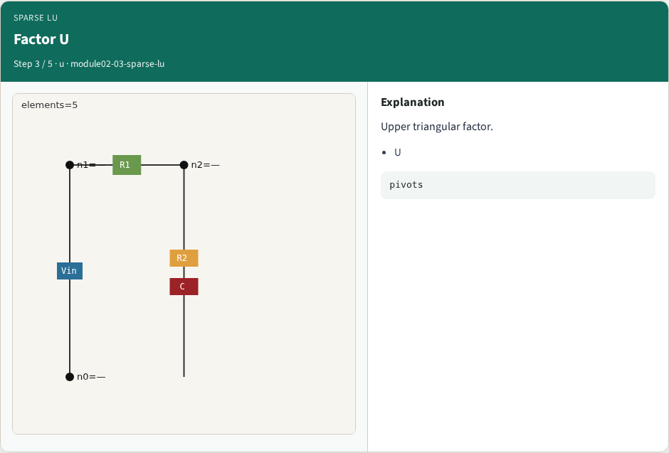
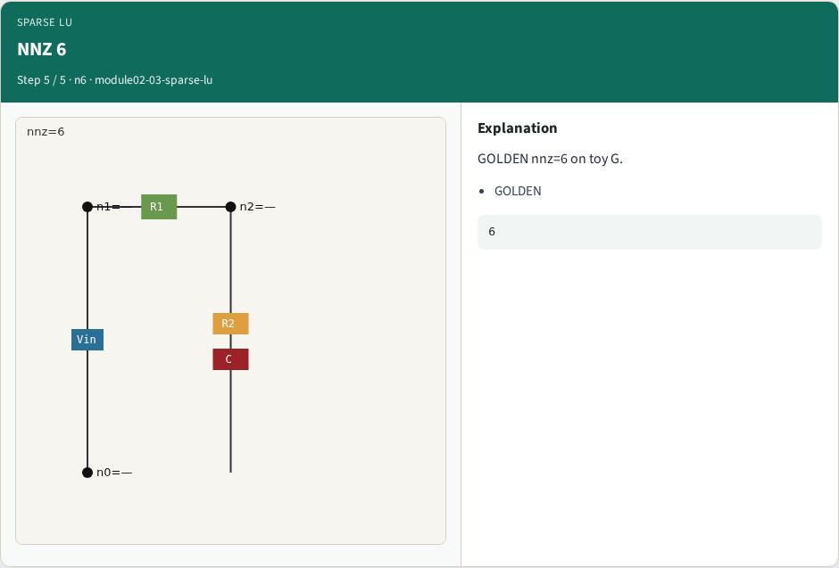

# Why sparse

Production SPICE uses sparse LU , count nonzeros and inspect L/U structure

---

## The idea
- GOLDEN: nnz=6 on the toy MNA conductance matrix

---

## NNZ

---

## Factor L

---

## Factor U

---

## Fwd/back idea

---

## NNZ 6

---

## Browser lab track

---

## Implement track
- Call sparse_lu_lite(G from dc_linear_solve); assert nnz==6

---

## Pitfalls
- Confusing nnz with matrix dimension
- Expecting fill-in on this tiny dense G

---

## Your turn
- Next: Newton-Raphson on the same stamps

