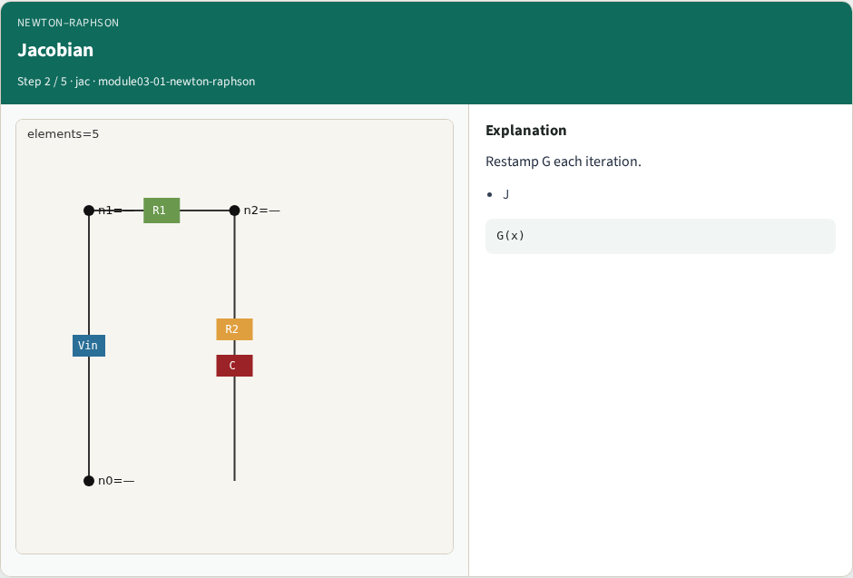
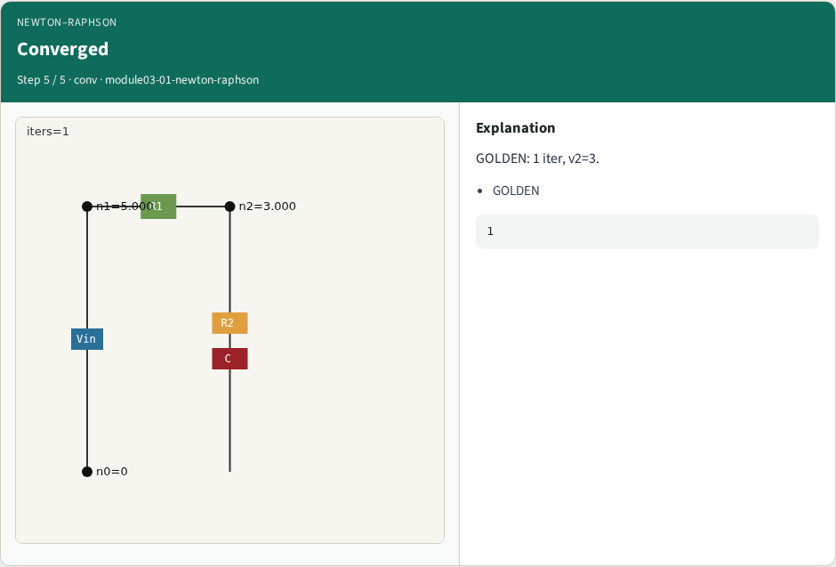

# Newton-Raphson DC — step-by-step (for slides / transcript)

**Module:** `module03-01-newton-raphson`  
**Lab / algo:** `newton-raphson`  
**Viewer:** `/tools/algorithm-walkthrough/?algo=newton-raphson&step=1`

Use each **Caption** as spoken prose (or a shortened slide note).
Use **Bullets** on the PPT; pair with the PNG in `assets/steps/`.

## Step 1 — Guess


**Caption (transcript):** Start from linear OP.

**Slide bullets:**

- x0

**On-screen metrics:**

```
linear
```

## Step 2 — Jacobian



**Caption (transcript):** Restamp G each iteration.

**Slide bullets:**

- J

**On-screen metrics:**

```
G(x)
```

## Step 3 — Update


**Caption (transcript):** Solve and update x.

**Slide bullets:**

- dx

**On-screen metrics:**

```
x←x+dx
```

## Step 4 — Residual


**Caption (transcript):** Stop when |dx| small.

**Slide bullets:**

- tol

**On-screen metrics:**

```
1e-9
```

## Step 5 — Converged



**Caption (transcript):** GOLDEN: 1 iter, v2=3.

**Slide bullets:**

- GOLDEN

**On-screen metrics:**

```
1
```

