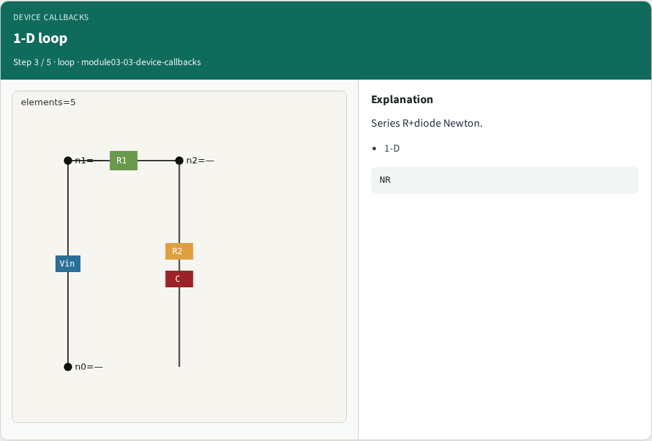
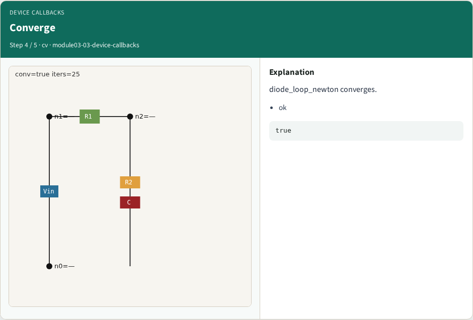
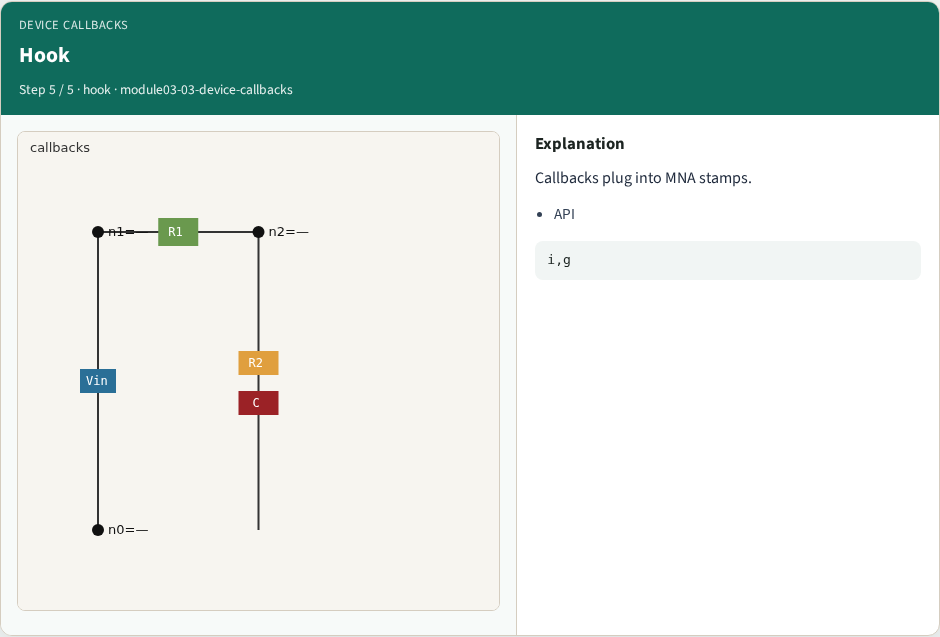
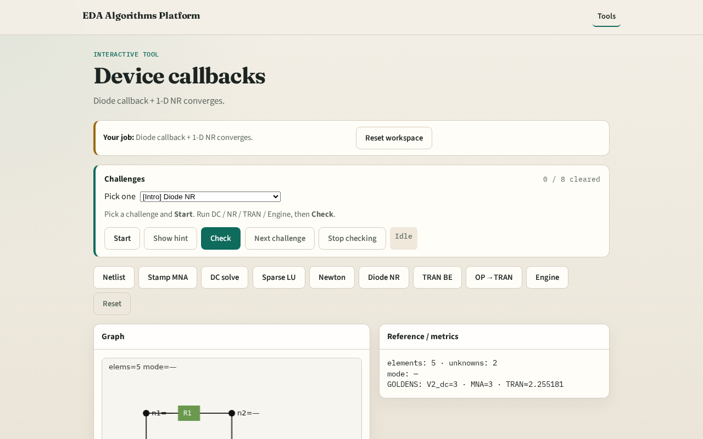

# Device callbacks (diode)

**Module id:** module03-03-device-callbacks
**Lab:** device-callbacks
**Tracks:** A (implement) · B (browser lab)

## Slide 1 — Why callbacks

Nonlinear devices expose i(v) and g=di/dv to the MNA Newton loop.

## Slide 2 — The idea

GOLDEN: diode_loop_newton converges; callback returns i and g at vd.

<!-- algorithm-walkthrough -->

## Slide 3 — i(v)

Diode current Is(exp(v/Vt)-1).

## Slide 4 — g=di/dv

Conductance for Jacobian.

## Slide 5 — 1-D loop

Series R+diode Newton.

## Slide 6 — Converge

diode_loop_newton converges.

## Slide 7 — Hook

Callbacks plug into MNA stamps.

<!-- /algorithm-walkthrough -->

## Slide 8 — Browser lab track

Open **device-callbacks**. Run callback + 1-D loop; confirm convergence.

## Slide 9 — Implement track

Call device_callback_diode(0.0) and diode_loop_newton(); assert converged.

## Slide 10 — Pitfalls

Using linear diode model. Forgetting companion conductance in transient.

## Slide 11 — Your turn

Next: backward-Euler transient on RC.
